# Parte I — Compreendendo o Agente BTP {#parte1}

Esta parte responde às perguntas mais básicas — e mais importantes — sobre o projeto: o que é o Agente BTP, que trabalho ele substitui, qual é o caminho que uma análise percorre do clique ao relatório e quais palavras é preciso conhecer para acompanhar o restante do livro. Nenhum conhecimento de programação é pressuposto. Os capítulos seguintes aprofundam cada ponto apresentado aqui.

## 1. Apresentação geral do projeto {#cap1}

O **Agente BTP** é um programa que roda no computador do usuário e automatiza uma tarefa de consulta repetitiva: para cada ordem de serviço (WO) informada, ele descobre quais materiais estão faltando segundo o *Monitor de alertas* de um sistema corporativo hospedado no SAP BTP, confere essa informação várias vezes e entrega tudo organizado numa planilha Excel. Ele não altera nada no sistema de origem: apenas lê.

### 1.1 O que é, em uma frase e em um parágrafo

Em uma frase: **o Agente BTP lê, confere e organiza os itens faltantes de cada WO no Monitor de alertas, sem que o usuário precise abrir WO por WO.**

Em um parágrafo: o usuário cola uma lista de WOs (ou importa uma planilha com elas) numa tela que o próprio programa abre no navegador. O programa pede à aba do navegador em que o usuário já está logado no BTP que faça, em nome dele, as mesmas consultas de dados que a tela do Monitor faz quando alguém abre a janela "Mensagens" de uma WO. Cada resposta é lida, comparada com leituras repetidas para garantir que nada mudou no meio do caminho, gravada numa base local e, ao final, transformada num relatório Excel com uma linha por item faltante, um resumo por material (inclusive com valores em reais, se uma tabela de preços tiver sido importada) e o rastro de cada leitura feita.

::: conceito
**Agente de software.** Um programa que executa uma tarefa em nome de uma pessoa, tomando pequenas decisões sozinho ao longo do caminho — por exemplo, repetir uma consulta que falhou ou pausar quando a sessão do usuário expira. O nome "agente" aqui não significa inteligência artificial: o Agente BTP segue regras explícitas, escritas no código, e cada decisão que ele toma pode ser rastreada no registro da análise.
:::

### 1.2 O problema concreto que ele resolve

No sistema de origem, a informação sobre o que falta para cada WO existe, mas está "escondida" atrás de vários cliques: é preciso abrir o aplicativo Monitor de alertas, filtrar a lista pela WO, clicar na linha encontrada e abrir uma janela chamada **Mensagens**, onde aparecem o material, o fornecedor, a quantidade faltante e a mensagem de erro de cada item. Para uma WO, isso leva poucos segundos; para milhares de WOs, torna-se inviável. O Capítulo 2 reconstrói esse processo manual em detalhe.

O Agente BTP elimina essa navegação repetida. Em vez de clicar, ele consulta diretamente o mesmo serviço de dados que alimenta a tela — com a mesma sessão autenticada do usuário — e faz isso para muitas WOs em paralelo, conferindo cada resultado.


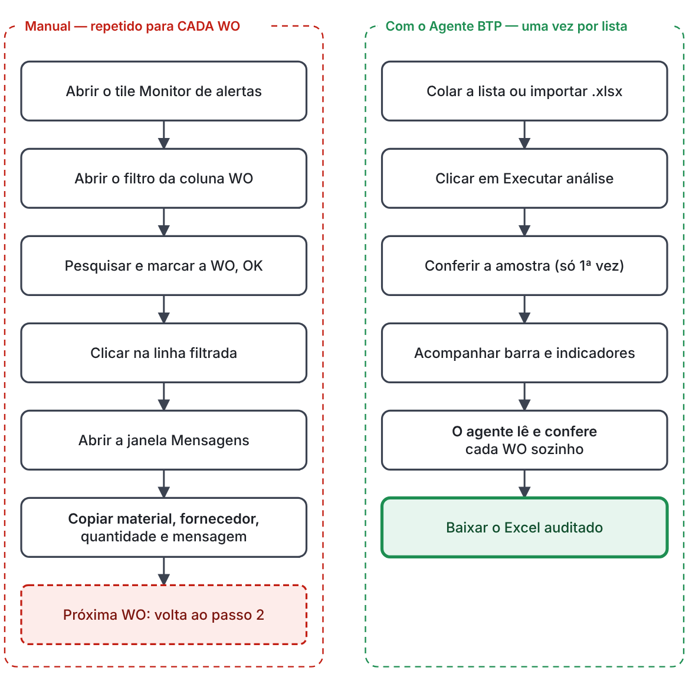


### 1.3 Em que ambiente ele opera

O agente vive em três lugares ao mesmo tempo, e entender essa divisão é a chave para entender o resto do livro:

1. **No computador do usuário**, como um programa escrito em Python que abre um pequeno servidor web local (acessível apenas pelo próprio computador, no endereço `127.0.0.1:8767`). É ali que ficam a lógica, a base de dados local e os arquivos gerados.
2. **Na aba do navegador em que o BTP está aberto**, como um pequeno script (`agente_btp.js`) colocado ali por uma extensão do Chrome (ou por um favorito). Esse script é o "braço" do agente dentro da sessão autenticada: é ele quem faz as consultas ao BTP.
3. **No navegador, numa segunda aba**, como a tela de operação (`index.html`), onde o usuário cola as WOs, acompanha o progresso e baixa o relatório.


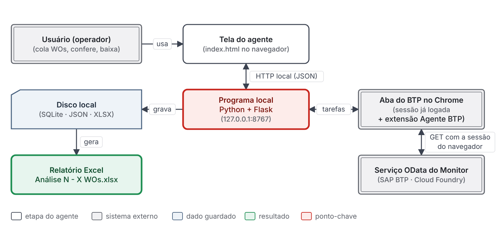


A Figura 1.2 mostra essa composição. Repare que o programa local **nunca fala diretamente** com o BTP: toda consulta passa pela aba do usuário. O Capítulo 11 explica por que isso foi feito assim e o que essa decisão garante em termos de segurança.

::: nobtp
O "BTP" do nome refere-se ao **SAP Business Technology Platform**, a plataforma em nuvem da SAP onde está hospedado o Launchpad (portal de aplicativos) que contém o Monitor de alertas. O arquivo `docs/mapeamento-processo.md` registra que o portal roda no ambiente Cloud Foundry da região `br10` e que o login é feito por SSO (SAML) com confirmação no celular (MFA). <span class="confirmado">CONFIRMADO</span> pelos arquivos `agente_btp/config.py` (variável `URL_LAUNCHPAD`) e `extensao/manifest.json` (permissão de acesso ao domínio do Launchpad).
:::

### 1.4 Quem usa os resultados

O usuário direto é o operador que precisa saber, para uma lista de WOs, quais materiais estão faltando e por quê. O histórico Git e os relatórios em `docs/` mostram análises reais de até **13.623 WOs** de uma vez (por exemplo, `docs/relatorio-correcao-raiz.md`, seção 7). A planilha gerada é o produto entregue: ela pode ser filtrada, somada por material e usada para priorizar reposição ou baixa de estoque.

O código não registra quais áreas ou processos consomem a planilha depois que ela sai do agente. <span class="naodet">NÃO DETERMINADO</span> — essa informação dependeria de entrevista com os usuários.

### 1.5 O que é uma execução bem-sucedida

Uma execução — chamada no projeto de **análise** — é considerada bem-sucedida quando:

- todas as WOs da lista foram consultadas (nenhuma ficou "pendente");
- cada WO recebeu um estado claro: **validada**, **divergente**, **incompleta** ou **falha**, sempre com o motivo quando não for validada;
- o arquivo `Análise N - X WOs.xlsx` foi gravado e, logo depois, **reaberto e conferido célula a célula** contra os dados da base (Capítulo 15);
- a análise ficou registrada no histórico, com diagnóstico e registro de eventos consultáveis depois.

Na prática, o sinal visível é o selo **Concluída** na tela e o botão **Baixar relatório auditado (.xlsx)**.

### 1.6 Dentro e fora do escopo

| Dentro do escopo (o agente faz) | Fora do escopo (o agente não faz) |
|---|---|
| Ler a lista de alertas do Monitor filtrada por WO | Fazer login, digitar senha ou responder ao MFA |
| Ler os itens da janela "Mensagens" de cada alerta | Clicar em "Reprocessar" ou "Efetuar Baixa" |
| Repetir leituras para conferir (auditoria) | Alterar qualquer dado no BTP (não há requisição de escrita no código) |
| Retomar uma análise interrompida | Agendar análises sozinho, sem um usuário |
| Gerar e conferir a planilha Excel | Enviar a planilha por e-mail ou para outro sistema |
| Somar quantidades e valores por material (com tabela importada) | Consultar preços no BTP (o preço vem de uma tabela do usuário) |

A restrição de somente leitura é uma das ideias centrais do projeto e aparece já no topo do módulo que faz as consultas:


**Código-fonte — agente_btp/cliente.py · docstring do módulo · linhas 1–6**

```python
   1  """Cliente de dados SOMENTE LEITURA.
   2  
   3  Só existe uma operação de rede: GET. Não há caminho no código para POST, PUT,
   4  PATCH, DELETE ou $batch — assim o agente não consegue acionar "Reprocessar" nem
   5  "Efetuar Baixa", nem por engano.
   6  """
```


::: leitura
As linhas 1 a 6 de `agente_btp/cliente.py` não são código executável: são um comentário de documentação (chamado *docstring* em Python). Elas declaram a regra de projeto — "só existe uma operação de rede: GET" — e explicam sua consequência: como não há no código nenhum caminho para métodos que alteram dados (POST, PUT, PATCH, DELETE), o agente não consegue acionar "Reprocessar" nem "Efetuar Baixa", nem por engano. O Capítulo 28 mostra que essa regra é reforçada em mais dois lugares: no script da aba (que só executa GET) e na ponte (que recusa endereços que não sejam do próprio sistema).
:::

### 1.7 O que o sistema faz hoje e o que ainda não faz

**Faz hoje** (versão do repositório na data desta edição): preparação automática da fonte de dados na primeira execução; conferência da amostra com o usuário; leitura em lote e em paralelo com verificação de equivalência; auditoria por WO com leituras extras em caso de divergência; pausa e retomada automáticas quando a sessão do BTP expira; base local que preserva cada WO concluída; retomada de análises interrompidas; planilha com cinco abas (Dados, Materiais, Análise e duas ocultas); filtro para listar na planilha apenas itens com a mensagem "Estoque indisponível"; tabela de valores importada; histórico com diagnóstico; ajuda guiada na própria tela.

**Ainda não faz**: execução sem usuário (agendada); integração direta com outros sistemas; manutenção da sessão do BTP viva quando o agente está ocioso; validação automática contra uma fonte independente do próprio BTP. O Capítulo 30 discute essas limitações e propõe melhorias, sempre separadas do que já existe.

### 1.8 Exemplo: a mesma tarefa com e sem o agente

::: exemplo
**Sem o agente** (reconstrução a partir de `docs/mapeamento-processo.md`): para cada WO, o operador abre o tile *Monitor de alertas — Itens pendentes* (que no momento do mapeamento listava cerca de 175 mil itens), abre o filtro da coluna WO, pesquisa e marca a WO, confirma, clica na linha filtrada, abre a janela *Mensagens* e copia material, fornecedor, quantidade faltante e mensagem de cada item. Em seguida, volta ao filtro para a próxima WO.

**Com o agente**: o operador cola a lista (por exemplo, 500 WOs) e clica em **Executar análise**. Na primeira vez, confere uma amostra para confirmar que os dados lidos são os mesmos da janela Mensagens. Depois disso, acompanha a barra de progresso e baixa a planilha ao final.

**Sobre ganho de tempo**: o diagnóstico de uma execução real de 13.623 WOs (arquivo `diagnostico_analise_1.json`, exportado pela própria tela do agente e enviado pelo usuário durante o desenvolvimento; não versionado no repositório) registra 2.583 s de processamento — cerca de 43 minutos —, 77.787 consultas ao BTP e 5,27 WOs por segundo, com a leitura em lote desativada naquela execução. Não há medição registrada do tempo manual equivalente, por isso este livro **não** apresenta um percentual de ganho. A conta pode ser feita por quem conhece o tempo manual por WO.
:::

## 2. O problema que motivou a criação {#cap2}

Todo software existe porque alguém tinha um trabalho difícil, lento ou sujeito a erro. Este capítulo reconstrói esse trabalho a partir das evidências disponíveis no repositório — principalmente a especificação original no `README.md`, o mapeamento do processo em `docs/mapeamento-processo.md` e os relatórios técnicos em `docs/`.

### 2.1 Como o processo funciona no sistema de origem

O documento de mapeamento, escrito a partir de capturas de tela reais enviadas pelo usuário, descreve a sequência manual:

| Passo | Tela | Ação do usuário |
|---|---|---|
| 1 | Launchpad (página inicial) | Clica no tile "Monitor de alertas — Itens pendentes" |
| 2 | Lista de itens | Clica no ícone de filtro (funil) da tabela |
| 3 | Diálogo "Filtrar por: WO" | Pesquisa a WO, marca a caixa e clica em OK |
| 4 | Lista filtrada | Clica na linha (mensagem "Clique para mais detalhes") |
| 5 | Diálogo "Mensagens" | Lê os dados da WO — é aqui que está a informação final |

A informação que interessa — o resultado — está no passo 5, na janela "Mensagens". O mesmo documento registra as colunas dessa janela:

| Coluna | Exemplo | Como deve ser tratada |
|---|---|---|
| WO | `88412|126579742` | Texto |
| Material | `000000000022026169` | Texto com 18 dígitos (zeros à esquerda importam) |
| Fornecedor | `0000137628` | Texto com 10 dígitos (zeros à esquerda importam) |
| Quantidade faltante | `2` | Número |
| Mensagem | `Estoque indisponível` | Texto |

::: termo
**WO (Work Order, ordem de serviço).** No contexto deste sistema, é o identificador de uma ordem de serviço no formato `PPPPP|NNNNNNNNN`: cinco dígitos, uma barra vertical e nove dígitos (por exemplo, `02235|230771207`). O prefixo pode começar com zero, por isso a WO é sempre tratada como **texto**, nunca como número — um número perderia o zero inicial. O formato está fixado na expressão regular `PADRAO_WO` de `agente_btp/entrada.py`.
:::

### 2.2 Onde está o esforço

Analisando a tabela do processo manual, o esforço se concentra em três pontos:

1. **Repetição.** Os passos 2 a 5 se repetem para cada WO. Não há na tela do Monitor uma forma de abrir as mensagens de várias WOs de uma vez.
2. **Transcrição.** Os dados da janela Mensagens precisam ser copiados para uma planilha. Códigos de 18 dígitos com zeros à esquerda são especialmente fáceis de copiar errado — e o Excel, se não for orientado, apaga os zeros iniciais ao interpretar o valor como número.
3. **Volume.** O mapeamento registrou cerca de 175 mil itens pendentes no Monitor. As análises reais documentadas tinham de algumas centenas a 13.623 WOs.

### 2.3 Onde os erros podem acontecer

O processo manual é vulnerável a erros de natureza diferente, e vale nomeá-los, porque cada um deles motivou um mecanismo específico no agente:

| Erro possível no processo manual | Mecanismo correspondente no agente | Onde está explicado |
|---|---|---|
| Copiar o material sem os zeros à esquerda | Identificadores sempre lidos como texto (`odata.como_texto`) e gravados em células de texto no Excel | Caps. 14 e 15 |
| Copiar a quantidade errada (quando a tela tem mais de uma) | Recusa em escolher entre dois campos de quantidade ("quantidade ambígua") | Cap. 14 |
| Ler uma WO no meio de uma atualização no BTP | Auditoria: leituras repetidas comparadas campo a campo | Cap. 14 |
| Pular uma WO da lista | Base local com todas as WOs e estado de cada uma | Caps. 14 e 26 |
| Atribuir os itens de uma WO à WO vizinha | Conferência de que cada linha devolvida pertence à WO pedida | Cap. 13 |
| Perder o trabalho se a sessão cair | Pausa automática e retomada sem refazer o que já foi concluído | Cap. 26 |

### 2.4 Por que a automação é útil — e por que não basta "automatizar cliques"

A especificação original no `README.md` previa um agente que "controla um navegador dedicado" e executa uma "navegação automatizada". O histórico Git mostra que o projeto seguiu outro caminho: em vez de clicar na tela, o agente consulta **o serviço de dados** que alimenta a tela, pela própria aba do usuário. O relatório `docs/relatorio-revisao-auditoria.md` registra explicitamente: "O agente **não clica na tela**. Ele lê o mesmo serviço de dados (OData) que alimenta o Monitor de Alertas e a janela 'Mensagens', pela aba já autenticada do usuário (somente GET)."

As vantagens técnicas dessa escolha, sustentadas pelo código, são:

- **Velocidade.** Uma consulta de dados devolve todas as linhas de uma vez, sem esperar a tela desenhar. Além disso, várias WOs podem ser consultadas numa só requisição (leitura em lote, Capítulo 13).
- **Fidelidade.** O agente recebe os valores exatamente como o servidor os envia, sem depender de como a tela os formata.
- **Robustez a mudanças visuais.** Uma alteração no desenho da tela não afeta o agente; só uma alteração no serviço de dados afetaria (Capítulo 32).

<span class="interpretacao">INTERPRETAÇÃO TÉCNICA</span> O histórico não registra por escrito a motivação da troca de "navegador controlado" por "consulta pela aba já aberta". O commit `bea63d9` (13/10/2026) tem a mensagem "conecta à aba do SAP já aberta via favorito (modelo Agente Atlas)", e o `40f7973` "conexão somente pela aba já aberta; remove navegador separado da interface". Uma motivação compatível com as regras de segurança da especificação ("utilizar somente a sessão que já tenha sido autenticada", "não automatizar ou contornar o MFA") é que a aba já logada resolve a autenticação sem que o programa jamais toque em credenciais.

### 2.5 O que continua difícil mesmo com o agente

A automação não elimina todos os problemas, e é importante deixá-los claros desde já:

- **A sessão do BTP expira.** O agente não faz login. Quando a sessão cai, ele pausa e espera o usuário logar de novo (Capítulo 26).
- **O serviço de dados pode mudar.** Se a SAP ou a equipe responsável pelo aplicativo alterar os nomes das tabelas ou dos campos, a fonte gravada deixa de servir. O agente detecta parte dessas situações (por exemplo, HTTP 404) e se prepara de novo, mas não todas (Capítulo 32).
- **A conferência é interna ao BTP.** A auditoria compara leituras do próprio BTP entre si. Ela garante que o agente leu de forma consistente o que o BTP mostrava, mas não verifica se o próprio BTP está certo.
- **A primeira configuração depende do usuário.** A conferência da amostra exige que alguém que conheça a janela Mensagens confirme que os dados lidos são os mesmos (Capítulo 12).

## 3. Visão geral do funcionamento {#cap3}

Antes de mergulhar nos detalhes, vale ver o caminho completo de uma análise numa única figura. Cada bloco da Figura 3.1 corresponde a código real e é explicado numa subseção a seguir; os capítulos da Parte III aprofundam cada um.


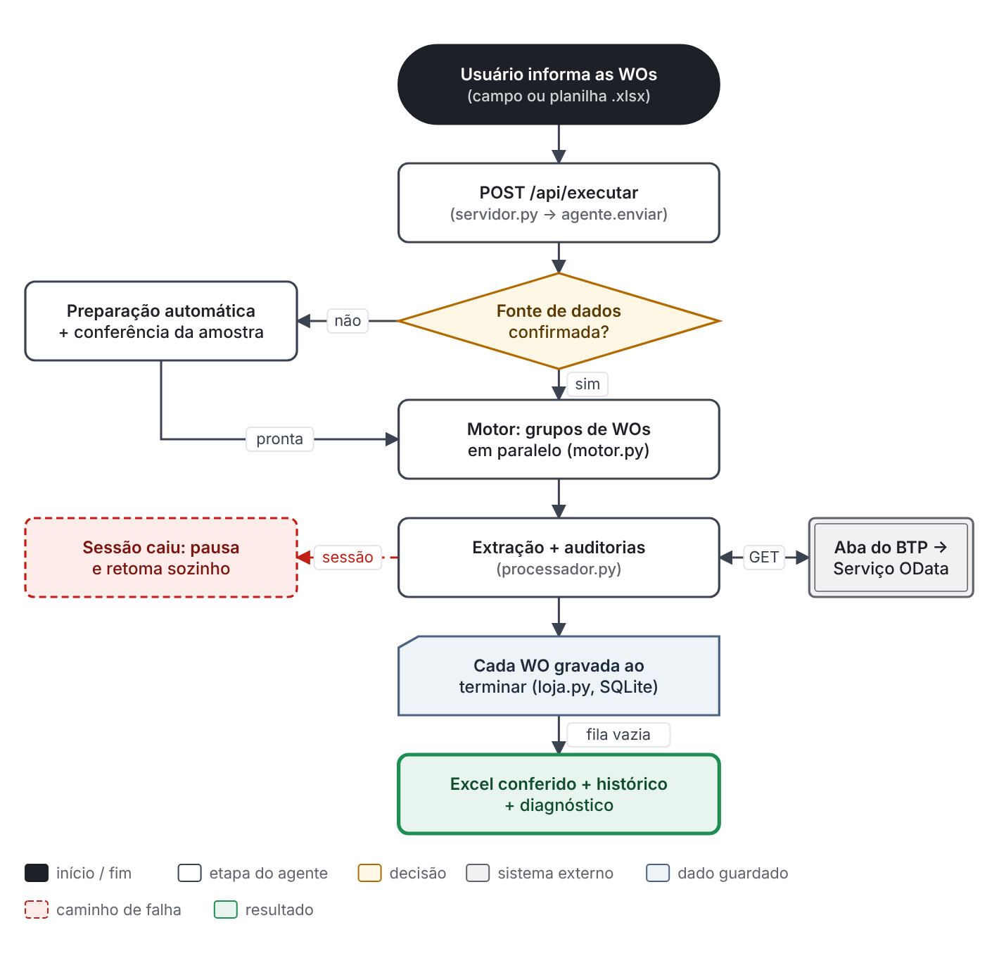


**Visão geral.** A figura mostra o que acontece desde que o usuário informa as WOs até a entrega do relatório. O caminho principal é vertical; os desvios laterais são a preparação (só quando ainda não há fonte de dados confirmada), a comunicação com o BTP (que passa pela aba do usuário) e o caminho de falha da sessão.

**Leitura passo a passo.** As setas indicam a ordem. O losango "Fonte de dados confirmada?" é uma decisão: se a resposta for "não", o agente primeiro se prepara e pede a conferência da amostra; se for "sim", vai direto ao processamento. A seta dupla entre "Extração + auditorias" e "Aba do BTP" indica ida e volta: uma consulta enviada e uma resposta recebida. A seta tracejada vermelha indica o caminho de exceção.

### 3.1 O usuário informa as WOs

Na tela de Análise, o usuário cola WOs no campo de texto (uma por linha) e/ou importa uma planilha `.xlsx`. A própria tela conta quantas linhas estão no formato certo antes de enviar. O botão **Executar análise** só fica disponível quando a aba do BTP está conectada e há pelo menos uma WO — e, se estiver bloqueado, o motivo aparece logo abaixo dele.

### 3.2 O pedido chega ao servidor local

Ao clicar em Executar, a tela envia uma requisição `POST /api/executar` ao servidor local. A função `executar` de `agente_btp/servidor.py` lê as WOs do texto e da planilha, remove repetições e entrega o trabalho ao orquestrador com `agente.enviar("executar", wos, descrição)`. O servidor responde imediatamente — a análise roda em segundo plano, numa linha de execução própria do orquestrador (Capítulo 10).

### 3.3 A fonte de dados está confirmada?

O agente precisa saber **de onde** ler os dados: qual endereço do serviço devolve a lista de alertas de uma WO e qual devolve os itens da janela Mensagens. Essa informação fica no arquivo `config/api.json`. Na primeira execução ele não existe, e o agente o constrói sozinho (`_garantir_preparo` em `agente_btp/agente.py`); depois, mostra uma amostra real ao usuário e só continua com a confirmação (`_confirmar_fonte`). Esse processo é o tema do Capítulo 12.

### 3.4 O motor distribui o trabalho

Com a fonte confirmada, o orquestrador cria a análise na base local — todas as WOs começam como **pendentes** — e entrega o controle ao **motor** (`agente_btp/motor.py`). O motor divide as WOs em grupos (por padrão, de 20) e coloca vários trabalhadores para processá-los ao mesmo tempo (por padrão, 4). Ele também verifica periodicamente se a sessão do BTP continua válida.

### 3.5 Extração e auditorias

Para cada grupo, o **processador** (`agente_btp/processador.py`) faz a extração inicial — a primeira leitura das WOs — e depois as auditorias: novas leituras completas, comparadas campo a campo com a primeira. Se algo mudou entre as leituras, ele faz até três leituras extras para tentar esclarecer. A decisão final sobre cada item (validado, divergente, incompleto, não concluído) é tomada pelo módulo `agente_btp/auditoria.py` (Capítulo 14).

### 3.6 A comunicação com o BTP

Cada leitura é uma ou mais consultas `GET` ao serviço de dados do Monitor. O cliente (`agente_btp/cliente.py`) monta o endereço e entrega a consulta à **ponte** (`agente_btp/ponte.py`), que a coloca numa fila. O script na aba do BTP busca a consulta nessa fila, executa-a com a sessão do usuário e devolve a resposta. O Capítulo 11 detalha esse circuito.

### 3.7 O caminho de falha da sessão

Se o BTP responder com sinais de sessão expirada (redirecionamento para o login, códigos 401 ou 403, ou uma página HTML de login no lugar dos dados), o agente não marca as WOs como falha: ele **pausa** a análise, devolve à fila as WOs que estavam em andamento e espera o usuário logar de novo. Quando a sessão volta, retoma sozinho (Capítulo 26).

### 3.8 Cada WO é gravada ao terminar

Assim que uma WO termina, seu resultado é gravado numa base de dados local (SQLite, no arquivo `dados/execucoes.sqlite3`) numa transação própria. Isso significa que fechar o programa ou perder a conexão no meio de uma análise **não perde** o trabalho já feito: a análise pode ser retomada, e só as WOs pendentes, em andamento ou com falha são refeitas.

### 3.9 O relatório e o histórico

Quando não há mais WOs na fila, o orquestrador gera o Excel a partir da base (`agente_btp/exportacao.py`), reabre o arquivo gravado para conferi-lo célula a célula e registra a análise no histórico. A tela mostra o selo de conclusão e o botão de download. O Capítulo 15 descreve cada aba da planilha.

::: resumo
1. O usuário informa as WOs e clica em Executar.
2. O servidor local recebe o pedido e o entrega ao orquestrador.
3. Se ainda não há fonte de dados confirmada, o agente se prepara e pede a conferência de uma amostra.
4. O motor distribui as WOs em grupos e trabalhadores paralelos.
5. Cada WO é lida, relida e comparada; divergências recebem leituras extras.
6. Todas as consultas passam pela aba do usuário, somente com GET.
7. Sessão expirada pausa a análise, sem perder nada; ela retoma sozinha.
8. Cada WO concluída é gravada na hora na base local.
9. Ao final, o Excel é gerado, conferido e registrado no histórico.
:::

## 4. Vocabulário fundamental {#cap4}

Este capítulo apresenta, em linguagem simples, os conceitos que aparecem com frequência no restante do livro. Para cada um, há uma explicação geral e a indicação de **como ele aparece no Agente BTP**. Termos que não se aplicam ao projeto foram deixados de fora ou são explicitamente marcados como não utilizados.

### 4.1 Programa, processo e linguagem de programação

Um **programa** é um conjunto de instruções escritas para um computador executar. Essas instruções são escritas numa **linguagem de programação** — um idioma com regras rígidas que o computador consegue interpretar. Quando o programa está em execução, o sistema operacional cria um **processo**: o programa "vivo", ocupando memória e trabalhando.

**No Agente BTP:** o núcleo é escrito em **Python** (pasta `agente_btp/`, arquivos `.py`). A tela e o script da aba são escritos em **JavaScript** (`agente_btp/web/index.html` e `agente_btp/web/agente_btp.js`), a linguagem que os navegadores executam. Quando o usuário abre o `Abrir Agente BTP.bat`, nasce um processo Python — a "janela preta" que deve ficar aberta enquanto o agente é usado.

### 4.2 Código-fonte

É o texto do programa, como escrito por quem o desenvolveu. **No Agente BTP:** todo o código-fonte está no repositório Git, e este livro cita trechos dele sempre com o arquivo e as linhas de origem.

### 4.3 Biblioteca e dependência

Uma **biblioteca** é um conjunto de funções já prontas que um programa pode usar em vez de reescrevê-las. Quando um programa precisa de uma biblioteca para funcionar, ela é uma **dependência** dele.

**No Agente BTP:** o arquivo `requirements.txt` declara apenas duas dependências externas: **Flask** (para criar o servidor web local) e **openpyxl** (para ler e escrever planilhas Excel). Todo o resto usa a biblioteca padrão do Python. O Capítulo 8 detalha cada uma.

### 4.4 Servidor e cliente

Um **servidor** é um programa que fica esperando pedidos e os atende; um **cliente** é quem faz os pedidos. Pense num balcão de atendimento: o atendente (servidor) espera, e quem chega (cliente) pede algo. Os papéis não dependem de máquina: o mesmo programa pode ser servidor de um lado e cliente de outro.

**No Agente BTP** há dois servidores diferentes, e é importante não confundi-los:

- O **servidor local do agente** (Flask, em `127.0.0.1:8767`): atende a tela e o script da aba. Roda no computador do usuário.
- O **servidor do BTP** (o serviço de dados do Monitor, na nuvem da SAP): atende as consultas de dados. O script da aba é o cliente dele.

### 4.5 Endereço local (127.0.0.1) e porta

`127.0.0.1` é um endereço especial que significa "este mesmo computador" (também chamado *localhost* ou *loopback*). Um programa que escuta nesse endereço só pode ser acessado de dentro da própria máquina. A **porta** é um número que identifica qual programa, naquele computador, deve receber o pedido — como o número de um apartamento num prédio.

**No Agente BTP:** o servidor escuta em `127.0.0.1`, porta `8767` (constantes `HOST` e `PORTA` em `agente_btp/__main__.py`). O comentário do código registra que a porta foi escolhida para não colidir com outro agente do mesmo autor (Agente Atlas, porta 8765).

### 4.6 Requisição, resposta e HTTP

**HTTP** é o protocolo — o conjunto de regras de conversa — usado na web. Uma conversa HTTP é sempre um par: o cliente envia uma **requisição** (com um método, um endereço e, às vezes, dados) e o servidor devolve uma **resposta** (com um código de situação, um tipo de conteúdo e um corpo).

Os métodos mais comuns são **GET** (pedir para ler algo) e **POST** (enviar algo para ser processado). Os **códigos de situação** dizem como foi o pedido: `200` significa sucesso; `302`, redirecionamento; `401`, não autenticado; `403`, acesso negado; `404`, endereço não encontrado; `429`, muitos pedidos; `500` a `599`, erro no servidor.

**No Agente BTP:** as consultas ao BTP são **sempre GET**. A tela e o script da aba usam GET e POST para conversar com o servidor local. Os códigos de situação do BTP são interpretados pela função `classificar` de `agente_btp/cliente.py`, que decide se a resposta é dado válido, sessão expirada, falha passageira ou erro (Capítulo 26).

### 4.7 API e endpoint

Uma **API** (*Application Programming Interface*, interface de programação de aplicações) é uma porta de comunicação organizada entre programas: um conjunto de pedidos que um programa aceita, com regras claras sobre o formato de cada um. Um **endpoint** é o endereço específico de uma dessas operações. Se a API fosse um restaurante, o cardápio seria a API e cada prato pedido pelo nome, um endpoint.

**No Agente BTP** há duas APIs:

- A **API interna** do agente: rotas como `/api/estado`, `/api/executar` e `/api/historico`, definidas em `agente_btp/servidor.py`, usadas apenas pela tela e pelo script da aba. O Apêndice A lista todas.
- A **API do serviço de dados do BTP**: endereços OData como `.../Pendencias?$filter=workOrderID eq '...'`. O agente é **cliente** dessa API; não a controla.

### 4.8 OData

**OData** (*Open Data Protocol*) é um padrão para expor dados pela web de forma consultável: cada conjunto de dados (como uma tabela) tem um endereço, e é possível filtrar, ordenar e paginar usando parâmetros na própria URL — por exemplo, `$filter=workOrderID eq '12345|678901234'`. Aplicativos SAP Fiori, como o Monitor de alertas, buscam seus dados assim.

**No Agente BTP:** o arquivo `agente_btp/odata.py` monta os endereços (escapando corretamente caracteres como a barra vertical da WO) e interpreta as respostas nas duas versões do padrão (V2 e V4).

### 4.9 JSON

**JSON** é um formato de texto para representar dados estruturados: listas entre colchetes, objetos com pares "nome": valor entre chaves. Exemplo: `{"value": [{"material": "000000000022026169", "quantidade": "2"}]}`. É o formato em que o serviço OData do BTP devolve os dados, e também o formato de vários arquivos locais do agente (`config/api.json`, `historico/historico.json`).

### 4.10 Arquivo de configuração e variável de ambiente

Um **arquivo de configuração** guarda parâmetros que mudam o comportamento do programa sem alterar o código. Uma **variável de ambiente** é um parâmetro passado pelo sistema operacional ao processo.

**No Agente BTP:** há três arquivos de configuração locais — `config/api.json` (fonte de dados, gerado pelo agente), `config/preferencias.json` (parâmetros da tela de Configurações) e `config/tabela_materiais.json` (tabela de valores importada). Há uma única variável de ambiente reconhecida: `AGENTE_BTP_URL`, que permite substituir o endereço do Launchpad (`agente_btp/config.py`). Nenhum desses arquivos guarda senha ou token.

### 4.11 Banco de dados

Um **banco de dados** é um sistema para guardar informações de forma organizada e consultável. O **SQLite** é um banco de dados que cabe num único arquivo, sem precisar de um servidor separado.

**No Agente BTP:** o arquivo `dados/execucoes.sqlite3` guarda cada análise, cada WO e cada evento, gerenciado por `agente_btp/loja.py` (Capítulo 14).

### 4.12 Autenticação, autorização e sessão

**Autenticação** é provar quem você é (login, senha, MFA). **Autorização** é o que você pode fazer depois de autenticado. Uma **sessão** é o estado de "estar logado" que o servidor mantém por um tempo; o navegador a prova a cada pedido, geralmente com um *cookie* — um pequeno dado guardado pelo navegador e enviado automaticamente.

**No Agente BTP:** autenticação e autorização são inteiramente do BTP. O agente não vê, não lê e não guarda o cookie: as consultas são feitas **de dentro da aba**, e o navegador anexa o cookie sozinho. Quando a sessão expira, o agente percebe pela resposta e pausa.

### 4.13 Log, exceção e tratamento de erros

Um **log** (registro) é uma lista de eventos com horário, gravada pelo programa para permitir investigar o que aconteceu. Uma **exceção** é a forma como um programa sinaliza que algo saiu do esperado; **tratar** a exceção é decidir o que fazer em seguida em vez de simplesmente parar.

**No Agente BTP:** há três registros diferentes — o arquivo `logs/agente_btp.log` (técnico, do processo inteiro), os eventos de cada análise na base SQLite (visíveis em Histórico → Registro de execução) e o diagnóstico de cada análise (problemas classificados com evidência). O projeto define quatro exceções próprias (`SessaoExpirada`, `FalhaComunicacao`, `ErroConsulta`, `TempoEsgotado`) em `agente_btp/modelos.py`, cada uma com um motivo classificado (Capítulo 26).

### 4.14 Execução síncrona, assíncrona e paralela

Uma tarefa **síncrona** é feita do começo ao fim antes de passar à próxima. Uma tarefa **assíncrona** é iniciada e "fica rodando" enquanto o programa faz outras coisas, avisando quando termina. **Paralelismo** é fazer várias tarefas ao mesmo tempo.

**No Agente BTP:** o servidor responde à tela na hora e a análise roda em segundo plano (uma *thread*, ou linha de execução, dedicada). O motor usa várias threads trabalhadoras para processar grupos de WOs em paralelo. No navegador, o script da aba usa funções assíncronas do JavaScript (`async`/`await`) para esperar respostas sem travar a página.

### 4.15 Long-poll (consulta longa)

Normalmente, quem pergunta espera a resposta e, se não houver nada, pergunta de novo mais tarde. No **long-poll**, o servidor segura a pergunta aberta por um tempo — até ter algo para responder ou até o tempo acabar. Isso permite que o servidor "mande" tarefas a quem perguntou, mesmo sem poder iniciar a conversa.

**No Agente BTP:** é assim que o programa local entrega consultas à aba do BTP. A aba pergunta "há tarefa para mim?" e o servidor segura a pergunta por até 15 segundos (`ESPERA_LONG_POLL` em `agente_btp/ponte.py`). O Capítulo 11 explica por que esse desenho é necessário.

### 4.16 Termos do domínio

| Termo | Significado no Agente BTP |
|---|---|
| **Monitor de alertas** | Aplicativo do Launchpad que lista os itens pendentes; fonte das informações |
| **Alerta / linha da lista** | Uma linha da lista do Monitor para uma WO (há uma por *consolidado*) |
| **Consolidado** | Identificador de um agrupamento de itens de uma WO no BTP (campo `consolidID`) |
| **Janela Mensagens** | Diálogo do Monitor com os itens de um alerta: material, fornecedor, quantidade, mensagem |
| **Item** | Uma linha da janela Mensagens: um material faltante |
| **Material SAP** | Código do material, com 18 dígitos e zeros à esquerda |
| **Fornecedor SAP** | Código do fornecedor (ou base), com 10 dígitos e zeros à esquerda |
| **Análise** | Uma execução do agente sobre uma lista de WOs, numerada (nº 1, nº 2...) |
| **Leitura** | Uma consulta completa de uma WO (extração inicial, auditoria ou leitura extra) |
| **Auditoria** | Leitura repetida comparada com a primeira, para confirmar os valores |
| **Fonte de dados** | O par de endereços (lista + itens) gravado em `config/api.json` |
| **Conferência da amostra** | Momento em que o usuário confirma que os dados lidos são os da janela Mensagens |
| **Sonda** | Consulta de teste para saber se a sessão do BTP continua válida |


# Parte II — A construção do projeto {#parte2}

Esta parte conta como o Agente BTP chegou à forma atual e descreve sua estrutura: a história reconstruída a partir do histórico Git, a arquitetura (quais peças existem e como se ligam), a organização das pastas e arquivos, as tecnologias usadas e o que é preciso para preparar um computador para executá-lo.

## 5. Como o projeto foi iniciado {#cap5}

O histórico Git do repositório tinha **39 commits**, de 01/10/2026 a 29/10/2026, quando este livro começou a ser escrito (depois vieram os commits do próprio livro e a correção de 30/10). Um *commit* é um "ponto de salvamento" do projeto: um conjunto de mudanças registrado com data, autor e uma mensagem descrevendo o que mudou. Lendo os commits em ordem, é possível reconstruir a evolução do projeto com segurança — e, quando a mensagem do commit não explica a motivação, este capítulo diz isso explicitamente.


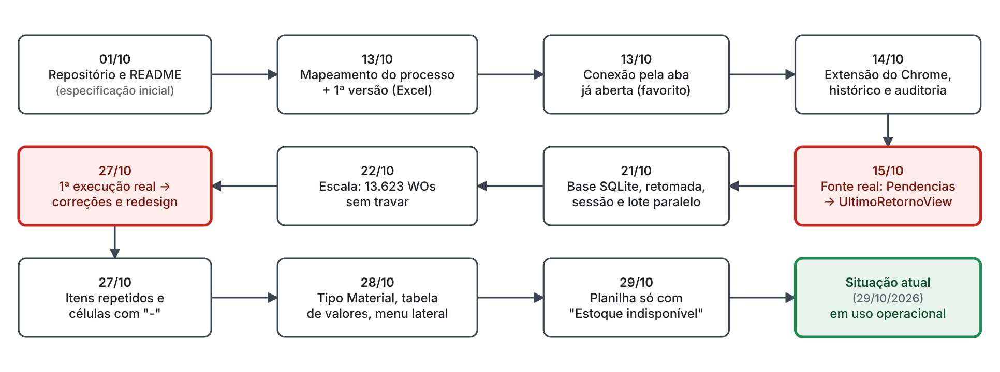


### 5.1 Antes do código: a especificação (01/10)

Os dois primeiros commits criam o repositório (`27a26fe`, "Initial commit") e um `README.md` com a especificação inicial (`53a5f3d`). O texto dessa especificação continua no fim do `README.md` atual, sob o título "Especificação original", e mostra o que se imaginava no começo:

- uma interface web local, "semelhante ao conceito utilizado no Agente Atlas";
- login e MFA sempre feitos pelo usuário, com regras explícitas de segurança: "não armazenar senha", "não automatizar ou contornar o MFA", "utilizar somente a sessão que já tenha sido autenticada";
- uma arquitetura que permitisse "controlar um navegador dedicado à tarefa";
- vários tipos de análise selecionáveis numa lista ("Análise 01"...);
- a observação de que "as informações específicas que serão coletadas ainda serão definidas durante o levantamento do processo manual".

<span class="confirmado">CONFIRMADO</span> Na data da especificação, o que seria extraído ainda não estava definido.

### 5.2 O mapeamento do processo e a primeira versão (13/10)

Em 13/10 o projeto dá um salto. O commit `0563fc6` acrescenta `docs/mapeamento-processo.md`, que descreve o processo manual a partir de capturas de tela reais, define as colunas da janela "Mensagens" e as regras de somente leitura ("o agente **nunca** aciona Reprocessar, Efetuar Baixa ou qualquer requisição que altere dados"). Logo em seguida, o commit `514543b` ("implementa Agente BTP (Monitor de alertas -> Excel)") cria a primeira versão funcional: 20 arquivos e cerca de 1.350 linhas, incluindo `agente.py`, `cliente.py`, `config.py`, `entrada.py`, `exportacao.py`, `modelos.py` e um módulo chamado `navegador.py`.

Esse `navegador.py` usava a biblioteca **Playwright** para abrir um navegador dedicado, onde o usuário fazia o login. Seu cabeçalho já trazia o princípio que sobreviveria a todas as versões: "as consultas são feitas DE DENTRO da página (fetch same-origin), com a sessão que o próprio navegador já mantém".

### 5.3 A virada: conectar à aba já aberta (13/10–14/10)

No mesmo dia, três commits mudam a forma de conexão:

- `7d18a36` — "configuração automática da API a partir da descoberta": o agente passa a aprender os endereços de dados observando as consultas da tela (nasce `analisador.py`).
- `bea63d9` — "conecta à aba do SAP já aberta via favorito (modelo Agente Atlas)": nascem `ponte.py`, `servidor.py`, `web/agente_btp.js` e a tela `web/index.html`. Em vez de abrir um navegador próprio, o agente passa a usar a **aba em que o usuário já está logado**, com um script carregado por um favorito.
- `40f7973` — "conexão somente pela aba já aberta; remove navegador separado da interface".

Em 14/10, o commit `f532242` remove definitivamente `navegador.py` e a dependência Playwright do `requirements.txt` e introduz a **preparação automática** pelo dicionário de dados do serviço (`autoconfig.py`). No mesmo dia nasce a **extensão do Chrome** (`954999f`), que injeta o script na aba sozinha, sem o usuário precisar clicar no favorito.

<span class="interpretacao">INTERPRETAÇÃO TÉCNICA</span> A troca do navegador dedicado pela aba já aberta elimina a necessidade de o usuário fazer login numa janela à parte e reaproveita a sessão que ele já usa no dia a dia. As mensagens dos commits não registram a motivação com essas palavras.

### 5.4 Fidelidade: auditoria e a fonte certa (14/10–15/10)

Os commits seguintes tratam de **fidelidade** — garantir que o que vai para a planilha é o que a janela Mensagens mostra:

- `dcff192` (14/10) — "auditoria por WO, correção da quantidade faltante e relatório em 6 abas": nascem `auditoria.py` e `campos.py`. O relatório `docs/relatorio-revisao-auditoria.md` explica a correção: quando um registro tinha dois campos de quantidade, o agente escolhia o de nome mais curto (a quantidade total) em vez da faltante.
- `6c7acdf` (15/10) — "9 defeitos da revisão independente da auditoria".
- `df81dca` (15/10) — "fonte errada no BTP real; conferência da amostra; planilha direta": nasce a **conferência da amostra** (o usuário confirma uma amostra antes do lote) e `exploracao.py`.
- `6f25ebc` (15/10) — "lê a janela Mensagens pelo caminho real do BTP (UltimoRetornoView, status E)": fixa no código a "receita" confirmada no tráfego real da tela: lista em `Pendencias`, itens em `UltimoRetornoView` filtrados por consolidado, WO e status `'E'`.

### 5.5 Robustez para volume real (21/10–22/10)

O commit `1201fd0` (21/10) é o maior do histórico (26 arquivos, cerca de 3.400 linhas acrescentadas): "preserva cada WO, retoma análise, sessão verificada, lote paralelo e autodiagnóstico". Nascem `loja.py` (base SQLite), `motor.py` (paralelismo e sessão) e `diagnostico.py`. O relatório `docs/relatorio-correcao-raiz.md`, seção 1, documenta os defeitos que motivaram essa reescrita, com números de linha da versão anterior — por exemplo, a queda de sessão marcava todas as WOs restantes como falha, e tudo ficava apenas em memória até o fim do lote.

O commit `8f69d6f` (22/10) resolve problemas que só apareciam com **13.623 WOs**: a geração do Excel tinha custo quadrático (chamava uma operação que percorre a planilha inteira a cada linha) e o pico de memória chegava a cerca de 1,5 GB. A seção 6 do mesmo relatório registra a medição antes e depois (pico de 1.487 MB para 387 MB).

### 5.6 Primeira execução real e ajustes de uso (27/10–29/10)

Em 27/10, a primeira análise real de 13.623 WOs revelou que todas as WOs ficavam "incompletas". A seção 7 do relatório de correção mostra a causa — a fonte aprendida observando a tela era outra tabela (`RetornoDaBaixa`), com dois campos de quantidade — e a correção (`25ee8e5`): a receita confirmada passa a ter prioridade e configurações antigas são descartadas (`VERSAO_CONFIG = 6` em `agente_btp/config.py`).

Os commits seguintes tratam de uso operacional: retomada em qualquer interrupção (`457e87a`), redesenho da interface com ajuda guiada (`35f0af6`, `4c4973c`, `cc02174`, `080d8de`, `2460ba6`), itens repetidos e células vazias com "-" (`b99c093`), tipo de material e tabela de valores (`b44a9e7`) e, por fim, a regra de listar na planilha apenas os itens "Estoque indisponível" (`1f16b17`, 29/10). Em 30/10, depois dos commits deste livro, essa regra foi revisada (`0a39d6c`): o Status passou a considerar só os itens da planilha, e a mensagem do item passou a ser lida em todas as leituras (Cap. 15.5).

### 5.7 O que o histórico não permite saber

- <span class="naodet">NÃO DETERMINADO</span> Quanto tempo o processo manual levava por WO e quantas pessoas o executavam.
- <span class="naodet">NÃO DETERMINADO</span> Quem consome a planilha depois de gerada e para quê.
- <span class="naodet">NÃO DETERMINADO</span> A motivação formal para escolher Python e Flask; o histórico mostra a escolha desde o primeiro commit de código, sem justificativa escrita.
- Como confirmar: entrevistas com o usuário responsável e, se houver, registros do processo anterior à automação.

## 6. A arquitetura do Agente BTP {#cap6}

### 6.1 O que é arquitetura de software

A **arquitetura** de um programa é a forma como ele é dividido em partes e como essas partes conversam. Assim como a planta de uma casa mostra cômodos, portas e encanamentos antes de mostrar os móveis, a arquitetura mostra os componentes e suas ligações antes do código de cada um. Ela responde perguntas como: quem recebe o pedido do usuário? Quem fala com o sistema externo? Onde os dados são guardados? O que acontece se uma peça falhar?

### 6.2 A arquitetura em uma figura


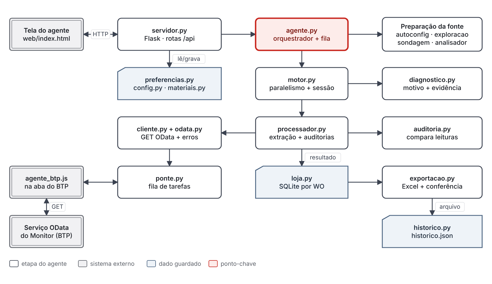


**Visão geral.** A Figura 6.1 mostra todos os módulos que participam de uma análise. A coluna da esquerda contém os elementos que vivem no navegador (a tela e o script da aba) e o serviço externo do BTP; as demais colunas contêm os módulos Python do programa local.

**Leitura passo a passo.** De cima para baixo, o pedido nasce na tela, passa pelo servidor, chega ao orquestrador (`agente.py`), desce para o motor e o processador e termina nas consultas feitas pelo cliente, entregues à ponte e executadas pela aba. À direita ficam os serviços auxiliares: preparação da fonte, diagnóstico, auditoria, base de dados, exportação e histórico. As setas indicam quem chama quem.

### 6.3 Os componentes, um a um

| Componente | Onde está | Por que existe | Recebe | Entrega | Se falhar |
|---|---|---|---|---|---|
| Tela | `agente_btp/web/index.html` | Interface de operação | Ações do usuário; estado a cada 1 s | Pedidos HTTP ao servidor | Nada é executado; o programa continua rodando |
| Servidor | `agente_btp/servidor.py` | Porta de entrada HTTP local | Pedidos da tela e da aba | Respostas JSON; comandos ao orquestrador | Nada funciona: é o único ponto de entrada |
| Orquestrador | `agente_btp/agente.py` | Coordena preparação, análise, planilha e histórico | Comandos (executar, retomar, refazer...) | Estado para a tela; análise ao motor | A análise não começa; comandos ficam na fila |
| Preparação | `autoconfig.py`, `exploracao.py`, `sondagem.py`, `analisador.py`, `raiox.py` | Descobrir de onde vêm os dados | WOs de amostra; respostas do BTP | Configuração candidata | Sem fonte, a análise não começa |
| Motor | `agente_btp/motor.py` | Paralelismo, sessão, pausa e retomada | WOs pendentes da base | Grupos aos trabalhadores; resultados à base | A análise para; WOs em andamento voltam a pendentes ao retomar |
| Processador | `agente_btp/processador.py` | Extração + auditorias por WO | Grupo de WOs | Resultado por WO | Erros viram falha da WO (com motivo) |
| Auditoria | `agente_btp/auditoria.py` | Comparar leituras e decidir o estado | Leituras de uma WO | Linhas finais + estado + registros | Sem ela, nada pode ser validado |
| Cliente | `agente_btp/cliente.py` + `odata.py` | Montar consultas e interpretar respostas | Configuração; WOs | Leituras; exceções classificadas | Nenhuma leitura é possível |
| Ponte | `agente_btp/ponte.py` | Fila de consultas para a aba | Consultas do cliente; respostas da aba | Respostas ao cliente | Consultas não saem; sessão é dada como desconectada |
| Script da aba | `agente_btp/web/agente_btp.js` | Executar o GET com a sessão do usuário | Tarefas da ponte | Respostas do BTP | Aba "desconectada"; análise pausa |
| Base (loja) | `agente_btp/loja.py` | Guardar cada WO, eventos e problemas | Resultados por WO | Contadores, retomada, dados da planilha | Sem gravação, nada é preservado |
| Exportação | `agente_btp/exportacao.py` | Gerar e conferir o Excel | Resultados da base; tabela de valores | Arquivo `.xlsx` | A análise conclui, mas sem planilha (erro registrado) |
| Histórico | `agente_btp/historico.py` | Listar análises passadas | Resumo de cada análise | `historico/historico.json` | Análises não aparecem na lista (a base continua) |
| Diagnóstico | `agente_btp/diagnostico.py` | Classificar problemas e registrar evidência | Exceções e eventos | Motivo, categoria, próxima ação | Problemas ficam sem explicação |
| Preferências e configuração | `preferencias.py`, `config.py`, `materiais.py` | Parâmetros e dados de referência | Edições na tela; importação de planilha | Valores validados | Valores padrão são usados |
| Extensão | `extensao/` | Injetar o script na aba sem favorito | Abertura de páginas do BTP | Script na aba | Usa-se o favorito como alternativa |

### 6.4 Camadas

Outra forma de ver a arquitetura é em **camadas**: cada camada usa apenas as que estão abaixo dela. Isso ajuda a prever o impacto de uma mudança — alterar uma camada de baixo pode afetar todas as de cima; alterar uma de cima não afeta as de baixo.


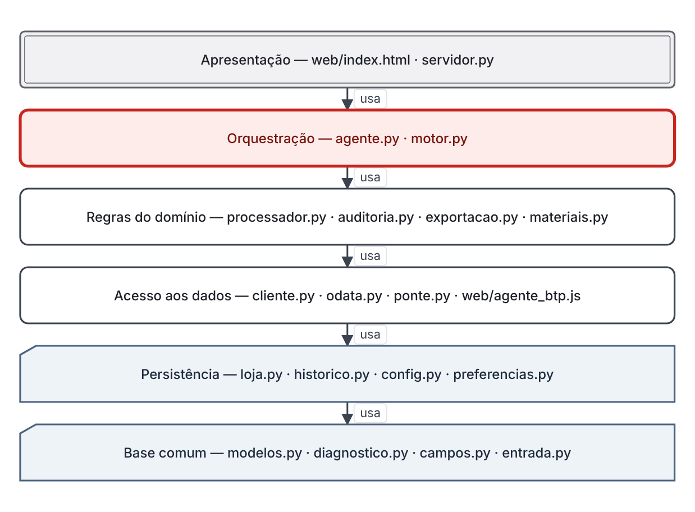


::: nobtp
<span class="interpretacao">INTERPRETAÇÃO TÉCNICA</span> A separação em camadas não está declarada como regra no projeto, mas é visível nas importações: `modelos.py` e `diagnostico.py` não importam nenhum outro módulo do agente; `cliente.py` não importa `processador.py`; `processador.py` não importa `motor.py`. A exceção é `exportacao.py`, que importa `loja.estado_da_wo` dentro de uma função para usar a mesma regra de estado da tela (`estado_rotulo`).
:::

### 6.5 Decisões de arquitetura observadas

| Decisão | Evidência | Consequência |
|---|---|---|
| Consultar o serviço de dados em vez de clicar na tela | `cliente.py`; `docs/relatorio-revisao-auditoria.md` | Rapidez e fidelidade; depende dos nomes do serviço |
| Usar a aba já logada como transporte | `ponte.py`, `agente_btp.js` | O programa nunca toca em credenciais |
| Uma única linha de execução para comandos | `Agente._laco` em `agente.py` | Uma análise por vez; sem disputa entre comandos |
| Base local transacional por WO | `loja.py` | Retomada sem perda após qualquer interrupção |
| Planilha gerada sempre a partir da base | `Agente._planilha` | O Histórico pode regenerar o relatório sem consultar o BTP |
| Somente GET em três camadas | `cliente.py`, `ponte.get`, `agente_btp.js:executar` | Não há caminho de código para alterar dados |

## 7. Estrutura de pastas e arquivos {#cap7}

A árvore abaixo foi gerada automaticamente a partir dos arquivos versionados no Git (comando `git ls-files`), excluindo a pasta desta documentação. Pastas que o programa cria durante o uso — `dados/`, `saidas/`, `logs/`, `historico/` e os arquivos locais de `config/` — não aparecem porque, de propósito, não são versionadas (veja o `.gitignore`).


```text
Agente-BTP/
├── agente_btp/
│   ├── web/
│   │   ├── agente_btp.js
│   │   └── index.html
│   ├── __init__.py
│   ├── __main__.py
│   ├── agente.py
│   ├── analisador.py
│   ├── auditoria.py
│   ├── autoconfig.py
│   ├── campos.py
│   ├── cliente.py
│   ├── config.py
│   ├── diagnostico.py
│   ├── entrada.py
│   ├── exploracao.py
│   ├── exportacao.py
│   ├── historico.py
│   ├── loja.py
│   ├── materiais.py
│   ├── modelos.py
│   ├── motor.py
│   ├── odata.py
│   ├── ponte.py
│   ├── preferencias.py
│   ├── processador.py
│   ├── raiox.py
│   ├── servidor.py
│   └── sondagem.py
├── config/
│   └── api.exemplo.json
├── docs/
│   ├── logo-agente-btp.svg
│   ├── mapeamento-processo.md
│   ├── relatorio-correcao-raiz.md
│   └── relatorio-revisao-auditoria.md
├── extensao/
│   ├── icones/
│   │   ├── icone128.png
│   │   ├── icone16.png
│   │   ├── icone32.png
│   │   └── icone48.png
│   ├── agente_btp.js
│   ├── fundo.js
│   ├── manifest.json
│   └── no_btp.js
├── testes/
│   ├── e2e/
│   │   ├── rodar_aba.py
│   │   ├── rodar_combinacoes.py
│   │   ├── rodar_extensao.py
│   │   ├── rodar_sessao.py
│   │   ├── rodar_tela.py
│   │   └── sap_falso.py
│   ├── btp_lote_falso.py
│   ├── conftest.py
│   ├── medir_desempenho.py
│   ├── servico_real_falso.py
│   ├── test_agente.py
│   ├── test_analisador.py
│   ├── test_auditoria.py
│   ├── test_execucao.py
│   ├── test_historico.py
│   ├── test_materiais.py
│   ├── test_ponte.py
│   └── test_preparo.py
├── .gitignore
├── Abrir Agente BTP.bat
├── FAVORITO - Agente BTP.txt
├── README.md
└── requirements.txt
```


### 7.1 Raiz do repositório

| Arquivo | Finalidade |
|---|---|
| `Abrir Agente BTP.bat` | Ponto de partida no Windows: prepara o ambiente e inicia o programa (Capítulo 9) |
| `FAVORITO - Agente BTP.txt` | Instruções para criar o favorito que conecta a aba, quando a extensão não puder ser usada |
| `README.md` | Instruções de uso, arquitetura resumida e a especificação original |
| `requirements.txt` | Dependências Python: `flask>=3.0` e `openpyxl>=3.1` |
| `.gitignore` | Lista do que não deve ir para o Git (dados locais, saídas, logs, configuração gerada) |

::: atencao
O `README.md` está parcialmente desatualizado em relação ao código. Por exemplo, ele diz que cada WO é "conferida N vezes (padrão 5)", mas o padrão atual em `agente_btp/preferencias.py` é `auditorias_por_wo = 2`, com até 3 leituras extras em caso de divergência; também descreve um relatório com abas que mudaram (hoje: Dados, Materiais, Análise, Rastreio e Tabela de valores). Quando houver diferença, vale o código — e este livro descreve o código.
:::

### 7.2 Pasta `agente_btp/` — o programa

| Arquivo | Linhas | Papel principal | Capítulo |
|---|---|---|---|
| `__main__.py` | 62 | Ponto de entrada (`python -m agente_btp`) | 10 |
| `agente.py` | 1.117 | Orquestrador: comandos, preparação, conferência, execução, planilha, histórico | 10, 12, 16 |
| `servidor.py` | 404 | Servidor Flask: tela, API interna, canal com a aba | 11 |
| `ponte.py` | 254 | Fila de tarefas entre o programa e a aba | 11 |
| `cliente.py` | 741 | Consultas OData, leitura em lote, releitura, classificação de respostas | 11, 13 |
| `odata.py` | 123 | Montagem de URLs e leitura de respostas OData | 13, 14 |
| `motor.py` | 335 | Paralelismo, sondas de sessão, pausa e retomada | 16, 26 |
| `processador.py` | 421 | Extração inicial, auditorias e leituras extras | 13, 16 |
| `auditoria.py` | 188 | Comparação de leituras e estado final | 14 |
| `loja.py` | 449 | Base SQLite de análises, WOs, eventos e problemas | 14, 26 |
| `exportacao.py` | 536 | Geração e conferência do Excel | 15 |
| `materiais.py` | 168 | Tabela de valores (Tipo Material e preço unitário) | 15 |
| `historico.py` | 108 | Histórico de análises em JSON | 15 |
| `diagnostico.py` | 149 | Taxonomia de problemas e evidências | 26 |
| `preferencias.py` | 147 | Parâmetros da tela Configurações | 22 |
| `config.py` | 116 | Fonte de dados (`config/api.json`) | 12, 22 |
| `modelos.py` | 158 | Estruturas de dados e exceções compartilhadas | 14, 16 |
| `entrada.py` | 70 | Leitura e validação das WOs | 13 |
| `campos.py` | 87 | Reconhecimento de campos pelo nome e pelo valor | 12 |
| `autoconfig.py` | 482 | Preparação pelo dicionário de dados e receita confirmada | 12 |
| `exploracao.py` | 205 | Preparação consultando os dados | 12 |
| `sondagem.py` | 71 | Preparação pela linha do alerta | 12 |
| `analisador.py` | 261 | Preparação observando a tela | 12 |
| `raiox.py` | 127 | Raio-X de uma WO (diagnóstico da fonte) | 12, 27 |
| `web/index.html` | 1.714 | Tela de operação (HTML, CSS e JavaScript num só arquivo) | 23 |
| `web/agente_btp.js` | 306 | Script executado dentro da aba do BTP | 11, 12 |

### 7.3 Pasta `extensao/` — a extensão do Chrome

| Arquivo | Papel |
|---|---|
| `manifest.json` | Declara a extensão (Manifest V3), as permissões (`scripting`, `tabs`) e o único site em que ela atua |
| `no_btp.js` | Roda nas páginas do BTP e pede ao service worker para carregar o agente |
| `fundo.js` | Service worker: injeta `agente_btp.js` na aba, no "mundo" da página |
| `agente_btp.js` | Cópia do script da aba; o servidor a mantém igual a `agente_btp/web/agente_btp.js` ao iniciar |
| `icones/` | Ícones da extensão |

### 7.4 Pasta `testes/` — verificação

| Arquivo | Papel |
|---|---|
| `test_*.py` (8 arquivos) | Testes automáticos executados pelo pytest (Capítulo 24) |
| `servico_real_falso.py` | Serviço falso que imita o Monitor real (nomes de campos confirmados) |
| `btp_lote_falso.py` | Serviço falso para lotes grandes, com `$filter` avaliado de verdade |
| `conftest.py` | Configuração comum dos testes |
| `medir_desempenho.py` | Medição de desempenho antes e depois |
| `e2e/*.py` | Testes de ponta a ponta com navegador real (Chromium) e um BTP falso |

### 7.5 Pasta `docs/` — documentação técnica anterior

| Arquivo | Conteúdo |
|---|---|
| `mapeamento-processo.md` | Processo manual, colunas da janela Mensagens, estados por WO |
| `relatorio-revisao-auditoria.md` | Revisão da extração, auditoria e relatório (14–15/10) |
| `relatorio-correcao-raiz.md` | Diagnóstico de raiz, correções e medições das rodadas de 21/10 a 29/10 |
| `logo-agente-btp.svg` | Logotipo |

### 7.6 Pastas criadas durante o uso (não versionadas)

| Pasta / arquivo | Criado por | Conteúdo |
|---|---|---|
| `.venv/` | `Abrir Agente BTP.bat` | Ambiente Python isolado com Flask e openpyxl |
| `config/api.json` | `config.salvar` | Fonte de dados confirmada |
| `config/preferencias.json` | `preferencias.salvar` | Parâmetros da tela Configurações |
| `config/tabela_materiais.json` | `materiais.salvar` | Tabela de valores importada |
| `config/fontes_recusadas.json` | `agente._rejeitar` | Fontes recusadas na conferência (nunca mais usadas) |
| `dados/execucoes.sqlite3` | `Loja` | Base de análises, WOs, eventos e problemas |
| `saidas/` | `exportacao`, `raiox` | Planilhas `Análise N - X WOs.xlsx` e arquivos de Raio-X |
| `historico/` | `historico.registrar` | `historico.json`, `contador.txt` e `analises/<id>.json` |
| `logs/agente_btp.log` | `__main__.configurar_log` | Registro técnico do processo |

### 7.7 Arquivos essenciais por finalidade

| Finalidade | Arquivos |
|---|---|
| Inicialização | `Abrir Agente BTP.bat`, `agente_btp/__main__.py` |
| Configuração | `config.py`, `preferencias.py`, `materiais.py` |
| Execução | `agente.py`, `motor.py`, `processador.py` |
| Comunicação | `servidor.py`, `ponte.py`, `web/agente_btp.js`, `extensao/` |
| Extração | `cliente.py`, `odata.py`, `entrada.py` |
| Processamento | `auditoria.py`, `campos.py` |
| Resultados | `exportacao.py`, `historico.py`, `loja.py` |
| Diagnóstico | `diagnostico.py`, `raiox.py` |
| Testes | `testes/` |
| Implantação | `Abrir Agente BTP.bat`, `requirements.txt`, `extensao/manifest.json` |

::: atencao
`config/api.exemplo.json` é um modelo ilustrativo antigo: seu comentário interno menciona um botão "Salvar descoberta" que não existe mais. O arquivo real `config/api.json` é gerado pelo agente na preparação. O exemplo serve apenas para mostrar o formato geral.
:::

## 8. Tecnologias, linguagens e ferramentas utilizadas {#cap8}

Esta lista contém apenas o que aparece de fato no repositório. Para cada item, a classificação diz o que ele é: linguagem, biblioteca, serviço externo, protocolo, plataforma ou ferramenta.

### 8.1 Python — linguagem de programação

**O que é.** Uma linguagem de programação de uso geral, conhecida pela legibilidade.

**Como é usada.** Todo o núcleo do agente (pasta `agente_btp/`) e todos os testes. O código usa recursos modernos da linguagem, como *dataclasses* (classes de dados declarativas, em `modelos.py`, `config.py`, `preferencias.py`) e anotações de tipo (`str | None`).

**Indispensável?** Sim; reescrever o núcleo em outra linguagem seria refazer o projeto.

**Cuidados.** O projeto não declara uma versão mínima. <span class="naodet">NÃO DETERMINADO</span> Os testes desta edição foram executados com Python 3.13; o `.bat` usa o lançador `py -3` (qualquer Python 3 instalado). Como verificar: `python --version` no terminal do ambiente.

### 8.2 Flask — biblioteca (framework web)

**O que é.** Uma biblioteca Python para criar servidores web: define rotas (endereços) e as funções que respondem a cada uma.

**Como é usada.** Em `agente_btp/servidor.py`, a função `criar_app` cria o aplicativo e declara as rotas com decoradores como `@app.get("/api/estado")`. Em `__main__.py`, `app.run(host="127.0.0.1", port=8767, threaded=True)` inicia o servidor de desenvolvimento embutido do Flask (Werkzeug), atendendo vários pedidos ao mesmo tempo com threads.

**Indispensável?** Substituível por outro framework, mas toda a API interna teria de ser reescrita.

**Cuidados.** O servidor embutido é o de desenvolvimento do Flask. Para um programa que atende apenas o próprio computador (`127.0.0.1`), isso é aceitável; ele não deve ser exposto na rede.

### 8.3 openpyxl — biblioteca

**O que é.** Biblioteca Python para ler e escrever arquivos Excel (`.xlsx`).

**Como é usada.** Para **ler** a planilha de WOs importada (`entrada.ler_wos_planilha`) e a tabela de valores (`materiais.ler_planilha`), sempre em modo somente leitura; e para **escrever** o relatório (`exportacao.gerar_planilha`) em modo de escrita contínua (*write-only*), que grava linha a linha sem montar a planilha inteira na memória.

**Cuidados.** O modo write-only exige que larguras de coluna e painéis congelados sejam definidos antes da primeira linha (`exportacao._preparar`).

### 8.4 SQLite — banco de dados embutido (biblioteca padrão)

**O que é.** Um banco de dados que cabe num arquivo, acessado pelo módulo `sqlite3` da biblioteca padrão do Python (não precisa instalar nada).

**Como é usada.** Em `agente_btp/loja.py`, com o modo WAL (que permite ler enquanto se escreve) e transações por WO.

### 8.5 JavaScript — linguagem de programação (no navegador)

**Como é usada.** Na tela (`index.html`, sem bibliotecas externas: JavaScript puro) e no script da aba (`agente_btp.js`), que usa `fetch` com `AbortController` (para impor tempo máximo às consultas) e funções assíncronas.

### 8.6 Extensão do Chrome (Manifest V3) — plataforma

**O que é.** Um pequeno pacote que adiciona comportamento ao Chrome. "Manifest V3" é a versão atual do formato de extensões.

**Como é usada.** `extensao/manifest.json` restringe a atuação ao domínio do Launchpad. O service worker (`fundo.js`) usa `chrome.scripting.executeScript` com `world: 'MAIN'` para colocar o agente no mesmo "mundo" de JavaScript da página — onde a sessão do usuário é válida.

**Substituível?** Sim: o favorito (`javascript:` que busca o script no programa local) faz o mesmo, com um clique manual a cada carregamento da página.

### 8.7 OData, HTTP e JSON — protocolos e formatos

**OData** é o padrão usado pelo serviço do Monitor; **HTTP** é o protocolo das conversas entre tela, programa, aba e BTP; **JSON** é o formato dos dados. O agente entende OData V2 e V4 (`odata.extrair_pagina`).

### 8.8 SAP BTP e SAP Fiori — serviço externo

O Monitor de alertas é um aplicativo **SAP Fiori** (padrão de interface da SAP, construído com a biblioteca SAPUI5) publicado no Launchpad do **SAP BTP**. O agente não depende de nenhuma biblioteca SAP; ele apenas lê a configuração do UI5 já carregada na página para descobrir quais serviços de dados o aplicativo usa (`fontesDeDados` em `agente_btp.js`).

### 8.9 Windows e o arquivo `.bat` — plataforma de execução

O ponto de partida é um script de lote do Windows. O `__main__.py` também tem código específico do Windows: desliga o "modo de edição rápida" (QuickEdit) do console, porque um clique na janela preta congelava o programa (Capítulo 10). <span class="interpretacao">INTERPRETAÇÃO TÉCNICA</span> O núcleo Python é multiplataforma (os testes rodam em Linux), mas a experiência de uso foi desenhada para Windows.

### 8.10 Ferramentas de desenvolvimento e teste

| Ferramenta | Tipo | Uso |
|---|---|---|
| Git | Controle de versão | Histórico de 39 commits |
| pytest | Biblioteca de testes | 167 testes automáticos (Capítulo 24) |
| Playwright + Chromium | Automação de navegador | Somente nos testes de ponta a ponta (`testes/e2e/`) — não é dependência do programa |
| http.server | Biblioteca padrão | Servidores falsos do BTP nos testes (`testes/e2e/sap_falso.py`) |

## 9. Dependências e preparação do ambiente {#cap9}

### 9.1 Pré-requisitos

| Item | Por quê | Como verificar |
|---|---|---|
| Windows | O `.bat` e o ajuste do console são do Windows | — |
| Python 3 instalado | O programa é Python | `py -3 --version` ou `python --version` |
| Google Chrome (ou Chromium) | Extensão e aba do BTP | `chrome://version` |
| Acesso ao Launchpad do BTP com usuário que vê o Monitor de alertas | Fonte dos dados | Abrir o Monitor manualmente |
| Acesso à internet para instalar Flask e openpyxl (só na 1ª vez) | `pip install` | — |

Nenhuma credencial é configurada no agente. Login e MFA são feitos pelo usuário no próprio Chrome, como de costume.

### 9.2 O que o `Abrir Agente BTP.bat` faz, linha a linha


**Código-fonte — Abrir Agente BTP.bat · script de inicialização · linhas 1–16**

```batch
   1  @echo off
   2  chcp 65001 >NUL
   3  title Agente BTP
   4  cd /d "%~dp0"
   5  
   6  rem Encerra qualquer Agente BTP que ainda esteja aberto (versao antiga na porta 8767).
   7  for /f "tokens=5" %%p in ('netstat -ano ^| findstr ":8767" ^| findstr "LISTENING"') do taskkill /PID %%p /F >NUL 2>&1
   8  
   9  if not exist .venv (
  10    echo Preparando ambiente pela primeira vez...
  11    py -3 -m venv .venv 2>NUL || python -m venv .venv
  12  )
  13  call .venv\Scripts\activate.bat
  14  python -m pip install -q -r requirements.txt
  15  python -m agente_btp
  16  pause
```


| Linhas | O que fazem | Resultado esperado | Como reconhecer um problema |
|---|---|---|---|
| 1–4 | Desligam o eco de comandos, ajustam a página de código para UTF-8, dão título à janela e entram na pasta do próprio `.bat` (`%~dp0`) | Janela "Agente BTP" aberta | — |
| 6–7 | Procuram um processo escutando a porta 8767 e o encerram | Uma versão antiga aberta é fechada | Se outro programa usar a porta, ele também é encerrado (ver Capítulo 28) |
| 9–12 | Se não existir `.venv`, criam um ambiente Python isolado com `py -3 -m venv .venv` (ou `python -m venv .venv`) | Mensagem "Preparando ambiente pela primeira vez..." | Erro de "py não reconhecido" e "python não reconhecido" = Python não instalado |
| 13 | Ativam o ambiente isolado | Comandos `python` e `pip` passam a ser os do `.venv` | — |
| 14 | Instalam ou atualizam Flask e openpyxl silenciosamente | Nenhuma saída (`-q`) | Mensagens de erro de rede ou proxy |
| 15 | Iniciam o programa | Mensagem "Agente BTP aberto em http://127.0.0.1:8767" e o navegador abre a tela | Mensagem de erro Python na janela |
| 16 | `pause`: mantém a janela aberta se o programa terminar | — | A janela mostra o erro que encerrou o programa |

::: termo
**Ambiente virtual (`.venv`).** Uma pasta com uma cópia isolada do Python e das bibliotecas instaladas só para este projeto. Assim, instalar Flask para o agente não interfere em outros programas Python do computador. Apagar a pasta `.venv` é seguro: o `.bat` a recria na próxima abertura.
:::

### 9.3 Instalação da extensão do Chrome (uma vez)

Os passos abaixo são os mesmos exibidos na própria tela do agente quando a aba do BTP não está conectada (cartão "Conecte a aba do BTP"):

1. No Chrome, abrir `chrome://extensions`.
2. Ligar o **Modo do desenvolvedor** (canto superior direito).
3. Clicar em **Carregar sem compactação** e escolher a pasta `extensao` do Agente BTP. A tela do agente tem um botão que abre essa pasta no Explorador (rota `POST /api/extensao/abrir`).
4. Recarregar a aba do BTP (F5). Se o Chrome perguntar sobre **acesso à rede local**, clicar em **Permitir** — o script da aba precisa falar com `127.0.0.1`.

Quando tudo está certo, aparece no canto inferior direito da aba do BTP um selo verde **"Agente BTP: conectado"**.

### 9.4 Alternativa sem extensão: o favorito

Se a empresa bloquear extensões, a tela oferece um **favorito**: um endereço do tipo `javascript:` que, clicado na aba do BTP, busca o script no programa local e o executa. O código desse carregador é gerado pela função `codigo_carregador` de `agente_btp/servidor.py`. A diferença prática é que o favorito precisa ser clicado de novo sempre que a página do BTP for recarregada.

### 9.5 Verificações antes da primeira execução

1. A janela preta mostra "Agente BTP aberto em http://127.0.0.1:8767".
2. A tela do agente abre no navegador e mostra, no rodapé do menu lateral, o estado da conexão.
3. Na aba do BTP, o selo diz "Agente BTP: conectado".
4. Na tela do agente, o estado passa a **"BTP conectado · sessão válida"** (ponto verde). Se ficar em "Aba conectada · sessão a verificar" (amarelo), a sessão ainda não foi confirmada por uma consulta bem-sucedida — veja o Capítulo 11.

### 9.6 Implantação e atualização


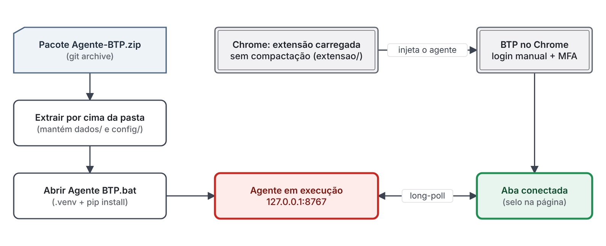


A distribuição observada ao longo do desenvolvimento é um arquivo `Agente-BTP.zip`, gerado com `git archive` (que inclui apenas arquivos versionados — portanto, sem dados locais). Para **atualizar** sem perder a base de análises, o pacote deve ser extraído **por cima** da pasta existente: as pastas `dados/`, `config/`, `historico/` e `saidas/` não fazem parte do pacote e ficam intactas.

::: atencao
Ao atualizar, o programa recalcula sua "versão" (uma impressão digital de todos os arquivos `.py` e da pasta `web/`) e, se a aba estiver com um script de outra versão, pede a ela que se recarregue uma única vez. Se a extensão instalada for de **outra pasta** (outra cópia do programa), a aba mostra um aviso vermelho pedindo para abrir o `.bat` da mesma pasta da extensão. Esse comportamento está em `agente_btp.js` (função `trabalhador`) e foi criado para evitar laços de recarga (commit `4ea72e2`).
:::


# Parte III — Como o agente funciona internamente {#parte3}

Esta é a parte central do livro. Ela acompanha o programa por dentro, na ordem em que as coisas acontecem: a inicialização, a comunicação entre o programa local, a aba do navegador e o BTP, a preparação da fonte de dados, a extração, a interpretação e a auditoria dos dados, a geração do relatório e, por fim, o papel de cada função importante e as relações entre os módulos. Cada mecanismo é explicado em três níveis: a ideia intuitiva, o funcionamento real e o código que o implementa.

## 10. O que acontece quando o agente é iniciado {#cap10}

### 10.1 A ideia

Iniciar o agente é como abrir uma loja: antes de atender o primeiro cliente, alguém precisa acender as luzes, conferir o caixa, organizar o estoque e destrancar a porta. No programa, "acender as luzes" é preparar o registro de eventos; "conferir o caixa" é abrir a base de dados; "organizar o estoque" é carregar as configurações; e "destrancar a porta" é começar a escutar pedidos no endereço local.

### 10.2 A sequência real


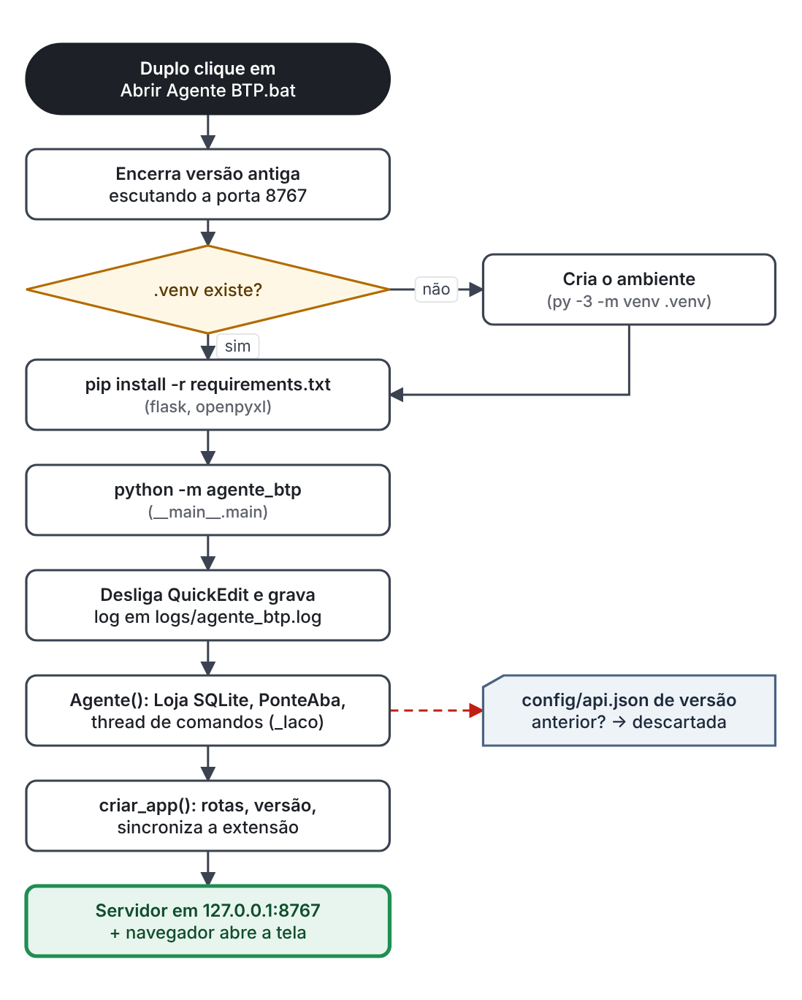


**Leitura passo a passo.** O fluxograma começa no duplo clique no `.bat` (Capítulo 9) e termina com o servidor escutando em `127.0.0.1:8767` e o navegador abrindo a tela. A decisão ".venv existe?" só cria o ambiente na primeira vez. A seta tracejada indica uma verificação feita durante a criação do orquestrador: se houver uma configuração de fonte gravada por versão anterior do programa, ela é descartada.

### 10.3 O ponto de entrada: `__main__.py`

Em Python, um pacote pode ser executado como programa com `python -m nome_do_pacote`; nesse caso, o arquivo `__main__.py` do pacote é executado. É o que a linha 15 do `.bat` faz.


**Código-fonte — agente_btp/__main__.py · main · linhas 47–58**

```python
  47  def main() -> None:
  48      desligar_selecao_da_janela()
  49      configurar_log()
  50      app = criar_app(Agente())
  51      url = f"http://{HOST}:{PORTA}"
  52      logging.getLogger("agente_btp").info("Agente BTP iniciado em %s", url)
  53      print(f"Agente BTP aberto em {url}\nNão feche esta janela enquanto usar o agente. "
  54            "O registro detalhado fica em logs\\agente_btp.log.", flush=True)
  55      threading.Timer(1.0, webbrowser.open, args=[url]).start()
  56      import flask.cli
  57      flask.cli.show_server_banner = lambda *a, **k: None   # nada escrito na janela durante o uso
  58      app.run(host=HOST, port=PORTA, debug=False, use_reloader=False, threaded=True)
```


::: leitura
- **Linha 48** — `desligar_selecao_da_janela()`: no Windows, um clique na janela preta coloca o console em "modo de seleção"; enquanto isso, qualquer escrita nela **congela** o programa. O comentário de `configurar_log` registra o caso real: "a análise parava no meio, ex.: 391 de 499 WOs". A função desliga esse modo só para esta janela (commit `72c9acd`).
- **Linha 49** — `configurar_log()`: todo o registro técnico vai para o arquivo `logs/agente_btp.log`, **nunca** para a janela — pelo mesmo motivo.
- **Linha 50** — `criar_app(Agente())`: primeiro cria o **orquestrador** (`Agente`), depois o **aplicativo web** (`criar_app`), que recebe o orquestrador para poder repassar a ele os pedidos.
- **Linha 55** — agenda a abertura do navegador na tela do agente um segundo depois, dando tempo ao servidor de começar a escutar.
- **Linhas 56–58** — silenciam a mensagem de boas-vindas do Flask (de novo, nada é escrito na janela) e iniciam o servidor com `threaded=True`, para atender a tela e a aba ao mesmo tempo.
:::


**Código-fonte — agente_btp/__main__.py · desligar_selecao_da_janela · linhas 32–44**

```python
  32  def desligar_selecao_da_janela() -> None:
  33      """Desliga o modo de seleção (QuickEdit) só desta janela do Windows, para nada congelar."""
  34      if os.name != "nt":
  35          return
  36      try:
  37          import ctypes
  38          kernel32 = ctypes.windll.kernel32
  39          entrada = kernel32.GetStdHandle(-10)          # STD_INPUT_HANDLE
  40          modo = ctypes.c_uint32()
  41          if kernel32.GetConsoleMode(entrada, ctypes.byref(modo)):
  42              kernel32.SetConsoleMode(entrada, (modo.value & ~0x0040) | 0x0080)   # -QUICK_EDIT +EXTENDED_FLAGS
  43      except Exception:  # noqa: BLE001 — sem console (pythonw) ou API indisponível: nada a fazer
  44          pass
```


A função acima usa `ctypes` (acesso direto às funções do sistema operacional) para ler o modo atual do console e retirar o bit `0x0040` (QuickEdit), acrescentando `0x0080` (flags estendidas, exigido para a mudança valer). Em qualquer outro sistema operacional (`os.name != "nt"`) ela não faz nada; se a chamada falhar, a exceção é ignorada de propósito — sem console, não há o que desligar.

### 10.4 A criação do orquestrador

O orquestrador é a classe `Agente`, em `agente_btp/agente.py`. Seu construtor prepara tudo o que uma análise vai precisar:


**Código-fonte — agente_btp/agente.py · Agente.__init__ · linhas 53–94**

```python
  53      def __init__(self):
  54          self._fila: queue.Queue = queue.Queue()
  55          self._trava = threading.Lock()
  56          self._trava_config = threading.Lock()
  57          self._parar = threading.Event()
  58          self._diag: dict = {}
  59          self._candidatos: list = []
  60          self._testados: set[str] = set()
  61          self._achados: dict = {}
  62          self._sondadas: set[str] = set()
  63          self._modelos: list = []
  64          self._explorados: set[str] = set()
  65          self._resposta: dict | None = None
  66          self._resposta_fonte = threading.Event()
  67          self._raiox_pronto = threading.Event()
  68          self.ponte = PonteAba()
  69          self.ponte.observador = self._ao_observar
  70          self.loja = Loja(ARQUIVO_LOJA)
  71          self._motor: Motor | None = None
  72          self._run_id: str | None = None
  73          self._sessao = {"estado": "nao_verificada", "em": 0.0, "motivo": ""}
  74          self._modelos_lidos = False      # dicionário ($metadata) da aba já lido?
  75          self._estado = {
  76              "ocupado": False,
  77              "fase": "ocioso",            # ocioso | preparando | processando | concluido
  78              "progresso": {"atual": 0, "total": 0},
  79              "contagem": {},
  80              "inicio": None,
  81              "ultimo_arquivo": None,
  82              "ultimo_numero": None,
  83              "etapa": "",
  84              "indicadores": {},
  85              "confirmacao": None,
  86              "ultimo_raiox": None,
  87              "aviso": "",
  88              "mensagens": [],
  89              "run_id": None,
  90              "situacao": "",
  91          }
  92          if cfg.descartar_se_antiga():
  93              self._msg("Configuração de versão anterior descartada; será refeita na próxima análise.")
  94          threading.Thread(target=self._laco, name="agente-btp", daemon=True).start()
```


::: leitura
- **Linhas 54–67** — estruturas internas: a **fila de comandos** (`queue.Queue`), travas para acesso concorrente (`threading.Lock`), eventos de sinalização (`threading.Event`) e listas usadas na preparação da fonte.
- **Linhas 68–69** — cria a **ponte** com a aba (`PonteAba`) e registra `_ao_observar` como a função a ser chamada quando a aba relatar consultas observadas na tela (usado na preparação, Capítulo 12).
- **Linha 70** — abre a **base de dados** (`Loja(ARQUIVO_LOJA)`, arquivo `dados/execucoes.sqlite3`). Se o arquivo não existir, é criado com as tabelas necessárias.
- **Linhas 75–91** — o dicionário `_estado`: tudo o que a tela mostra (fase, progresso, aviso, mensagens...). A tela lê esse estado a cada segundo.
- **Linhas 92–93** — se `config/api.json` foi gravado por uma versão anterior do programa, ele é apagado e a fonte é refeita na próxima análise (função `descartar_se_antiga` de `config.py`, que compara `VERSAO_CONFIG`).
- **Linha 94** — inicia a **linha de execução de comandos** (`_laco`), que vai rodar durante toda a vida do programa.
:::

### 10.5 A fila de comandos

O orquestrador executa um comando por vez, numa linha de execução própria. Isso é importante: o servidor web nunca executa uma análise diretamente; ele apenas **coloca um pedido na fila** e responde à tela imediatamente.


**Código-fonte — agente_btp/agente.py · Agente._laco · linhas 358–368**

```python
 358      def _laco(self) -> None:
 359          while True:
 360              comando, args = self._fila.get()
 361              self._definir(ocupado=True)
 362              try:
 363                  getattr(self, f"_cmd_{comando}")(*args)
 364              except Exception as exc:  # noqa: BLE001
 365                  log.exception("Falha no comando %s", comando)
 366                  self._msg(f"ERRO: {exc}")
 367              finally:
 368                  self._definir(ocupado=False)
```


::: conceito
**Thread (linha de execução).** Um programa pode fazer várias coisas "ao mesmo tempo" dividindo o trabalho em linhas de execução. Aqui, uma thread atende a tela (as do Flask), outra executa comandos (`_laco`) e, durante uma análise, várias trabalham em paralelo (as do motor). Como elas compartilham dados, o código usa **travas** (`Lock`) para que duas threads não alterem o mesmo dado ao mesmo tempo.
:::

O laço é simples: espera um comando na fila (`self._fila.get()` bloqueia até chegar algo), marca o agente como ocupado, chama o método correspondente (`_cmd_executar`, `_cmd_retomar`, `_cmd_refazer`, `_cmd_preparar`, `_cmd_raiox`, `_cmd_sondar`) e, aconteça o que acontecer, marca o agente como livre. Uma exceção inesperada é registrada no log com o *traceback* completo (`log.exception`) e aparece como mensagem na tela — o laço nunca morre por causa dela.

O método que coloca comandos na fila é `enviar`. Um detalhe de projeto: para os comandos que iniciam análises, ele já marca o agente como ocupado **no momento do pedido**, e não só quando a fila o pegar — assim um segundo clique rápido em "Executar" não inicia outra análise.


**Código-fonte — agente_btp/agente.py · Agente.enviar · linhas 221–225**

```python
 221      def enviar(self, comando: str, *args) -> None:
 222          if comando in ("executar", "retomar", "refazer"):
 223              # Ocupado JÁ no pedido (não só quando a fila o pega): um 2º clique não inicia outra análise.
 224              self._definir(ocupado=True, fase="preparando", aviso="")
 225          self._fila.put((comando, args))
```


### 10.6 A criação do aplicativo web


**Código-fonte — agente_btp/servidor.py · criar_app · linhas 47–58**

```python
  47  def criar_app(agente: Agente) -> Flask:
  48      app = Flask(__name__)
  49      codigo_agente = (PASTA_WEB / "agente_btp.js").read_text(encoding="utf-8")
  50      sincronizar_extensao(codigo_agente)
  51      # Versão = impressão digital de todo o programa: qualquer mudança gera outra versão.
  52      digital = hashlib.sha1()
  53      for arq in sorted(PASTA_WEB.parent.glob("*.py")) + sorted(PASTA_WEB.glob("*")):
  54          digital.update(arq.read_bytes())
  55      versao = digital.hexdigest()[:10]
  56      agente.ponte.versao_agente = versao
  57      app.config["MAX_CONTENT_LENGTH"] = 20 * 1024 * 1024
  58  
```


::: leitura
- **Linha 49** — lê o script da aba (`web/agente_btp.js`).
- **Linha 50** — `sincronizar_extensao`: copia esse script para dentro da pasta `extensao/` se a cópia estiver diferente. A extensão leva sua própria cópia do script (o Chrome não permite que ela execute código baixado), e esta linha garante que a cópia corresponda ao programa aberto.
- **Linhas 52–55** — calculam a **versão** do programa: uma impressão digital (SHA-1) de todos os arquivos `.py` do pacote e de todos os arquivos da pasta `web/`. Qualquer alteração em qualquer arquivo gera outra versão. A ponte guarda esse valor para detectar abas com script desatualizado.
- **Linha 57** — limita o tamanho dos pedidos a 20 MB (importação de planilhas).
:::

### 10.7 Configurações ausentes ou inválidas

| Situação | Comportamento | Onde |
|---|---|---|
| `config/api.json` não existe | Normal na primeira vez; a preparação o cria na primeira análise | `agente._garantir_preparo` |
| `config/api.json` de versão anterior ou ilegível | Apagado na inicialização; refeito na próxima análise | `config.descartar_se_antiga` |
| `config/preferencias.json` não existe ou ilegível | Valores padrão (por exemplo, 2 auditorias, 4 em paralelo) | `preferencias.carregar` |
| Preferência fora da faixa permitida | Ajustada ao limite e registrada como problema | `preferencias.validar` |
| Preferências da versão 1 com valores padrão antigos | Migradas para a política atual, com aviso no registro | `preferencias.migrar` |
| `config/tabela_materiais.json` não existe | Planilha sem Tipo Material e sem valores ("-") | `materiais.carregar` |
| Porta 8767 ocupada | O `.bat` encerra o processo que a ocupa antes de iniciar | `Abrir Agente BTP.bat`, linhas 6–7 |

### 10.8 Como o programa indica que está pronto

Três sinais, em ordem: a mensagem na janela preta ("Agente BTP aberto em http://127.0.0.1:8767..."), a abertura automática da tela no navegador e, na tela, o estado da conexão no rodapé do menu lateral — que começa em "Aguardando o BTP" e passa a "Aba conectada" quando a aba se anuncia, e a "BTP conectado · sessão válida" quando uma consulta confirma a sessão.

## 11. A relação entre o agente, o servidor e os sistemas externos {#cap11}

Este é o capítulo mais importante para entender **como o Agente BTP conversa com o BTP** — e por que ele conversa desse jeito.

### 11.1 A ideia: um mensageiro dentro da sessão

Imagine um escritório com uma sala de acesso restrito, onde só entra quem tem crachá. O agente não tem crachá — e não deve ter: ele não guarda senhas. Mas o usuário tem, e já está lá dentro (a aba do BTP, logada). A solução do projeto é deixar dentro da sala um **mensageiro** (o script `agente_btp.js`) que pergunta periodicamente ao agente, do lado de fora, "tem algo para eu buscar?". Quando há, o mensageiro busca com o crachá do usuário e entrega a resposta. O agente nunca entra na sala e nunca toca no crachá.

Tecnicamente, o "crachá" é o cookie de sessão que o navegador anexa automaticamente a toda consulta feita **de dentro da página do BTP** (uma consulta *same-origin*, ou "da mesma origem"). O script faz as consultas de dentro da página; por isso o cookie vai junto, sem que nenhum código do agente o leia.

### 11.2 Quem é servidor e quem é cliente

| Componente | Onde roda | Papel | Fala com |
|---|---|---|---|
| Tela (`index.html`) | Navegador do usuário | Cliente do servidor local | Servidor local (HTTP, JSON) |
| Servidor local (Flask) | Computador do usuário, `127.0.0.1:8767` | Servidor para a tela e para a aba | Tela; script da aba |
| Script da aba (`agente_btp.js`) | Dentro da aba do BTP | Cliente do servidor local **e** cliente do BTP | Servidor local; serviço OData do BTP |
| Serviço OData do Monitor | Nuvem SAP BTP | Servidor de dados | Script da aba |

Repare na consequência: o **único** componente que conversa com o BTP é o script da aba. O programa local (Python) não abre conexão nenhuma para a internet durante uma análise — todas as consultas saem do navegador.


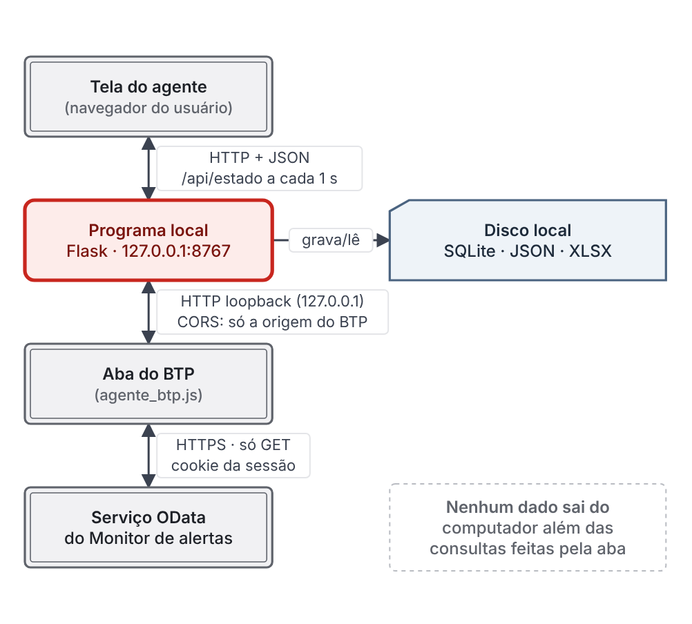


### 11.3 Por que a aba pergunta e o programa não manda

Um navegador não aceita conexões de entrada: um programa externo não consegue "mandar" uma ordem para uma aba. Quem pode iniciar a conversa é a própria aba. Por isso a comunicação é invertida: a aba faz pedidos ao programa local, e o programa usa a técnica de **long-poll** (Capítulo 4) — segura o pedido aberto até ter uma tarefa para entregar, ou até 15 segundos.

### 11.4 A sequência de uma consulta


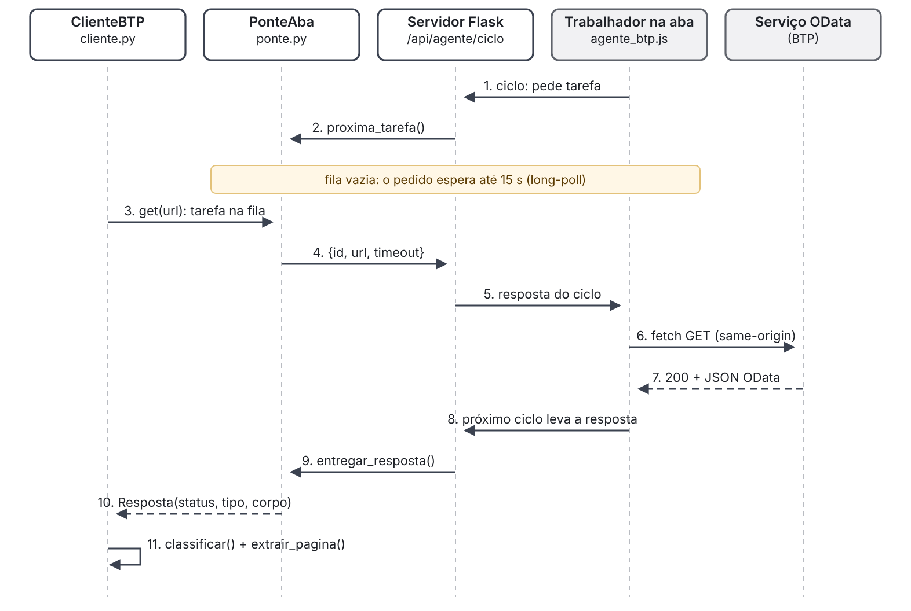


**Leitura passo a passo.**

1. Cada **trabalhador** do script da aba envia `POST /api/agente/ciclo` ao programa local.
2. O servidor chama `PonteAba.proxima_tarefa`, que espera até haver tarefa na fila (ou até 15 s).
3. Enquanto isso, do lado Python, o cliente (`ClienteBTP`) precisa de um dado e chama `PonteAba.get(url)`, que coloca a tarefa na fila e fica esperando a resposta.
4. A ponte entrega a tarefa ao pedido que estava esperando: `{id, url, timeout}`.
5. O servidor responde ao ciclo da aba com essa tarefa.
6. O script faz `fetch` (o GET) ao serviço OData, com a sessão da aba.
7. O BTP responde (por exemplo, `200` com o JSON).
8. O script envia o **próximo** ciclo levando a resposta da tarefa anterior.
9. O servidor entrega a resposta à ponte (`entregar_resposta`), que acorda quem estava esperando.
10. O cliente recebe um objeto `Resposta` com situação, tipo de conteúdo e corpo.
11. O cliente classifica a resposta e extrai os registros (Capítulos 13 e 14).

Um detalhe elegante: cada ciclo **entrega a resposta anterior e pede a próxima tarefa** no mesmo pedido. Assim, cada trabalhador usa uma única conexão por vez com o programa local — importante porque o navegador limita a seis as conexões simultâneas a um mesmo servidor (`LIMITE_TRABALHADORES_ABA = 6` em `ponte.py`).

### 11.5 O lado Python: a ponte

A fila e a espera ficam em `agente_btp/ponte.py`. Primeiro, o lado que a aba chama:


**Código-fonte — agente_btp/ponte.py · PonteAba.proxima_tarefa · linhas 81–109**

```python
  81      def proxima_tarefa(self, agente: str, autenticado: bool, pagina: str,
  82                         capturando_na_aba: bool = False, espera: float = ESPERA_LONG_POLL,
  83                         versao: str | None = None) -> dict:
  84          with self._cond:
  85              if (self.versao_agente and versao not in (self.versao_agente, "ext")
  86                      and versao not in self._versoes_avisadas):
  87                  # Script de outra versão na aba: pede UMA recarga. Se a mesma versão voltar
  88                  # (a recarga não a mudou), aceita e segue — nunca entra em laço.
  89                  self._versoes_avisadas.add(versao)
  90                  return {"atualizar": True, "substituido": True}
  91              if agente != self.agente_id:
  92                  return {"substituido": True}
  93              self._visto_em = time.monotonic()
  94              self._aba_autenticada = autenticado
  95              self.pagina = pagina
  96              limite = time.monotonic() + espera
  97              # Responde na hora se há tarefa OU se a aba precisa saber que a observação
  98              # começou/terminou — senão ela perderia as primeiras consultas da tela.
  99              while (not self._fila and time.monotonic() < limite and agente == self.agente_id
 100                     and (self._captura is not None) == capturando_na_aba):
 101                  self._cond.wait(timeout=min(1.0, limite - time.monotonic()))
 102                  self._visto_em = time.monotonic()
 103              resposta = {"capturar": self._captura is not None}
 104              if self._fila and agente == self.agente_id:
 105                  tarefa = self._fila.popleft()
 106                  self._entregues[tarefa["id"]] = tarefa
 107                  self._em_curso[tarefa["id"]] = time.monotonic() + tarefa.get("timeout", 60000) / 1000 + 10
 108                  resposta["tarefa"] = tarefa
 109              return resposta
```


::: leitura
- **Linhas 85–90** — controle de versão: se a aba estiver com um script de outra versão (e não for o da extensão, marcado como `"ext"`), a ponte pede **uma** recarga. Se a mesma versão voltar, aceita — o comentário diz explicitamente: "nunca entra em laço".
- **Linhas 91–92** — se outra aba se conectou depois, esta é avisada de que foi substituída.
- **Linhas 93–95** — registra o "batimento" da aba (`_visto_em`): é assim que o programa sabe que a aba está viva.
- **Linhas 99–102** — a espera do long-poll: enquanto a fila estiver vazia e o tempo não acabar, a thread dorme em fatias de no máximo 1 segundo (`self._cond.wait`), sempre atualizando o batimento.
- **Linhas 104–108** — se há tarefa, ela sai da fila, é registrada como "entregue" e ganha um prazo (`_em_curso`) — o tempo máximo da consulta mais 10 segundos.
:::

Agora o lado que o cliente Python chama para fazer uma consulta:


**Código-fonte — agente_btp/ponte.py · PonteAba.get · linhas 161–179**

```python
 161      def get(self, url: str, accept: str | None = None, timeout: float | None = None) -> Resposta:
 162          """GET pela aba. `timeout` (s) = tempo máximo desta consulta (a aba aborta ao estourar)."""
 163          if not url.startswith("/") or url.startswith("//"):
 164              raise FalhaComunicacao(f"URL recusada (precisa ser do próprio sistema): {url[:80]}")
 165          tarefa = {"url": url}
 166          if accept:
 167              tarefa["accept"] = accept
 168          if timeout:
 169              tarefa["timeout"] = int(timeout * 1000)
 170          r = self._executar(tarefa, (timeout + 10) if timeout else TIMEOUT_TAREFA)
 171          if r.get("status") == -1:
 172              if str(r.get("body")).startswith("TEMPO_ESGOTADO"):
 173                  raise FalhaComunicacao(f"Tempo máximo da consulta ({timeout or 60:g} s) excedido.", "timeout_wo",
 174                                         evidencia(url, -1, "", str(r.get("body"))))
 175              raise FalhaComunicacao(f"Falha de rede na aba: {str(r.get('body'))[:200]}", "falha_rede",
 176                                     evidencia(url, -1, "", str(r.get("body"))))
 177          return Resposta(status=int(r.get("status", 0)), content_type=r.get("ct") or "",
 178                          corpo=r.get("body") or "", redirecionado=bool(r.get("redir")),
 179                          retry_after=str(r.get("ra") or ""))
```


A linha 163 é uma proteção de segurança: o endereço precisa começar com `/` e não com `//` — ou seja, precisa ser um caminho **do próprio site** em que a aba está. Um endereço absoluto para outro site é recusado antes de chegar à aba. As linhas 171–176 traduzem a falha de rede devolvida pela aba (situação `-1`) em exceções classificadas: tempo esgotado (`timeout_wo`) ou falha de rede (`falha_rede`).


**Código-fonte — agente_btp/ponte.py · PonteAba._executar · linhas 190–218**

```python
 190      def _executar(self, tarefa: dict, espera_max: float | None = None) -> dict:
 191          if not self.conectada:
 192              raise SessaoExpirada("A aba do BTP não está conectada. Clique no favorito 'Agente BTP' na aba.",
 193                                   "aba_desconectada", evidencia(str(tarefa.get("url", "")), silencio=self.silencio_seg))
 194          tarefa = dict(tarefa, id=uuid.uuid4().hex)
 195          pendente = {"evento": threading.Event(), "resposta": None}
 196          with self._cond:
 197              self._pendentes[tarefa["id"]] = pendente
 198              self._fila.append(tarefa)
 199              self._cond.notify_all()
 200          try:
 201              limite = time.monotonic() + (espera_max or TIMEOUT_TAREFA)
 202              # Espera em fatias curtas: se a aba sumir, percebe logo (não espera os 90 s).
 203              while not pendente["evento"].wait(0.5):
 204                  if not self.conectada:
 205                      raise SessaoExpirada("A aba do BTP foi fechada ou recarregada. "
 206                                           "Clique no favorito 'Agente BTP' na aba do BTP.", "aba_desconectada",
 207                                           evidencia(str(tarefa.get("url", "")), silencio=self.silencio_seg))
 208                  if time.monotonic() > limite:
 209                      raise FalhaComunicacao("A aba do BTP não respondeu a tempo.", "aba_sem_resposta",
 210                                             evidencia(str(tarefa.get("url", ""))))
 211          finally:
 212              with self._cond:
 213                  self._pendentes.pop(tarefa["id"], None)
 214                  self._entregues.pop(tarefa["id"], None)
 215                  self._em_curso.pop(tarefa["id"], None)
 216                  if tarefa in self._fila:
 217                      self._fila.remove(tarefa)
 218          return pendente["resposta"]
```


::: leitura
A espera pela resposta é feita em fatias de meio segundo (linha 203). A cada fatia, a ponte verifica se a aba **continua conectada**; se não, desiste na hora com `SessaoExpirada("aba_desconectada")`, em vez de esperar os 90 segundos inteiros. O bloco `finally` (linhas 211–217) garante que a tarefa seja removida de todas as estruturas aconteça o que acontecer — inclusive se a espera terminar com exceção.
:::

### 11.6 O que significa "aba conectada"


**Código-fonte — agente_btp/ponte.py · PonteAba.conectada · linhas 148–156**

```python
 148      @property
 149      def conectada(self) -> bool:
 150          """Aba conectada: falou com o programa há pouco OU está executando uma consulta dentro do
 151          prazo dela. (Caso real 27/10: 4 consultas lentas em paralelo deixaram a aba 26 s calada e
 152          ela foi dada como desconectada — a análise pausou sem motivo.)"""
 153          if not self.agente_id:
 154              return False
 155          agora = time.monotonic()
 156          return agora - self._visto_em < TOLERANCIA_SILENCIO or any(p > agora for p in list(self._em_curso.values()))
```


A aba é considerada conectada se falou com o programa há menos de 25 segundos (`TOLERANCIA_SILENCIO`) **ou** se está executando uma consulta ainda dentro do prazo. A segunda condição nasceu de um caso real registrado no comentário: em 27/10, quatro consultas lentas em paralelo deixaram a aba 26 segundos sem falar com o programa, e ela foi considerada desconectada — a análise pausou sem motivo. O relatório `docs/relatorio-correcao-raiz.md`, seção 7, documenta esse episódio.

### 11.7 O lado da aba: o script `agente_btp.js`

O script tem duas funções centrais. A primeira executa a consulta:


**Código-fonte — agente_btp/web/agente_btp.js · função executar · linhas 183–205**

```javascript
 183    async function executar(t) {
 184      if (t.tipo === 'fontes') {
 185        return { id: t.id, status: 200, ct: 'application/json', body: JSON.stringify(fontesDeDados()), redir: false };
 186      }
 187      if (typeof t.url !== 'string' || !/^\/(?!\/)/.test(t.url)) {
 188        return { id: t.id, status: -1, ct: '', body: 'URL recusada', redir: false };
 189      }
 190      const ctrl = new AbortController();
 191      let estourou = false;
 192      const timer = setTimeout(() => { estourou = true; ctrl.abort(); }, t.timeout || 60000);
 193      try {
 194        // no-store: cada leitura (inclusive cada auditoria) vem do BTP, nunca do cache do navegador.
 195        const r = await fetchOriginal(t.url, {
 196          method: 'GET', credentials: 'same-origin', redirect: 'manual', signal: ctrl.signal, cache: 'no-store',
 197          headers: { 'Accept': t.accept || 'application/json', 'X-Requested-With': 'XMLHttpRequest' },
 198        });
 199        if (r.type === 'opaqueredirect') return { id: t.id, status: 0, ct: '', body: '', redir: true };
 200        return { id: t.id, status: r.status, ct: r.headers.get('content-type') || '', body: await r.text(), redir: false,
 201                 ra: r.headers.get('retry-after') || '' };
 202      } catch (e) {
 203        return { id: t.id, status: -1, ct: '', body: (estourou ? 'TEMPO_ESGOTADO ' : '') + String(e), redir: false };
 204      } finally { clearTimeout(timer); }
 205    }
```


::: leitura
- **Linhas 187–189** — recusa qualquer endereço que não comece com uma única barra (a mesma regra da ponte, verificada de novo do lado da aba).
- **Linhas 190–192** — cria um `AbortController` e um temporizador: se a consulta passar do tempo máximo recebido (`t.timeout`, padrão 60 s), ela é abortada e marcada com `TEMPO_ESGOTADO`.
- **Linhas 195–198** — o `fetch` em si: método **GET**, credenciais `same-origin` (o cookie da sessão vai junto, e só para o próprio site), `redirect: 'manual'` (um redirecionamento para o login não é seguido: vira sinal de sessão expirada), `cache: 'no-store'` (cada leitura vem do BTP, nunca de uma cópia guardada pelo navegador — essencial para que as auditorias sejam leituras de verdade).
- **Linha 199** — um redirecionamento é devolvido como `redir: true`, que o Python interpreta como sessão expirada.
- **Linhas 200–201** — a resposta normal: situação, tipo de conteúdo, corpo como texto e o cabeçalho `Retry-After` (pedido do servidor para esperar antes de tentar de novo).
:::

A segunda é o **trabalhador**, o laço que conversa com o programa local:


**Código-fonte — agente_btp/web/agente_btp.js · função trabalhador · linhas 231–280**

```javascript
 231    async function trabalhador(n) {
 232      let falhas = 0, resposta = null;
 233      while (estado.ativo) {
 234        try {
 235          const r = await servidor('/api/agente/ciclo', {
 236            agente: ID, trabalhador: n, autenticado: autenticado(), capturando: estado.capturando,
 237            versao: VERSAO, pagina: location.pathname + location.hash, resposta: resposta });
 238          resposta = null;
 239          falhas = 0;
 240          // Pedido de atualização: no máximo UMA recarga por minuto. Se a versão continuar
 241          // diferente (ex.: extensão de outra pasta), segue com esta mesma — nunca em laço.
 242          const podeRecarregar = Date.now() - (principal.__btpUltimaRecarga || 0) > 60000;
 243          if (r.atualizar && podeRecarregar) principal.__btpUltimaRecarga = Date.now();
 244          if (r.atualizar && !podeRecarregar && VIA_EXTENSAO) {
 245            // A recarga não resolveu: o programa aberto é de outra versão que a extensão.
 246            aviso('o programa aberto é de outra versão. Feche a janela preta e abra o ' +
 247                  '"Abrir Agente BTP.bat" da MESMA pasta da extensão.', '#b0191e');
 248            parar();
 249            principal.__btpSubstituido = true;     // não reconectar sozinho até recarregar a página
 250            return;
 251          }
 252          if (r.atualizar && !podeRecarregar) r.atualizar = false;
 253          if (r.atualizar && VIA_EXTENSAO) {       // a extensão injeta a versão nova (sem eval)
 254            parar();
 255            principal.postMessage({ agenteBtp: 'reinjetar' }, location.origin);
 256            return;
 257          }
 258          if (r.atualizar) {                       // o programa local foi atualizado: recarrega este script
 259            parar();
 260            const novo = await fetchOriginal(SERVIDOR + '/agente_btp.js', Object.assign({ cache: 'no-store' }, LOOPBACK));
 261            (0, eval)(await novo.text());
 262            return;
 263          }
 264          if (r.substituido) {
 265            aviso('desconectado (outra aba do BTP está conectada).', '#666');
 266            parar();
 267            principal.__btpSubstituido = true;   // a extensão não reconecta esta aba sozinha
 268            return;
 269          }
 270          if (!estado.ativo) return;
 271          estado.capturando = principal.__btpCapturando = !!r.capturar;
 272          aviso('conectado');
 273          if (r.tarefa) resposta = await executar(r.tarefa);
 274        } catch (e) {
 275          falhas++;
 276          if (falhas >= 3) aviso('sem contato com o programa local. Ele está aberto?', '#b0191e');
 277          await new Promise((ok) => setTimeout(ok, Math.min(5000, 1000 * falhas)));
 278        }
 279      }
 280    }
```


O trabalhador faz o ciclo descrito na Figura 11.2 e trata três casos especiais: pedido de atualização (no máximo uma recarga por minuto, para nunca entrar em laço), substituição por outra aba (para e mostra o aviso "desconectado (outra aba do BTP está conectada)") e falhas de contato com o programa (depois de três falhas seguidas, mostra "sem contato com o programa local. Ele está aberto?" e tenta de novo com espera crescente, até 5 segundos).

### 11.8 Quantos trabalhadores e quem decide

Quando o script começa, ele se anuncia com `POST /api/agente/ola`. O servidor responde dizendo quantos trabalhadores abrir:


**Código-fonte — agente_btp/servidor.py · rota /api/agente/ola · linhas 91–99**

```python
  91      @app.post("/api/agente/ola")
  92      def agente_ola():
  93          exigir_origem_sap()
  94          dados = request.get_json(force=True, silent=True) or {}
  95          agente.ponte.registrar_agente(str(dados.get("agente", "")), str(dados.get("pagina", "")))
  96          agente.aba_conectada()
  97          # Trabalhadores na aba = paralelismo configurado (até o limite de conexões do navegador).
  98          paralelo = max(1, min(preferencias.carregar().concorrencia, LIMITE_TRABALHADORES_ABA))
  99          return jsonify(ok=True, trabalhadores=paralelo)
```


O número é o **paralelismo** configurado (padrão 4), limitado a 6 pelo limite de conexões do navegador. A linha 95 também avisa o orquestrador de que uma aba se conectou (`aba_conectada`), o que dispara a preparação (se ainda não houver fonte) ou uma sonda de sessão.

### 11.9 Proteções na comunicação


**Código-fonte — agente_btp/servidor.py · CORS e verificação de origem · linhas 66–81**

```python
  66      @app.after_request
  67      def cors(resposta):
  68          if request.path == "/agente_btp.js" or request.path.startswith("/api/agente/"):
  69              resposta.headers["Access-Control-Allow-Origin"] = ORIGEM_SAP
  70              resposta.headers["Access-Control-Allow-Private-Network"] = "true"
  71              resposta.headers["Access-Control-Allow-Local-Network"] = "true"
  72              resposta.headers["Access-Control-Allow-Headers"] = "Content-Type"
  73              resposta.headers["Access-Control-Allow-Methods"] = "GET, POST, OPTIONS"
  74              resposta.headers["Vary"] = "Origin"
  75          return resposta
  76  
  77      def exigir_origem_sap():
  78          # O navegador sempre envia Origin em pedidos de outra origem; nenhum outro
  79          # site consegue se passar pela aba do SAP.
  80          if request.headers.get("Origin") != ORIGEM_SAP:
  81              abort(403)
```


::: conceito
**CORS e origem.** Por segurança, um navegador só permite que uma página de um site (origem) leia respostas de outro site se esse outro site autorizar explicitamente. A aba do BTP é de um site; o programa local (`127.0.0.1:8767`) é outro. As linhas 66–75 autorizam **apenas** a origem do Launchpad do BTP (`ORIGEM_SAP`), e apenas nas rotas do canal da aba. As linhas 77–81 vão além: toda rota do canal exige que o cabeçalho `Origin` do pedido seja exatamente a origem do BTP — e o navegador sempre preenche esse cabeçalho sozinho, sem que uma página possa falsificá-lo. Assim, outra página aberta no navegador não consegue se passar pela aba do BTP. Os cabeçalhos `Access-Control-Allow-Private-Network` e `Access-Control-Allow-Local-Network` atendem à política do Chrome que exige autorização para um site público acessar um endereço local.
:::

### 11.10 Falha do agente ou falha do sistema externo?

| Sintoma | Quem falhou | Como o agente sabe | O que faz |
|---|---|---|---|
| Aba não fala com o programa há mais de 25 s (sem consulta em curso) | Aba (fechada, recarregada, congelada) | `PonteAba.conectada` | Pausa a análise por sessão; espera a aba voltar |
| Resposta 302/401/403 ou HTML de login | Sessão do BTP | `cliente.classificar` | Sonda; se confirmar, pausa; se não, falha só da WO |
| Resposta 429 ou 5xx | Servidor do BTP sobrecarregado ou com erro | `classificar` + `Ritmo` | Repete com espera crescente; ajusta o ritmo |
| Resposta 404 | Endereço do serviço mudou | `classificar` | Erro da consulta; se for geral, a fonte é refeita |
| JSON inválido | Serviço devolveu algo inesperado | `odata.extrair_pagina` | Erro da consulta (`parse_falhou`) com evidência |
| Exceção Python não prevista | O próprio agente | `except Exception` no motor | Falha do grupo com traceback (`excecao_app`); a análise continua |

### 11.11 O estado "honesto" da conexão

A tela não mostra "conectado" só porque a aba deu sinal de vida. A função `estado_conexao` distingue quatro situações:


**Código-fonte — agente_btp/agente.py · Agente.estado_conexao · linhas 165–180**

```python
 165      def estado_conexao(self) -> dict:
 166          """Estado HONESTO da conexão: só "conectado" com batimento recente da aba E sessão do BTP
 167          confirmada há pouco (sonda ou consulta de dados bem-sucedida)."""
 168          silencio = self.ponte.silencio_seg
 169          s = dict(self._sessao)
 170          verificada_ha = round(time.monotonic() - s["em"], 1) if s["em"] else None
 171          if not self.ponte.conectada:
 172              conexao = "desconectado"
 173          elif s["estado"] == "expirada":
 174              conexao = "sessao_expirada"
 175          elif s["estado"] == "valida" and verificada_ha is not None and verificada_ha <= VALIDADE_SESSAO_SEG:
 176              conexao = "conectado"
 177          else:
 178              conexao = "aba_conectada"     # aba fala com o programa; sessão do BTP ainda não confirmada
 179          return {"conexao": conexao, "batimento_seg": silencio, "sessao": s["estado"],
 180                  "sessao_verificada_ha_seg": verificada_ha, "sessao_motivo": s["motivo"]}
```


Só é "conectado" (ponto verde) quando há batimento recente da aba **e** uma consulta ao BTP deu certo há no máximo 120 segundos (`VALIDADE_SESSAO_SEG`). O relatório de correção (seção 1, D3) explica a origem dessa regra: antes, a aba considerava "autenticado" se o objeto `sap.ushell.Container` existisse na página — mas ele continua existindo depois que a sessão expira.

A verificação ativa da sessão é a **sonda**: uma consulta real, a mesma usada para buscar a lista de uma WO.


**Código-fonte — agente_btp/agente.py · Agente.sondar · linhas 198–219**

```python
 198      def sondar(self, api=None, wo: str | None = None) -> tuple:
 199          """SONDA da sessão: a MESMA consulta confirmada no tráfego real da tela (lista do Monitor
 200          filtrada por uma WO). Sessão viva = 200 com JSON/OData. Não inventa endereço."""
 201          try:
 202              api = api or cfg.carregar()
 203          except (FileNotFoundError, ValueError) as exc:
 204              return None, "sem_configuracao", {"erro": str(exc)}
 205          wo = wo or getattr(self, "_wo_sonda", None) or "00000|000000000"
 206          cliente = ClienteBTP(api, self.ponte.get, tempos={"lista": 20.0, "detalhes": 20.0})
 207          try:
 208              cliente._get(odata.preencher_modelo(api.url_lista, wo=wo), "lista")
 209          except SessaoExpirada as exc:
 210              self._sessao_caiu(exc.motivo)
 211              return False, exc.motivo, exc.evidencia
 212          except (FalhaComunicacao, TempoEsgotado) as exc:
 213              return None, exc.motivo, exc.evidencia
 214          except ErroConsulta as exc:
 215              # O BTP RESPONDEU (não é página de login): a sessão está viva, a consulta é que falhou.
 216              self._sessao_ok()
 217              return True, exc.motivo, exc.evidencia
 218          self._sessao_ok()
 219          return True, "", {}
```


::: nobtp
A sonda não inventa endereço nenhum: usa o mesmo modelo de URL da lista (`api.url_lista`) com uma WO real da análise. Um detalhe importante está nas linhas 214–217: se o BTP responder com um erro de consulta (por exemplo, 400), isso significa que **o BTP respondeu** — não é uma página de login —, e portanto a sessão está viva. Só redirecionamento, 401, 403 ou HTML de login contam como sessão caída.
:::

## 12. Como o agente acessa a fonte de informações {#cap12}

O capítulo anterior mostrou **como** as consultas chegam ao BTP. Este mostra **quais** consultas o agente faz e como ele descobre os endereços certos — o que o projeto chama de **preparação da fonte de dados** —, além de como o script chega à aba.

### 12.1 Como o script chega à aba


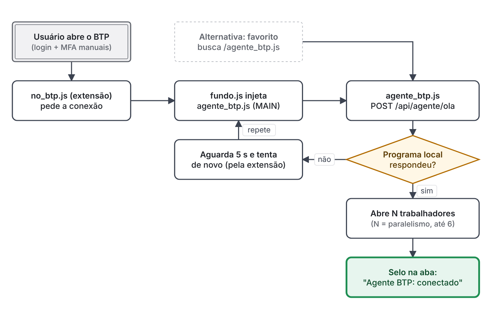


A extensão tem dois arquivos ativos. O `no_btp.js` roda em toda página do domínio do Launchpad e pede ao service worker que conecte; o `fundo.js` faz a injeção:


**Código-fonte — extensao/fundo.js · função injetar · linhas 26–36**

```javascript
  26  
  27  async function injetar(tabId, forcar) {
  28    const alvo = { tabId };
  29    if (!forcar) {
  30      const [s] = await chrome.scripting.executeScript({ target: alvo, world: 'MAIN', func: situacaoNaPagina });
  31      if (s && s.result !== 'livre') return s.result;
  32    }
  33    await chrome.scripting.executeScript({ target: alvo, world: 'MAIN', func: prepararNaPagina, args: [PROGRAMA] });
  34    await chrome.scripting.executeScript({ target: alvo, world: 'MAIN', files: ['agente_btp.js'] });
  35    return 'ok';
  36  }
```


A chave está na opção `world: 'MAIN'`: o script é colocado no mesmo ambiente de JavaScript da página do BTP — onde a sessão do usuário vale —, e não no ambiente isolado em que extensões normalmente rodam. Antes de injetar, a função verifica se a página já tem um agente ativo (`window.__btpAtivo`) ou se foi substituída por outra aba, para não injetar duas vezes. O endereço do programa (`http://127.0.0.1:8767`) é fixo dentro da extensão: nenhuma página consegue alterá-lo.

### 12.2 O que precisa ser descoberto

Para ler uma WO, o agente precisa de duas consultas:

1. **A lista**: qual endereço devolve as linhas do Monitor para uma WO (por exemplo, `Pendencias?$filter=workOrderID eq '{wo}'`).
2. **Os itens**: como, a partir de uma linha da lista, chegar aos itens da janela Mensagens (por exemplo, `UltimoRetornoView?$filter=consolidID eq '{linha[consolidID]}' and workOrderID eq '{linha[workOrderID]}' and status eq 'E'`).

Além disso, precisa saber o **nome técnico** de cada campo (material, fornecedor, quantidade faltante, mensagem). Tudo isso fica gravado em `config/api.json`, representado em Python pela classe `ApiConfig`:


**Código-fonte — agente_btp/config.py · ApiConfig · linhas 33–53**

```python
  33  @dataclass
  34  class ApiConfig:
  35      url_lista: str
  36      campo_consolidado_lista: str
  37      # Mensagens: consulta própria (url_mensagens), expandidas dentro da linha da lista,
  38      # link de navegação da própria linha (__deferred) ou texto JSON guardado num campo.
  39      url_mensagens: str | None
  40      campo_mensagens_expandidas: str | None
  41      campos: dict[str, str]
  42      campo_mensagens_link: str | None = None
  43      campo_mensagens_json: str | None = None
  44      # Releitura de UM item pela chave (auditoria independente). Ex.: /srv/Itens({linha[ID]})
  45      url_item: str | None = None
  46      chaves_item: list | None = None
  47      # Mensagem do ALERTA (coluna Mensagem do Monitor, ex.: "Erro durante baixa de estoque…")
  48      campo_mensagem_alerta: str | None = None
  49      # Qual mensagem vai para a planilha: "item" (janela Mensagens) ou "alerta" (lista do Monitor)
  50      mensagem_origem: str = "item"
  51      confirmada: bool = False
  52      # Campos vistos na resposta real do BTP: sem "quantidade ambígua" (ex.: quantidadeDoc)
  53      campos_confirmados: bool = False
```


Os marcadores `{wo}` e `{linha[Campo]}` nas URLs são **modelos**: a cada consulta, são substituídos pela WO e pelos valores da linha da lista, com a codificação correta (função `odata.preencher_modelo`, Capítulo 13).

### 12.3 A ordem de tentativa


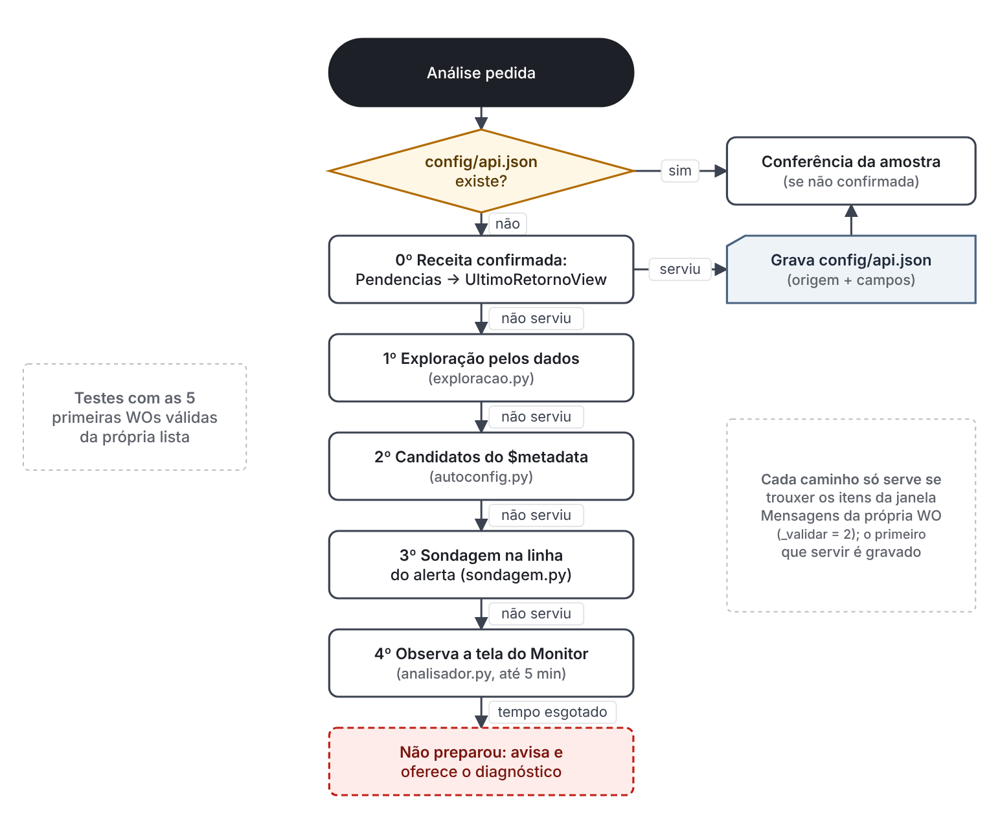


A preparação tenta caminhos em ordem e para no primeiro que servir. O teste é sempre feito com as **cinco primeiras WOs válidas da própria lista do usuário**:

| Ordem | Caminho | Módulo | Como funciona |
|---|---|---|---|
| 0º | **Receita confirmada** | `autoconfig.receita_monitor` | Se o serviço da aba tiver os conjuntos `Pendencias` e `UltimoRetornoView` com os campos esperados, usa o caminho confirmado no tráfego real da tela |
| 1º | **Exploração pelos dados** | `exploracao.py` | Consulta cada conjunto de dados que tem campo de WO e escolhe o que devolve registros parecidos com a janela Mensagens |
| 2º | **Dicionário de dados** | `autoconfig.candidatos` | Lê o `$metadata` (a descrição formal do serviço) e monta combinações plausíveis de lista + itens |
| 3º | **Sondagem na linha** | `sondagem.py` | A partir de uma linha real da lista, procura os itens num link de navegação, dentro da própria linha ou num campo JSON |
| 4º | **Observação da tela** | `analisador.py` | Pede ao usuário que abra a janela Mensagens no BTP e aprende com as consultas que a tela faz (até 5 minutos) |

::: termo
**`$metadata` (dicionário de dados).** Todo serviço OData publica, no endereço `<serviço>/$metadata`, um documento XML que descreve seus conjuntos de dados, campos, tipos e chaves. O agente descobre quais serviços a página usa lendo a configuração do SAPUI5 já carregada (`fontesDeDados` em `agente_btp.js`) e, então, lê o `$metadata` de cada um.
:::

### 12.4 A receita confirmada


**Código-fonte — agente_btp/autoconfig.py · receita_monitor · linhas 453–482**

```python
 453  def receita_monitor(servico: str, modelo: dict) -> dict | None:
 454      """Configuração exata da janela Mensagens, quando o serviço é o do Monitor de Alertas."""
 455      conj = modelo["conjuntos"]
 456      lista, msgs = conj.get("Pendencias"), conj.get("UltimoRetornoView")
 457      if not lista or not msgs:
 458          return None
 459      precisa = {"consolidID", "workOrderID"}
 460      if not precisa <= set(lista["props"]) or not (precisa | {"status"}) <= set(msgs["props"]):
 461          return None
 462      # Campos vistos na resposta real da janela (UltimoRetornoView): quantidade = "Quantidade
 463      # faltante" (vem como "1e+0"); quantidadeDoc é outra coisa e NÃO entra.
 464      confirmados = {"wo": "workOrderID", "material": "material", "fornecedor": "fornecedorID",
 465                     "quantidade_faltante": "quantidade", "mensagem": "mensagem", "consolidado": "consolidID"}
 466      if all(c in msgs["props"] for c in confirmados.values()):
 467          campos = dict(confirmados)
 468      else:   # versão diferente do serviço: reconhece pelos nomes (e a conferência na tela confirma)
 469          campos = mapear_por_nomes({k: v for k, v in msgs["props"].items() if k not in ("status", "consolidID")})
 470          campos.update(wo="workOrderID", consolidado="consolidID")
 471      alerta = mapear_por_nomes(lista["props"]).get("mensagem")
 472      return {
 473          "url_lista": f"{servico}Pendencias?$filter=workOrderID eq '{{wo}}'",
 474          "campo_consolidado_lista": "consolidID",
 475          "url_mensagens": (f"{servico}UltimoRetornoView?$filter=consolidID eq '{{linha[consolidID]}}'"
 476                            f" and workOrderID eq '{{linha[workOrderID]}}'"
 477                            f" and status eq '{STATUS_JANELA_MENSAGENS}'"),
 478          "campo_mensagens_expandidas": None,
 479          "campo_mensagem_alerta": alerta,
 480          "campos": campos,
 481          "campos_confirmados": campos.get("quantidade_faltante") == "quantidade" and campos.get("fornecedor") == "fornecedorID",
 482      }
```


::: leitura
- **Linhas 456–460** — a receita só se aplica se o serviço tiver os dois conjuntos e os campos `consolidID` e `workOrderID` (e `status` no conjunto de itens).
- **Linhas 462–465** — o mapeamento confirmado dos campos: `material`, `fornecedorID`, `quantidade`, `mensagem`. O comentário registra uma armadilha real: `quantidadeDoc` é outra coisa e **não** entra.
- **Linhas 473–477** — os modelos de URL. O filtro `status eq 'E'` é essencial: sem ele, vêm também linhas "Ok" que não aparecem na janela Mensagens (comentário na linha 449: "Sem o status 'E' vêm linhas 'Ok'").
- **Linha 481** — `campos_confirmados` marca que os nomes vieram da resposta real; com isso, a auditoria não considera a quantidade "ambígua" por existirem outros campos numéricos no registro.
:::

<span class="confirmado">CONFIRMADO</span> O comentário nas linhas 447–449 registra a origem da receita: "Confirmado pelas consultas da tela do BTP (DevTools, 15/10/2026): a janela 'Mensagens' do Monitor de Alertas lê UltimoRetornoView filtrando por consolidado + WO + status 'E' (erro)".

### 12.5 Como um caminho é validado

Nenhum caminho é aceito só porque "parece certo". A função `_validar` testa o caminho com as WOs da amostra e dá uma nota:


**Código-fonte — agente_btp/agente.py · Agente._validar · linhas 418–451**

```python
 418      def _validar(self, dados: dict, amostra: list[str], get, achados: dict) -> int:
 419          """2 = trouxe as mensagens da WO; 1 = nenhuma WO da amostra está na lista; 0 = não serve.
 420  
 421          Achar a WO na lista NÃO basta: se a lista traz o alerta e as mensagens vêm vazias,
 422          a ligação com a janela "Mensagens" está errada e o caminho é recusado.
 423          """
 424          try:
 425              cliente = ClienteBTP(cfg.a_partir_de_dict(dados), get)
 426          except ValueError:
 427              return 0
 428          com_alerta, falhas = 0, 0
 429          for wo in amostra:
 430              try:
 431                  alertas = cliente.buscar_alertas(wo)
 432                  if not alertas:
 433                      continue
 434                  com_alerta += 1
 435                  achados.setdefault(dados["url_lista"], (wo, alertas[0], dados))
 436                  mensagens = cliente.buscar_mensagens(alertas[0])
 437                  if mensagens:
 438                      linha = cliente.converter(wo, alertas[0], mensagens[0])
 439                      outras_wos = {str(v).strip() for v in mensagens[0].values()
 440                                    if isinstance(v, str) and wo_valida(v.strip())} - {wo}
 441                      if linha.wo != wo or outras_wos:   # mensagens de outra WO: ligação errada
 442                          return 0
 443                      return 2 if (linha.material or linha.mensagem) else 0
 444              except ErroConsulta:
 445                  return 0
 446              except FalhaComunicacao:
 447                  falhas += 1          # sem resposta não há como julgar: nunca conta como "lista vazia"
 448                  continue
 449              if com_alerta >= 2:                 # 2 WOs com alerta e nenhuma mensagem: caminho errado
 450                  return 0
 451          return 0 if (com_alerta or falhas) else 1
```


| Nota | Significado | Consequência |
|---|---|---|
| 2 | Trouxe os itens da própria WO (com material ou mensagem) | Caminho aceito e gravado |
| 1 | Nenhuma WO da amostra está na lista | Não há como julgar; guardado como "fraco" |
| 0 | Não serve (itens de outra WO, nenhum item em 2 WOs com alerta, erro) | Recusado |

As linhas 439–442 são uma proteção contra o pior erro possível — atribuir os itens de uma WO a outra: se os registros devolvidos contiverem um valor no formato de WO diferente da WO pedida, o caminho é recusado na hora.

### 12.6 A preparação em código


**Código-fonte — agente_btp/agente.py · Agente._preparar_com_wos · linhas 468–485**

```python
 468      def _preparar_com_wos(self, wos: list[str]) -> bool:
 469          """Testa os caminhos possíveis com as WOs do usuário; grava só o que trouxer as mensagens."""
 470          candidatos = self._candidatos or self._buscar_candidatos()
 471          amostra = [w for w in wos if wo_valida(w)][:5]
 472          get = self._transporte_com_cache(self.ponte.get)
 473          testes = self._diag.setdefault("dicionario", {}).setdefault("testes", [])
 474          # 0º) Caminho confirmado no BTP real (consultas da própria janela Mensagens).
 475          for servico, modelo in self._modelos:
 476              dados = receita_monitor(servico, modelo)
 477              if not dados or _rejeitada(dados):
 478                  continue
 479              nota = self._validar(dados, amostra, get, {})
 480              testes.append({"lista": dados["url_lista"], "nota": nota, "mensagens": dados["url_mensagens"],
 481                             "receita": "janela Mensagens (UltimoRetornoView, status E)"})
 482              if nota == 2:
 483                  self._gravar_config(dados, "receita_btp", ["Caminho da janela Mensagens confirmado no BTP real: "
 484                                                             "Pendencias -> UltimoRetornoView (status E)."])
 485                  return True
```


O trecho acima é o início da preparação: o "0º" passo, a receita. As linhas seguintes da mesma função (até a 562) seguem a ordem da tabela da seção 12.3. A função que coordena a preparação e a espera pela observação da tela é `_garantir_preparo`:


**Código-fonte — agente_btp/agente.py · Agente._garantir_preparo · linhas 984–1023**

```python
 984      def _garantir_preparo(self, wos: list[str]) -> bool:
 985          """Na primeira vez, prepara a conexão com o Monitor sem exigir nada técnico do usuário."""
 986          if cfg.ARQUIVO_CONFIG.exists():
 987              return True
 988          self._msg("Preparando a conexão com o Monitor de alertas (só na primeira vez)…")
 989          self._testados, self._achados, self._sondadas = set(), {}, set()
 990          self._explorados = set()
 991          self.ponte.iniciar_captura()
 992          try:
 993              if self._preparar_com_wos(wos):
 994                  return True
 995          except SessaoExpirada:
 996              self._definir(aviso="A sessão do BTP caiu. Faça login na aba e clique no favorito 'Agente BTP'.")
 997              return False
 998          limite = time.monotonic() + ESPERA_APRENDIZADO_SEG
 999          proxima_tentativa = time.monotonic() + 20
1000          while not self._parar.is_set():
1001              restante = int(limite - time.monotonic())
1002              if cfg.ARQUIVO_CONFIG.exists():
1003                  self._definir(aviso="")
1004                  return True
1005              if restante <= 0:
1006                  break
1007              self._definir(aviso=f"Ação necessária (uma única vez): na aba do BTP, filtre uma WO no Monitor de "
1008                                  f"alertas e abra a janela 'Mensagens'. A análise prossegue automaticamente. "
1009                                  f"({restante} s)")
1010              if time.monotonic() >= proxima_tentativa:   # o usuário pode ter acabado de abrir o Monitor
1011                  proxima_tentativa = time.monotonic() + 20
1012                  self._candidatos = []
1013                  try:
1014                      if self._preparar_com_wos(wos):
1015                          self._definir(aviso="")
1016                          return True
1017                  except SessaoExpirada:
1018                      break
1019              time.sleep(1)
1020          self._definir(aviso="Não foi possível identificar a origem das mensagens. Baixe o diagnóstico "
1021                              "(abaixo) e envie o arquivo para ajuste.")
1022          self._definir(fase="falhou")
1023          return False
```


Se nenhum caminho automático servir, a tela passa a mostrar, com contagem regressiva: "Ação necessária (uma única vez): na aba do BTP, filtre uma WO no Monitor de alertas e abra a janela 'Mensagens'". Enquanto isso, o script da aba observa as consultas da tela (ganchos instalados em `XMLHttpRequest` e `fetch`, função `instalarGanchos` de `agente_btp.js`), retirando antes cabeçalhos sensíveis como `cookie`, `authorization` e `x-csrf-token` (expressão `SENSIVEL`, linha 26 do script). A cada 20 segundos, a preparação tenta de novo — o usuário pode ter acabado de abrir o Monitor.

### 12.7 A conferência da amostra

Mesmo um caminho validado pode ser "parecido mas errado" — foi o que aconteceu duas vezes no BTP real (Capítulo 5). Por isso, antes do primeiro lote com uma fonte nova, o agente mostra ao usuário uma amostra real e só continua com a confirmação.


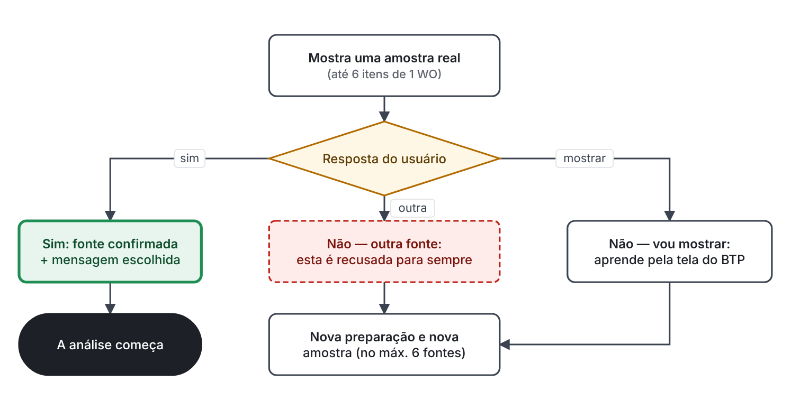


**Código-fonte — agente_btp/agente.py · Agente._confirmar_fonte · linhas 272–302**

```python
 272      def _confirmar_fonte(self, wos: list[str]) -> bool:
 273          """Antes do lote, mostra uma amostra REAL e só segue com a confirmação do usuário.
 274  
 275          Evita o erro de processar 499 WOs com uma tabela parecida mas errada: quem conhece a
 276          janela Mensagens confere uma vez; a fonte confirmada fica gravada para as próximas.
 277          """
 278          for _ in range(6):                      # no máximo 6 fontes diferentes por execução
 279              if not cfg.ARQUIVO_CONFIG.exists():
 280                  return False
 281              api = cfg.carregar()
 282              if api.confirmada:
 283                  return True
 284              if self._origem_config() != "receita_btp" and self._trocar_pela_receita(wos):
 285                  api = cfg.carregar()
 286              amostra = self._amostra_da_fonte(api, wos)
 287              self._resposta, self._resposta_fonte = None, threading.Event()
 288              self._definir(fase="confirmando", confirmacao=amostra, aviso="")
 289              self._msg("Aguardando a conferência da amostra na tela do agente.")
 290              self._resposta_fonte.wait(timeout=1800)
 291              resposta = self._resposta or {}
 292              self._definir(confirmacao=None)
 293              if self._parar.is_set() or not resposta:
 294                  self._definir(aviso="Análise não iniciada: a amostra não foi conferida.")
 295                  return False
 296              if resposta.get("resposta") == "sim":
 297                  dados = json.loads(cfg.ARQUIVO_CONFIG.read_text(encoding="utf-8"))
 298                  dados.update(confirmada=True, mensagem_origem=resposta.get("mensagem")
 299                               if resposta.get("mensagem") in ("item", "alerta", "ambas") else "item")
 300                  cfg.salvar(dados)
 301                  self._msg("Fonte de dados confirmada pelo usuário.")
 302                  self._definir(fase="preparando")
```


::: leitura
- **Linha 278** — no máximo 6 fontes diferentes por execução.
- **Linhas 284–285** — se a fonte gravada não for a receita confirmada e a receita servir para estas WOs, ela substitui a fonte antes da amostra.
- **Linhas 286–290** — lê a amostra, muda a fase para `confirmando` (a tela mostra o cartão "Confira a amostra antes de continuar") e espera a resposta por até 30 minutos.
- **Linhas 296–302** — "Sim": a fonte é gravada como confirmada, junto com a escolha de qual mensagem vai para a planilha (do item, do alerta ou as duas).
:::

Quando a resposta é "não", a fonte é **recusada para sempre**: sua assinatura vai para `config/fontes_recusadas.json` (função `_rejeitar`) e ela nunca mais é testada.

### 12.8 O Raio-X da fonte

Para quando os dados não batem com o BTP, a tela de Configurações oferece o **Raio-X da fonte**: o usuário informa uma WO cuja janela Mensagens ele conhece, e o agente consulta tudo o que o serviço tem para ela, ao mesmo tempo em que observa as consultas da tela enquanto o usuário abre a janela. O resultado é um arquivo JSON em `saidas/` (módulo `raiox.py`). Ele não altera a fonte; serve de evidência para ajuste.

## 13. Como o agente encontra e extrai as informações {#cap13}

### 13.1 A ideia

Extrair os dados de uma WO é repetir, por consulta de dados, o que o usuário faria na tela: filtrar a lista pela WO, pegar cada linha encontrada e abrir os itens dela. A diferença é que, em vez de ler uma tela, o agente lê registros estruturados — e confere que cada registro pertence de fato à WO pedida.

### 13.2 De onde vêm as WOs

As WOs vêm do campo de texto, de uma planilha ou dos dois. A leitura está em `agente_btp/entrada.py`:


**Código-fonte — agente_btp/entrada.py · normalizar_wo · linhas 11–17**

```python
  11  def normalizar_wo(valor) -> str:
  12      """Converte para texto sem alterar dígitos (preserva zeros à esquerda)."""
  13      if valor is None:
  14          return ""
  15      texto = str(valor).strip()
  16      # Tolera espaços ao redor da barra: "02235 | 230771207".
  17      return re.sub(r"\s*\|\s*", "|", texto)
```


**Código-fonte — agente_btp/entrada.py · ler_wos_planilha · linhas 30–60**

```python
  30  def ler_wos_planilha(caminho: str | Path) -> list[str]:
  31      """Lê as WOs de uma planilha, tolerando variações de layout.
  32  
  33      1. coluna cujo cabeçalho é exatamente 'WO' (em qualquer aba);
  34      2. senão, coluna cujo cabeçalho contém a palavra WO (ex.: 'Nº WO', 'WO Claro');
  35      3. senão, qualquer célula da planilha no formato de WO (5 dígitos|9 dígitos).
  36      """
  37      from openpyxl import load_workbook
  38  
  39      wb = load_workbook(caminho, read_only=True, data_only=True)
  40      try:
  41          abas = [list(ws.iter_rows(values_only=True)) for ws in wb.worksheets]
  42      finally:
  43          wb.close()
  44  
  45      for criterio in (lambda h: h == "WO", lambda h: re.search(r"\bWO\b", h) is not None):
  46          for linhas in abas:
  47              for num, linha in enumerate(linhas[:10]):          # cabeçalho nas 10 primeiras linhas
  48                  cab = [str(c).strip().upper() if c is not None else "" for c in linha]
  49                  indice = next((i for i, h in enumerate(cab) if criterio(h)), None)
  50                  if indice is not None:
  51                      wos = [normalizar_wo(l[indice]) for l in linhas[num + 1:] if indice < len(l)]
  52                      wos = [w for w in wos if w]
  53                      if wos:
  54                          return _sem_duplicadas(wos)
  55  
  56      encontradas = [normalizar_wo(c) for linhas in abas for linha in linhas for c in linha
  57                     if c is not None and PADRAO_WO.match(normalizar_wo(c))]
  58      if not encontradas:
  59          raise ValueError("Não encontrei WOs na planilha (formato esperado: 02235|230771207).")
  60      return _sem_duplicadas(encontradas)
```


::: leitura
A planilha é lida com tolerância a variações de formato, em três tentativas (linhas 33–35 do comentário): uma coluna com cabeçalho exatamente "WO"; senão, um cabeçalho que contenha a palavra WO ("Nº WO", "WO Claro"); senão, qualquer célula no formato `5 dígitos|9 dígitos`. O cabeçalho é procurado nas 10 primeiras linhas de cada aba. WOs repetidas contam uma vez (`_sem_duplicadas`), mantendo a ordem. A leitura é feita em modo somente leitura (`read_only=True, data_only=True`): valores, nunca fórmulas.
:::

WOs fora do formato não são descartadas em silêncio: elas entram na análise e saem no relatório como "Número de WO inválido" (função `_invalida` de `processador.py`).

### 13.3 Montando o endereço da consulta


**Código-fonte — agente_btp/odata.py · preencher_modelo · linhas 27–35**

```python
  27  def preencher_modelo(modelo: str, wo: str | None = None, linha: dict | None = None) -> str:
  28      """Substitui {wo} e {linha[Campo]} no modelo de URL, com os valores codificados."""
  29      base = quote(modelo, safe=_SEGUROS_MODELO)
  30      valores = {k: codificar_valor(v) for k, v in (linha or {}).items()
  31                 if not isinstance(v, (dict, list))}
  32      try:
  33          return base.format(wo=codificar_valor(wo) if wo is not None else "", linha=valores)
  34      except KeyError as exc:
  35          raise ErroConsulta(f"Campo {exc} ausente na linha do alerta.") from exc
```


A WO contém uma barra vertical (`|`), que não pode aparecer crua numa URL, e valores de dados podem conter aspas, que em OData precisam ser duplicadas. `codificar_valor` resolve as duas coisas: primeiro troca `'` por `''` (regra do OData), depois codifica todo caractere especial (`|` vira `%7C`). A WO `02235|230771207`, por exemplo, entra no filtro como `'02235%7C230771207'`.

### 13.4 A extração de uma WO, passo a passo


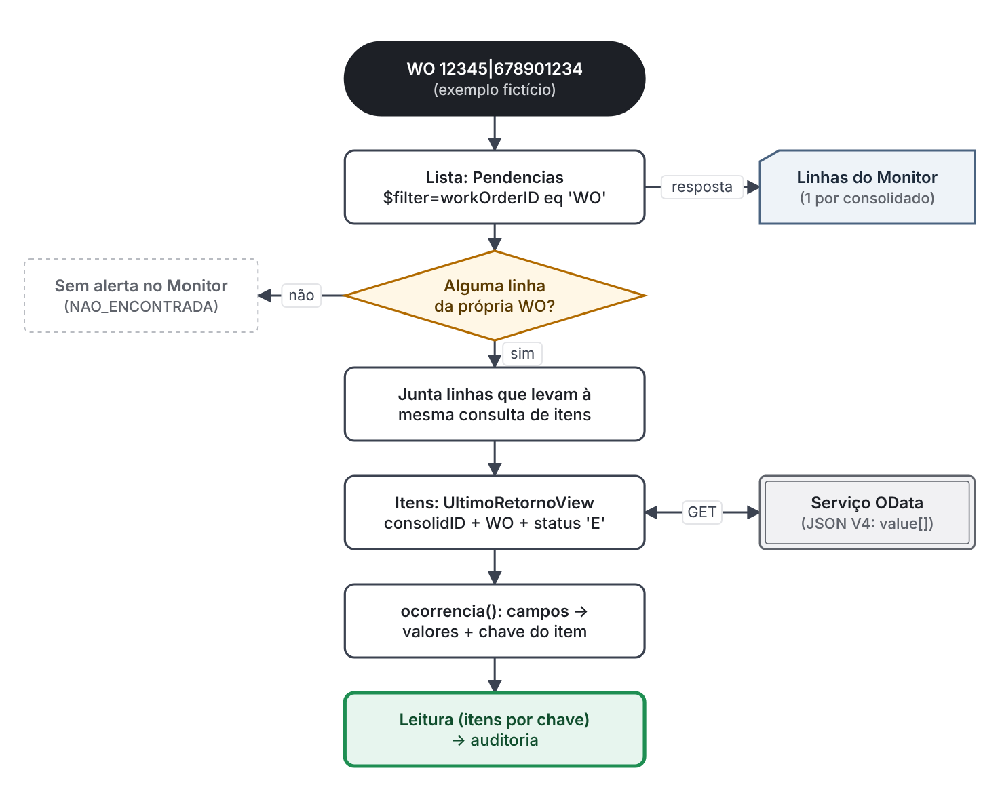


O método que lê uma WO é `ClienteBTP.ler_wo`, que busca a lista e entrega as linhas a `_montar`:


**Código-fonte — agente_btp/cliente.py · ClienteBTP._montar · linhas 287–331**

```python
 287      def _montar(self, wo: str, rodada: int, tipo: str, alertas: list[dict], mensagens_de) -> Leitura:
 288          """Monta a Leitura de UMA WO a partir das linhas da lista e das mensagens de cada linha.
 289          Usado igualmente pela leitura individual e pela leitura em lote (mesmas regras)."""
 290          leitura = Leitura(rodada, tipo)
 291          validos = []
 292          for a in alertas:
 293              lido = odata.como_texto(odata.obter_campo(a, self.campo_wo_lista)) if self.campo_wo_lista else ""
 294              if lido and lido != wo:
 295                  leitura.avisos.append(f"Linha da lista de outra WO ({lido}) descartada: o filtro não foi aplicado.")
 296                  continue
 297              validos.append(a)
 298          leitura.alertas = len(validos)
 299          validos = self._sem_consulta_repetida(validos, leitura)
 300          itens: dict = {}
 301          sem_chave = 0
 302          mesma_consulta = self.config.campo_mensagens_expandidas == "."   # cada linha já é um item
 303          vistos_no_alerta: dict[str, int] = {}
 304          for a in validos:
 305              if not mesma_consulta:
 306                  vistos_no_alerta = {}
 307              for m in mensagens_de(a):
 308                  o = self.ocorrencia(wo, a, m)
 309                  if o.valores["wo"] != wo:
 310                      leitura.avisos.append(f"Item de outra WO ({o.valores['wo']}) descartado.")
 311                      continue
 312                  if o.chave.startswith("conteudo:"):
 313                      # Sem chave do BTP: itens iguais DENTRO do mesmo alerta são itens distintos
 314                      # (numerados pela ordem); o mesmo item vindo de outra linha idêntica da lista
 315                      # recebe o mesmo número e aí sim é repetição.
 316                      sem_chave += 1
 317                      n = vistos_no_alerta.get(o.chave, 0) + 1
 318                      vistos_no_alerta[o.chave] = n
 319                      if n > 1:
 320                          o.chave = f"{o.chave}#{n}"
 321                  if o.chave in itens:
 322                      leitura.duplicadas += 1
 323                      continue
 324                  itens[o.chave] = o
 325          if sem_chave:
 326              leitura.avisos.append(f"{sem_chave} item(ns) sem chave no BTP: identificados pelo conteúdo "
 327                                    "(sem quantidade, mensagem ou data de alteração).")
 328          leitura.itens = itens
 329          if leitura.duplicadas:
 330              leitura.avisos.append(f"{leitura.duplicadas} item(ns) repetido(s) no retorno do BTP contado(s) uma vez.")
 331          return leitura
```


::: leitura
- **Linhas 292–297** — **proteção contra itens de outra WO**: cada linha da lista tem seu campo de WO conferido; se for de outra WO (o servidor ignorou o filtro), a linha é descartada e um aviso é registrado.
- **Linha 299** — `_sem_consulta_repetida`: linhas da lista que levariam à **mesma** consulta de itens (por exemplo, duas linhas da WO com o mesmo consolidado) são lidas uma vez só. Essa regra corrigiu, em 27/10, 157 WOs que apareciam com linhas duplicadas na planilha real (`docs/relatorio-correcao-raiz.md`, seção 11).
- **Linhas 307–311** — para cada item, `ocorrencia()` monta os valores; um item cuja WO não seja a pedida também é descartado.
- **Linhas 312–320** — sem chave técnica do BTP, o item é identificado pelo **conteúdo** (sem quantidade, mensagem ou data de alteração), para que uma mudança de quantidade apareça como divergência, e não como "item novo".
- **Linhas 321–323** — o mesmo item chegando duas vezes conta uma vez (`duplicadas`).
:::

### 13.5 De um registro do BTP a um item


**Código-fonte — agente_btp/cliente.py · ClienteBTP.ocorrencia · linhas 627–681**

```python
 627      def ocorrencia(self, wo: str, alerta: dict, mensagem: dict) -> Ocorrencia:
 628          campos = self.config.campos
 629  
 630          def campo(nome):
 631              return odata.obter_campo(mensagem, campos[nome]) if campos.get(nome) else None
 632  
 633          consolidado = campo("consolidado")
 634          if consolidado in (None, ""):
 635              consolidado = odata.obter_campo(alerta, self.config.campo_consolidado_lista)
 636          bruto = {k: v for k, v in mensagem.items()
 637                   if not k.startswith(("__", "@")) and not isinstance(v, (dict, list))}
 638          valores = {
 639              "wo": odata.como_texto(campo("wo")) if campos.get("wo") else wo,
 640              "material": odata.como_texto(campo("material")),
 641              "fornecedor": odata.como_texto(campo("fornecedor")),
 642              "quantidade_faltante": odata.como_quantidade(campo("quantidade_faltante")),
 643              "mensagem": odata.como_texto(campo("mensagem")),
 644              "consolidado": odata.como_texto(consolidado),
 645              "mensagem_alerta": odata.como_texto(odata.obter_campo(alerta, self.config.campo_mensagem_alerta))
 646                                 if self.config.campo_mensagem_alerta else "",
 647          }
 648          valores["mensagem_item"] = valores["mensagem"]
 649          if self.config.mensagem_origem == "alerta" and valores["mensagem_alerta"]:
 650              valores["mensagem"] = valores["mensagem_alerta"]
 651          elif (self.config.mensagem_origem == "ambas" and valores["mensagem"] and valores["mensagem_alerta"]
 652                and valores["mensagem_alerta"] != valores["mensagem"]):
 653              # As duas, sempre na mesma ordem: a do item (janela Mensagens) e a do alerta (lista do Monitor).
 654              valores["mensagem"] = f'{valores["mensagem"]} — Alerta: {valores["mensagem_alerta"]}'
 655          elif not valores["mensagem"] and valores["mensagem_alerta"]:
 656              valores["mensagem"] = valores["mensagem_alerta"]   # o item não tem texto próprio
 657          fonte = {c: campos[c] for c in ("wo", "material", "fornecedor", "quantidade_faltante", "mensagem")
 658                   if campos.get(c)}
 659          quantidades = campos_de_quantidade(bruto)
 660          outras = {} if self.config.campos_confirmados else {
 661              k: v for k, v in quantidades.items() if k != campos.get("quantidade_faltante")}
 662          # Evidência de alteração: só campo com nome de alteração E valor que é DATA de fato
 663          # ("alteradoPor", "motivoAlteracao"... não servem).
 664          tempo = next((str(v) for k, v in bruto.items()
 665                        if _MARCA_TEMPO.search(k) and odata.instante(v) is not None), None)
 666          chaves = self.config.chaves_item or []
 667          if chaves and all(bruto.get(k) not in (None, "") for k in chaves):
 668              chave = "|".join(f"{k}={bruto[k]}" for k in chaves)
 669          else:
 670              # Sem chave declarada: identifica pelo que NÃO muda quando o BTP atualiza o item —
 671              # sem quantidades, sem mensagem, sem campos de alteração — mais o alerta de origem.
 672              # Assim uma mudança de quantidade aparece como DIVERGÊNCIA, não como item novo.
 673              variaveis = set(quantidades) | {campos.get("mensagem")} | {
 674                  k for k in bruto if _MARCA_TEMPO.search(k)}
 675              identidade = {k: v for k, v in bruto.items() if k not in variaveis}
 676              origem = {k: v for k, v in alerta.items() if not k.startswith(("__", "@"))
 677                        and not isinstance(v, (dict, list)) and k not in variaveis
 678                        and k not in campos_de_quantidade(alerta)} if alerta is not mensagem else {}
 679              chave = "conteudo:" + hashlib.sha1(json.dumps([origem, identidade], sort_keys=True, default=str)
 680                                                  .encode()).hexdigest()[:12]
 681          return Ocorrencia(chave, valores, bruto, alerta, fonte, outras, tempo)
```


Esta função transforma um registro bruto (um dicionário com os nomes técnicos do BTP) num conjunto de **valores** com nomes do agente (`material`, `fornecedor`, `quantidade_faltante`, `mensagem`...). Três detalhes merecem atenção:

1. **Identificadores como texto** (`odata.como_texto`) e **quantidade como número exato** (`odata.como_quantidade`), explicados no Capítulo 14.
2. **A mensagem que vai para a planilha** depende da escolha feita na conferência (`mensagem_origem`): do item, do alerta ou as duas, no formato `"<item> — Alerta: <alerta>"`. O texto do item é sempre guardado à parte em `mensagem_item`, porque é por ele que o filtro "Estoque indisponível" funciona (Capítulo 15).
3. **A chave do item**: se o serviço declara chaves (por exemplo, `consolidID` e `zeile`), elas identificam o item; senão, um resumo do conteúdo (SHA-1) que exclui os campos que podem mudar.

### 13.6 A leitura em lote

Ler uma WO por vez custa pelo menos duas consultas por WO (lista + itens), multiplicadas pelas auditorias. Para volumes de milhares de WOs, o agente consulta **várias WOs numa só requisição**, unindo os filtros com `or`:


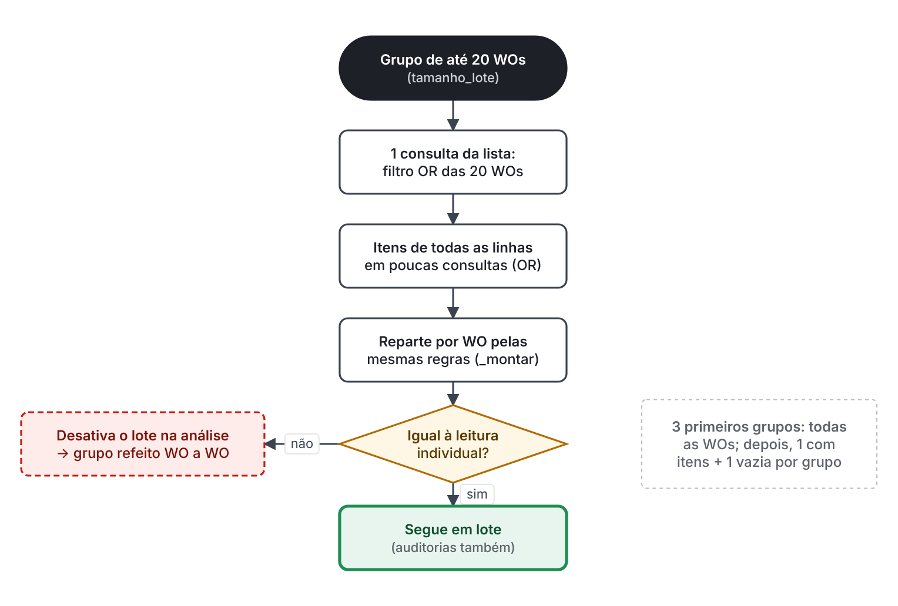


**Código-fonte — agente_btp/cliente.py · ClienteBTP.ler_lote · linhas 498–522**

```python
 498      def ler_lote(self, wos: list[str], rodada: int, tipo: str) -> dict[str, Leitura]:
 499          """Lê várias WOs com UMA consulta da lista (+ poucas de mensagens) e reparte por WO.
 500  
 501          O resultado de cada WO é montado pelas MESMAS regras da leitura individual (_montar).
 502          Linha devolvida que não é de nenhuma WO pedida => LoteInconsistente (refazer WO a WO)."""
 503          if not self.pode_ler_em_lote:
 504              raise LoteInconsistente("leitura em lote indisponível")
 505          pedidas = set(wos)
 506          por_wo: dict[str, list[dict]] = {w: [] for w in wos}
 507          for a in self._get(self._url_lista_lote(wos), "lote_lista"):
 508              lido = odata.como_texto(odata.obter_campo(a, self.campo_wo_lista))
 509              if lido not in pedidas:
 510                  raise LoteInconsistente(f"linha da lista de WO não pedida ({lido or 'vazio'})")
 511              por_wo[lido].append(a)
 512          todos = [a for w in wos for a in por_wo[w]]
 513          if self.config.url_mensagens and not self.config.campo_mensagens_expandidas \
 514                  and not self.config.campo_mensagens_link and not self.config.campo_mensagens_json:
 515              msgs = self._mensagens_em_lote(todos)
 516              indice = {id(a): i for i, a in enumerate(todos)}
 517  
 518              def mensagens_de(a):
 519                  return msgs[indice[id(a)]]
 520          else:
 521              mensagens_de = self.buscar_mensagens
 522          return {w: self._montar(w, rodada, tipo, por_wo[w], mensagens_de) for w in wos}
```


A resposta do lote precisa ser **repartida** por WO. Isso é feito pelas mesmas regras da leitura individual (o mesmo `_montar`). Se aparecer uma linha que não pertence a nenhuma WO pedida, a exceção `LoteInconsistente` é levantada e o grupo é refeito WO a WO.

Mas repartir corretamente não basta para confiar no lote: e se o servidor tratar o filtro com `or` de um jeito diferente? Por isso o processador **compara** a leitura em lote com leituras individuais da mesma WO:


**Código-fonte — agente_btp/processador.py · processar_grupo · linhas 258–294**

```python
 258          etapa(f"{len(validas)} WOs: extração inicial (consulta em lote)")
 259          base = lote(validas, 0, "Extração inicial")
 260          vazias = [w for w in validas if not base[w].itens and not base[w].alertas]
 261          if vazias and prefs.wo_sem_resultado == "reconsultar":
 262              _pausa(prefs.intervalo_auditorias_seg, prazo)
 263              base.update(lote(vazias, 0, "Extração inicial (reconsulta: 1ª leitura sem resultado)"))
 264          if verificar == "todas":
 265              alvos = list(validas)
 266          elif verificar:
 267              com_itens = [w for w in validas if base[w].itens]
 268              sem_itens = [w for w in validas if not base[w].itens]
 269              vez = cliente.cache.consultas
 270              alvos = [lista[vez % len(lista)] for lista in (com_itens, sem_itens) if lista]
 271          else:
 272              alvos = []
 273          for alvo in alvos:
 274              conferida = _com_retentativa(lambda a=alvo: cliente.ler_wo(a, 0, base[a].tipo), extras, prazo)
 275              if assinatura_leitura(conferida) != assinatura_leitura(base[alvo]):
 276                  raise LoteDivergente(alvo)
 277      except LoteDivergente as exc:
 278          detalhe = {"wo": str(exc)}
 279          if cliente.cache.desativar_lote("leitura em lote diferente da individual") and ao_lote_desativado:
 280              ao_lote_desativado("leitura em lote diferente da leitura individual", detalhe)
 281          cliente.prazo = None
 282          individual(validas)
 283          return [saida[w] for w in wos]
 284      except (LoteInconsistente, ErroConsulta, FalhaComunicacao, TempoEsgotado) as exc:
 285          # Lote recusado (URL longa, filtro, tempo...): menor nas próximas vezes; este grupo, WO a WO.
 286          if isinstance(exc, ErroConsulta) or getattr(exc, "motivo", "") == "timeout_lote":
 287              cliente.cache.reduzir_lote(len(validas))
 288              if not cliente.cache.lote_ativo and ao_lote_desativado:
 289                  ao_lote_desativado(str(exc), getattr(exc, "evidencia", {}))
 290          elif isinstance(exc, LoteInconsistente) and cliente.cache.desativar_lote(str(exc)) and ao_lote_desativado:
 291              ao_lote_desativado(str(exc), {})
 292          cliente.prazo = None
 293          individual(validas)
 294          return [saida[w] for w in wos]
```


::: leitura
- **Linhas 264–270** — quais WOs são conferidas: **todas** nos três primeiros grupos da análise (`verificar == "todas"`); depois, uma amostra de duas por grupo — uma com itens e uma sem —, em rodízio.
- **Linhas 273–276** — cada WO conferida é relida individualmente; se a "assinatura" (itens, valores, número de alertas) diferir da leitura em lote, `LoteDivergente` é levantada.
- **Linhas 277–283** — o lote é **desativado para a análise inteira**, o fato vai para o diagnóstico (`lote_desativado`) e o grupo é refeito WO a WO. O resultado continua exato; só fica mais lento.
- **Linhas 284–294** — outros problemas (URL longa demais, tempo esgotado no lote) reduzem o tamanho do lote pela metade nas próximas vezes; com tamanho 1, o lote é desativado.
:::

::: exemplo
Na execução real de 13.623 WOs descrita no diagnóstico enviado pelo usuário (Capítulo 1), o evento "Consulta em lote desativada nesta análise (leitura em lote diferente da leitura individual)" aparece um segundo depois do início. A análise seguiu WO a WO e terminou com 13.623 WOs validadas, a 5,27 WOs por segundo. Esse é exatamente o comportamento projetado: diante de qualquer diferença, o agente escolhe a exatidão em vez da velocidade.
:::

### 13.7 A extração inicial e as auditorias de uma WO

O fluxo completo de uma WO está em `processar_wo`:


**Código-fonte — agente_btp/processador.py · processar_wo · linhas 135–183**

```python
 135  def processar_wo(cliente: ClienteBTP, wo: str, prefs: Preferencias | None = None,
 136                   ao_etapa: Callable[[str], None] | None = None,
 137                   deve_parar: Callable[[], bool] | None = None) -> ResultadoWO:
 138      """Uma WO, do início ao fim, por consultas individuais. SessaoExpirada é propagada."""
 139      prefs = prefs or Preferencias()
 140      etapa = ao_etapa or (lambda texto: None)
 141      if not wo_valida(wo):
 142          return _invalida(wo)
 143      prazo = time.monotonic() + prefs.tempo_max_wo_seg
 144      cliente.prazo = prazo
 145      previstas = prefs.auditorias_por_wo
 146      extras = prefs.repeticoes_falha
 147  
 148      def ler(rodada, tipo):
 149          return _com_retentativa(lambda: cliente.ler_wo(wo, rodada, tipo), extras, prazo)
 150  
 151      # ---- Etapa A: extração inicial
 152      etapa(f"{wo}: extração inicial")
 153      try:
 154          base = ler(0, "Extração inicial")
 155          if not base.itens and not base.alertas and prefs.wo_sem_resultado == "reconsultar":
 156              _pausa(prefs.intervalo_auditorias_seg, prazo)
 157              base = ler(0, "Extração inicial (reconsulta: 1ª leitura sem resultado)")
 158      except TempoEsgotado:
 159          return ResultadoWO(wo, Status.TEMPO_ESGOTADO, auditoria=Auditoria.NAO_CONCLUIDO,
 160                             observacao=f"Tempo máximo da WO ({prefs.tempo_max_wo_seg:g} s) atingido na extração.",
 161                             rodadas_previstas=previstas)
 162      finally:
 163          cliente.prazo = prazo
 164      leituras = [base]
 165  
 166      # ---- Etapa B: auditorias
 167      estado = _estado_auditoria(cliente, prefs, base)
 168      for rodada in range(1, previstas + 1):
 169          if deve_parar and deve_parar():
 170              break
 171          _pausa(prefs.intervalo_auditorias_seg, prazo)
 172          tipo = _tipo_rodada(estado, rodada)
 173          etapa(f"{wo}: auditoria {rodada} de {previstas} ({tipo.lower()})")
 174          try:
 175              leituras.append(_ler_auditoria(cliente, wo, base, rodada, tipo, extras, prazo, estado))
 176          except TempoEsgotado:
 177              leituras.append(Leitura(rodada, tipo, erro=f"tempo máximo da WO ({prefs.tempo_max_wo_seg:g} s) atingido"))
 178              break
 179          except (FalhaComunicacao, ErroConsulta) as exc:
 180              leituras.append(Leitura(rodada, tipo, erro=str(exc)))
 181      r = _concluir(cliente, wo, leituras, prefs, prazo, estado, etapa, deve_parar)
 182      r.origem = "consulta individual"
 183      return r
```


::: leitura
- **Linhas 143–146** — cada WO tem um **prazo** próprio (`tempo_max_wo_seg`, padrão 180 s), que limita a soma de todas as suas consultas.
- **Linhas 151–157** — **etapa A**, a extração inicial. Se a primeira leitura não encontrar nada e a preferência `wo_sem_resultado` for "reconsultar" (padrão), lê de novo antes de concluir que a WO não está no Monitor.
- **Linhas 166–180** — **etapa B**, as auditorias. Cada rodada é uma leitura nova; se a preferência "auditorias independentes" estiver ligada e o serviço permitir, as rodadas pares releem cada item pelo seu endereço próprio (chave), um caminho diferente do da lista. Uma falha numa auditoria não derruba a WO: vira uma leitura com erro, e a auditoria fica "não concluída".
- **Linha 181** — **etapa C** (`_concluir`): comparação, leituras extras em caso de divergência e situação operacional da WO.
:::

A função `_com_retentativa` (usada em todas as leituras) repete uma consulta que falhou por rede ou tempo até `repeticoes_falha` vezes (padrão 2), com espera de 1, 2 e no máximo 5 segundos — sem ultrapassar o prazo da WO.

### 13.8 Como o agente sabe que a extração produziu algo utilizável

| Verificação | Onde | O que acontece se falhar |
|---|---|---|
| A resposta é JSON/OData válido | `odata.extrair_pagina` | `ErroConsulta` (`parse_falhou`) |
| A resposta não é página de login | `cliente.classificar` | `SessaoExpirada` |
| Cada linha da lista é da WO pedida | `ClienteBTP._montar` | Linha descartada, aviso registrado |
| Cada item é da WO pedida | `ClienteBTP._montar` | Item descartado, aviso registrado |
| A leitura em lote equivale à individual | `processar_grupo` | Lote desativado; grupo refeito WO a WO |
| As leituras repetidas concordam | `auditoria.consolidar` | Estado divergente (Capítulo 14) |
| Os quatro campos vieram preenchidos | `auditoria.consolidar` | Estado incompleto |
| Mais de 50 páginas de resultado | `ClienteBTP._get` | Consulta interrompida com erro |


## 14. Como o agente interpreta e organiza os dados {#cap14}

Extrair e interpretar não são a mesma coisa. Extrair é **obter** os registros do BTP; interpretar é **entender** o que eles dizem — converter textos em números, reconhecer campos, comparar leituras e decidir o que pode ser afirmado. Este capítulo trata da segunda parte.

### 14.1 O caminho de um valor


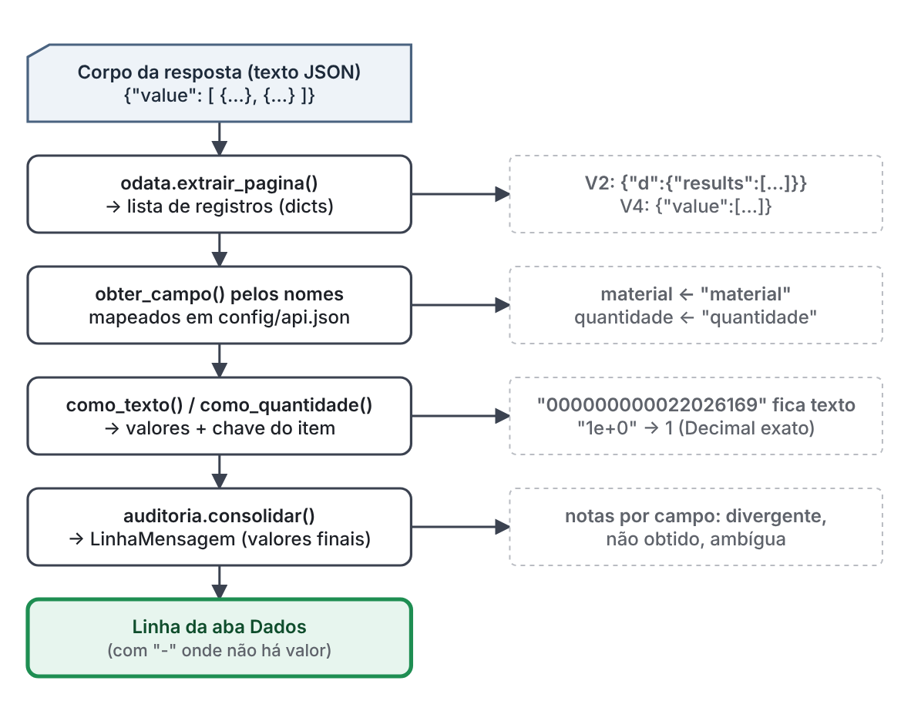


| Etapa | Dados recebidos | Transformação | Resultado | Onde |
|---|---|---|---|---|
| Leitura da resposta | Texto JSON devolvido pelo BTP | Interpretação do formato OData (V2 ou V4) e paginação | Lista de registros (dicionários) | `odata.extrair_pagina`, `ClienteBTP._get` |
| Reconhecimento dos campos | Registro com nomes técnicos | Leitura pelos nomes gravados em `config/api.json` | Valores com nomes do agente | `ClienteBTP.ocorrencia`, `odata.obter_campo` |
| Conversão | Valores brutos (texto, números) | Identificadores → texto; quantidade → número exato | `material`, `fornecedor`, `quantidade_faltante`... | `odata.como_texto`, `odata.como_quantidade` |
| Comparação | Leituras da mesma WO | Comparação por chave do item, campo a campo | Valores finais + notas + estado | `auditoria.consolidar` |
| Organização | Linhas finais de todas as WOs | Remoção de cópias, filtro de mensagem, preenchimento com "-" | Linhas da planilha | `exportacao._linhas_dados` |

### 14.2 Lendo a resposta OData


**Código-fonte — agente_btp/odata.py · extrair_pagina · linhas 42–71**

```python
  42  def extrair_pagina(corpo: str) -> tuple[list[dict], str | None]:
  43      """Aceita V2 ({d:{results:[...]}} ou {d:{...}}) e V4 ({value:[...]} ou entidade única).
  44  
  45      Devolve (registros, link da próxima página ou None).
  46      """
  47      try:
  48          dados = json.loads(corpo)
  49      except (json.JSONDecodeError, TypeError) as exc:
  50          raise ErroConsulta(f"Resposta não é JSON válido: {exc}") from exc
  51  
  52      if isinstance(dados, dict) and "error" in dados:
  53          mensagem = dados["error"].get("message")
  54          if isinstance(mensagem, dict):
  55              mensagem = mensagem.get("value")
  56          raise ErroConsulta(f"Serviço retornou erro: {mensagem}")
  57  
  58      if isinstance(dados, dict) and "d" in dados:
  59          d = dados["d"]
  60          if isinstance(d, dict) and "results" in d:
  61              return list(d["results"]), d.get("__next")
  62          if isinstance(d, list):
  63              return d, None
  64          return ([d] if isinstance(d, dict) else []), None
  65  
  66      if isinstance(dados, dict) and "value" in dados:
  67          return list(dados["value"]), dados.get("@odata.nextLink")
  68  
  69      if isinstance(dados, dict):
  70          return [dados], None
  71      raise ErroConsulta("Formato de resposta OData não reconhecido.")
```


A mesma função entende os dois formatos do padrão OData: a versão 2 envolve os registros em `{"d": {"results": [...]}}` e indica a próxima página em `__next`; a versão 4 usa `{"value": [...]}` e `@odata.nextLink`. Se o servidor devolver um objeto `error`, a função levanta `ErroConsulta` com a mensagem do próprio serviço. Se o texto nem for JSON, também.

A paginação é feita por `ClienteBTP._get`, que segue o link da próxima página até no máximo 50 páginas (`LIMITE_PAGINAS`). Um resultado maior que isso é interrompido com erro, em vez de seguir indefinidamente.

### 14.3 Identificadores como texto, quantidades como números exatos


**Código-fonte — agente_btp/odata.py · como_texto · linhas 84–88**

```python
  84  def como_texto(valor) -> str:
  85      """Identificadores são sempre texto: nada de float, nada de perder zero à esquerda."""
  86      if valor is None:
  87          return ""
  88      return str(valor).strip()
```


**Código-fonte — agente_btp/odata.py · como_quantidade · linhas 91–99**

```python
  91  def como_quantidade(valor):
  92      """OData entrega Edm.Decimal como string ("2.000"). Converte para número exato."""
  93      if valor is None or valor == "":
  94          return None
  95      try:
  96          numero = Decimal(str(valor).strip())
  97      except InvalidOperation:
  98          return None
  99      return int(numero) if numero == numero.to_integral_value() else numero
```


::: conceito
**Por que isso importa.** Um material `000000000022026169` lido como número vira `22026169` — os zeros somem e o código deixa de ser idêntico ao do BTP. Por isso todo identificador é **texto** (`como_texto`). Já a quantidade chega do serviço como texto em notação variada (`"2.000"`, `"1e+0"`). Converter para número de ponto flutuante (o tipo `float` comum) pode introduzir resíduos como `1.9999999`; por isso `como_quantidade` usa `Decimal`, um tipo numérico **exato**, e devolve um inteiro quando não há parte fracionária (`"1e+0"` vira `1`). Um valor que não é número vira `None` (vazio) — o agente não "chuta".
:::

### 14.4 A estrutura de dados central

Todos os módulos trocam informações por meio de algumas estruturas definidas em `agente_btp/modelos.py`. As duas classificações mais importantes são:


**Código-fonte — agente_btp/modelos.py · Status · linhas 16–26**

```python
  16  class Status(Enum):
  17      """Situação OPERACIONAL da WO no Monitor (independe da auditoria)."""
  18      PROCESSADA = "Com itens faltantes"
  19      SEM_REGISTROS = "Sem itens"
  20      NAO_ENCONTRADA = "Não consta no Monitor"
  21      WO_INVALIDA = "Formato inválido"
  22      SESSAO_EXPIRADA = "Sessão expirada"
  23      FALHA_COMUNICACAO = "Falha de comunicação"
  24      TEMPO_ESGOTADO = "Tempo esgotado"
  25      NAO_PROCESSADA = "Não processada"
  26      ERRO = "Erro"
```


**Código-fonte — agente_btp/modelos.py · Auditoria · linhas 34–40**

```python
  34  class Auditoria(Enum):
  35      """Resultado da AUDITORIA (fidelidade da extração)."""
  36      VALIDADO = "Validado"
  37      DIVERGENTE = "Divergente"
  38      INCOMPLETO = "Incompleto"
  39      NAO_CONCLUIDO = "Não concluído"
  40      NAO_APLICAVEL = "Não se aplica"   # WO inválida: nada a auditar
```


Elas respondem a perguntas **diferentes**, e é importante não misturá-las:

| Pergunta | Classificação | Exemplos |
|---|---|---|
| O que o Monitor diz sobre esta WO? | `Status` (situação operacional) | Com itens faltantes; Sem itens; Não consta no Monitor; Formato inválido |
| O quanto podemos confiar no que foi lido? | `Auditoria` (fidelidade) | Validado; Divergente; Incompleto; Não concluído |

Uma WO pode ser "Não consta no Monitor" e "Validado" ao mesmo tempo: significa que **todas** as leituras confirmaram que ela não tem alerta. Já uma WO "Com itens faltantes" e "Divergente" teve itens, mas algum valor mudou entre as leituras.

O resultado de cada item é uma `LinhaMensagem`:


**Código-fonte — agente_btp/modelos.py · LinhaMensagem · linhas 53–77**

```python
  53  @dataclass
  54  class LinhaMensagem:
  55      """Uma ocorrência de alerta, com os valores FINAIS (após a auditoria)."""
  56      consolidado: str
  57      wo: str
  58      material: str
  59      fornecedor: str
  60      quantidade_faltante: Decimal | int | None
  61      mensagem: str
  62      chave: str = ""
  63      auditoria: Auditoria = Auditoria.NAO_CONCLUIDO
  64      observacao: str = ""
  65      # Notas por campo (divergente, não obtido...), viram comentários na célula do Excel.
  66      notas: dict = field(default_factory=dict)
  67      # Mensagem do próprio item (janela Mensagens), mesmo quando a planilha usa a do alerta ou as duas.
  68      mensagem_item: str = ""
  69      # Mensagens do item vistas em TODAS as leituras (sem repetição): decide se o item vai para a
  70      # planilha mesmo quando a mensagem mudou entre leituras (ver exportacao.entra_na_planilha).
  71      mensagens_lidas: list = field(default_factory=list)
  72  
  73      def como_lista(self) -> list:
  74          return [self.wo, self.material, self.fornecedor, self.quantidade_faltante, self.mensagem]
  75  
  76      def valor(self, campo: str):
  77          return getattr(self, campo)
```


### 14.5 A auditoria: comparar para poder afirmar

A ideia da auditoria é simples: **ler mais de uma vez e só afirmar o que se repetiu**. Se a quantidade faltante de um material foi lida como 2 na extração e como 2 nas duas auditorias, o agente afirma "2" com segurança. Se foi lida como 1 e depois 4, o agente **não escolhe** — nem pela maioria, nem pela última leitura —, a menos que o próprio BTP explique a mudança.


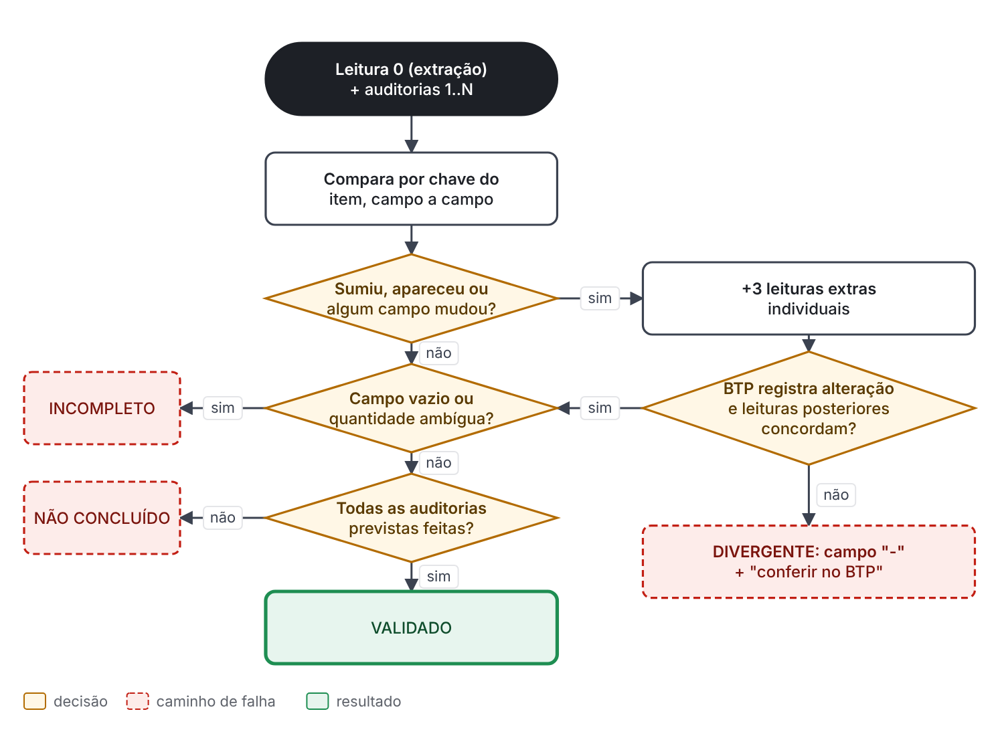


A decisão é tomada pela função `consolidar`. O coração dela é o laço por item:


**Código-fonte — agente_btp/auditoria.py · consolidar · linhas 99–163**

```python
  99      for chave in chaves:
 100          obs = list(_observacoes(chave, leituras))
 101          presentes = [(l, o) for l, o in obs if o is not None and o != "nao_relido"]
 102          if not presentes:
 103              continue
 104          ref = presentes[0][1]
 105          # Auditorias que de fato conferiram ESTA ocorrência ("não relido" não conta).
 106          feitas = sum(1 for l, o in obs if l.rodada > 0 and l.tipo != "Leitura extra" and o != "nao_relido")
 107          notas, motivos, divergente = {}, [], False
 108          ausencias = [l.rodada for l, o in obs if o is None]
 109          if ausencias or chave not in base.itens:
 110              divergente = True
 111              motivos.append(("Não estava na extração inicial; " if chave not in base.itens else "")
 112                             + (f"ausente na(s) rodada(s) {', '.join(map(str, ausencias))}" if ausencias else
 113                                f"apareceu na rodada {presentes[0][0].rodada}"))
 114          finais = {}
 115          for campo in CAMPOS:
 116              valores = [o.valores[campo] for _, o in presentes]
 117              if len({_texto(v) for v in valores}) == 1:
 118                  finais[campo] = valores[0]
 119                  continue
 120              divergente = True
 121              vistos = " / ".join(f"r{l.rodada}={_texto(o.valores[campo])}" for l, o in presentes)
 122              valor, explicacao = _resolver(presentes, campo)
 123              finais[campo] = valor
 124              notas[campo] = f"Divergente entre leituras: {vistos}." + (f" {explicacao}" if explicacao else
 125                                                                        " Não resolvida: revisar no BTP.")
 126              motivos.append(f"{ROTULO[campo]} divergente ({vistos})"
 127                             + (" — resolvida pelo registro de alteração" if explicacao else ""))
 128          # Mensagem do próprio item (janela Mensagens) em cada leitura. Conta mesmo quando a planilha
 129          # mostra a mensagem do alerta: é ela que decide se o item entra na planilha.
 130          lidas = list(dict.fromkeys(str(o.valores.get("mensagem_item", o.valores.get("mensagem")) or "")
 131                                     for _, o in presentes))
 132          if len(lidas) > 1 and "mensagem" not in notas:
 133              divergente = True
 134              vistos = " / ".join(f"r{l.rodada}={_texto(o.valores.get('mensagem_item', o.valores.get('mensagem')))}"
 135                                  for l, o in presentes)
 136              notas["mensagem"] = f"Divergente entre leituras (mensagem do item): {vistos}. Não resolvida: revisar no BTP."
 137              motivos.append(f"Mensagem do item divergente ({vistos})")
 138          incompleto = False
 139          for campo in CAMPOS:
 140              if campo not in notas and finais[campo] in (None, ""):
 141                  incompleto = True
 142                  notas[campo] = "Não obtido no BTP (campo vazio ou inexistente no registro)."
 143                  motivos.append(f"{ROTULO[campo]} não obtido")
 144          fonte_qtd = ref.fonte.get("quantidade_faltante", "")
 145          if ref.outras_quantidades and fonte_qtd and peso_nome("quantidade_faltante", fonte_qtd) <= 0:
 146              incompleto = True
 147              alternativas = ", ".join(f"{k}={_texto(v)}" for k, v in ref.outras_quantidades.items())
 148              notas.setdefault("quantidade_faltante",
 149                               f"Ambígua: lido de '{fonte_qtd}', mas o registro também tem {alternativas}.")
 150              motivos.append(f"Quantidade faltante ambígua ('{fonte_qtd}' x {alternativas})")
 151          if divergente:
 152              estado = Auditoria.DIVERGENTE
 153          elif incompleto:
 154              estado = Auditoria.INCOMPLETO
 155          elif feitas < previstas or previstas == 0:
 156              estado = Auditoria.NAO_CONCLUIDO
 157              motivos.append(f"{feitas} de {previstas} auditorias conferiram esta ocorrência" if previstas else
 158                             "Auditoria desativada nas configurações: apenas uma leitura")
 159          else:
 160              estado = Auditoria.VALIDADO
 161          if ref.outras_quantidades and estado is Auditoria.VALIDADO:
 162              motivos.append("Quantidade lida de '" + fonte_qtd + "'; outros campos de quantidade no registro: "
 163                             + ", ".join(f"{k}={_texto(v)}" for k, v in ref.outras_quantidades.items()))
```


::: leitura
- **Linhas 99–104** — para cada chave de item (de todas as leituras), reúne as observações; a primeira leitura em que o item aparece é a **referência**.
- **Linha 106** — conta quantas auditorias realmente conferiram este item (uma releitura por chave que não conseguiu reler o item não conta).
- **Linhas 108–113** — **item que sumiu ou apareceu** entre leituras: divergência.
- **Linhas 114–127** — **campo a campo**: se todas as leituras trazem o mesmo valor, ele é o valor final; se não, é divergência, e `_resolver` tenta explicá-la pelo registro de alteração do BTP. Sem explicação, o valor final fica **vazio** e a nota diz "Não resolvida: revisar no BTP".
- **Linhas 128–137** — **mensagem do item em todas as leituras**: o agente guarda a mensagem do item (janela Mensagens) vista em cada leitura (`mensagens_lidas`). Se ela mudou entre leituras, o item é divergente — inclusive quando a planilha mostra a mensagem do alerta. É essa lista que decide se o item vai para a planilha (Cap. 15.5).
- **Linhas 138–143** — **campo vazio**: se algum dos cinco campos não veio do BTP, o item é incompleto.
- **Linhas 144–150** — **quantidade ambígua**: se o registro tem outros campos de quantidade e o nome do campo usado não indica claramente "faltante", o item é incompleto — o agente se recusa a escolher.
- **Linhas 151–160** — a ordem de gravidade: divergente vence incompleto, que vence não concluído; só sem nenhum desses o item é **validado**.
:::

### 14.6 Quando o BTP explica a mudança


**Código-fonte — agente_btp/auditoria.py · _resolver · linhas 44–64**

```python
  44  def _resolver(obs: list, campo: str):
  45      """Tenta explicar a divergência pelo registro de alteração do próprio BTP.
  46  
  47      Exige: data de alteração REAL (não texto qualquer), datas que não voltam no tempo na ordem
  48      das leituras, e ≥ 2 leituras feitas DEPOIS da última alteração concordando entre si.
  49      """
  50      com_marca = [(l, o, instante(o.marca_tempo)) for l, o in obs
  51                   if o is not None and o != "nao_relido" and o.marca_tempo]
  52      if len(com_marca) < 3 or any(t is None for _, _, t in com_marca):
  53          return None, ""
  54      tempos = [t for _, _, t in com_marca]
  55      if any(b < a for a, b in zip(tempos, tempos[1:])) or len(set(tempos)) < 2:
  56          return None, ""                      # data voltou no tempo ou nunca mudou: não explica
  57      ultima = tempos[-1]
  58      inicio = tempos.index(ultima)            # primeira leitura já com a alteração mais recente
  59      depois = [o.valores[campo] for _, o, _ in com_marca[inicio:]]
  60      if len(depois) >= 2 and len({_texto(v) for v in depois}) == 1:
  61          return depois[-1], (f"Resolvida: o BTP registra alteração do item ({com_marca[0][1].marca_tempo} → "
  62                              f"{com_marca[inicio][1].marca_tempo}); valor atual confirmado em "
  63                              f"{len(depois)} leituras posteriores à alteração.")
  64      return None, ""
```


Uma divergência pode ter causa legítima: o item foi alterado no BTP durante a análise. `_resolver` só aceita essa explicação com evidência rigorosa: precisa haver um campo de data de alteração **real** (não um texto qualquer) em pelo menos três leituras, as datas não podem voltar no tempo e pelo menos **duas leituras feitas depois da última alteração** precisam concordar. Nesse caso, o valor atual é aceito e a planilha registra: "mudou no BTP durante a consulta (...); vale o valor atual". Os testes `test_divergencia_resolvida_pelo_registro_de_alteracao_do_btp`, `test_campo_que_nao_e_data_nao_serve_de_evidencia` e `test_data_que_volta_no_tempo_nao_resolve` verificam cada uma dessas condições.

### 14.7 Leituras extras em caso de divergência

Quando a primeira consolidação aponta divergência e a preferência "Diante de divergência" está em "Reconsultar e sinalizar" (padrão), `_concluir` (em `processador.py`) faz até `consultas_extras_divergencia` leituras adicionais (padrão 3) — sempre **individuais**, mesmo que a WO tenha sido lida em lote, para usar um caminho diferente. Depois, consolida de novo com todas as leituras. As leituras extras **nunca aprovam sozinhas**: elas entram na mesma comparação rigorosa. O teste `test_r4_divergencia_escalona_para_5_leituras_e_nunca_valida` verifica que uma quantidade que muda a cada leitura chega a 5 leituras e continua divergente.

### 14.8 A situação operacional da WO

Depois da auditoria, `_concluir` decide a situação da WO olhando **todas** as leituras, não só a primeira (que pode ter vindo vazia): se há itens, "Com itens faltantes"; se há linhas na lista mas nenhum item, "Sem itens"; se não há linha nenhuma, "Não consta no Monitor".

### 14.9 Do resultado ao estado gravado

A base local guarda um estado simplificado por WO, usado pela tela, pela retomada e pela planilha:


**Código-fonte — agente_btp/loja.py · estado_da_wo · linhas 78–87**

```python
  78  def estado_da_wo(r: ResultadoWO, filtro: str | None = None) -> str:
  79      """Estado gravado a partir do resultado (a mesma regra vale para a tela e para a planilha)."""
  80      r = visao_da_planilha(r, filtro)
  81      if r.status is Status.WO_INVALIDA or r.status in STATUS_FALHA:
  82          return "falha"
  83      if r.auditoria is Auditoria.VALIDADO:
  84          return "validada"
  85      if r.auditoria is Auditoria.DIVERGENTE:
  86          return "divergente"
  87      return "incompleta"
```


Antes de decidir, `estado_da_wo` aplica `visao_da_planilha`: com o filtro de mensagem ligado (padrão "Estoque indisponível"), só os itens que vão para a planilha contam. Uma divergência num item de outra mensagem — que só aparece na Observação — não torna a WO divergente. O motor passa o filtro ao gravar cada WO (`Loja.concluir`), e a coluna Status da planilha usa a mesma função; por isso tela, histórico e planilha mostram o mesmo estado (teste `test_status_da_planilha_ignora_divergencia_em_item_de_outra_mensagem`).


**Código-fonte — agente_btp/loja.py · visao_da_planilha · linhas 66–75**

```python
  66  def visao_da_planilha(r: ResultadoWO, filtro: str | None) -> ResultadoWO:
  67      """O resultado como a planilha o vê: só os itens com a mensagem do filtro (padrão "Estoque
  68      indisponível") contam para o estado. Divergência num item de outra mensagem (que só aparece na
  69      Observação) não torna a WO divergente. Sem filtro, falha ou sem itens: o próprio resultado."""
  70      if not filtro or not r.linhas or r.status is Status.WO_INVALIDA or r.status in STATUS_FALHA:
  71          return r
  72      from .exportacao import entra_na_planilha
  73      itens = [l for l in r.linhas if entra_na_planilha(l, filtro)]
  74      pior = max(itens, key=lambda l: GRAVIDADE[l.auditoria]).auditoria if itens else Auditoria.VALIDADO
  75      return replace(r, linhas=itens, auditoria=pior)
```


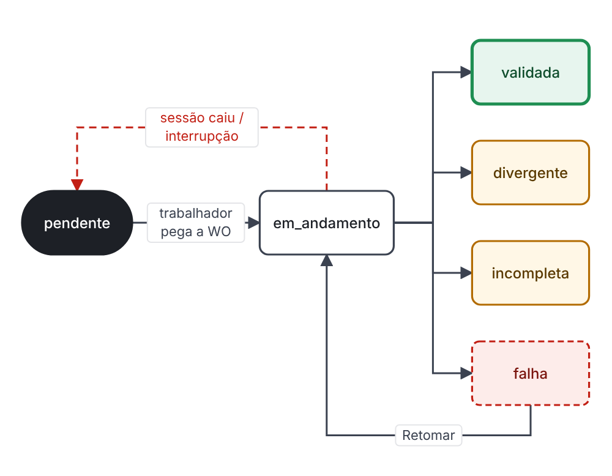


Toda WO não validada recebe também um **motivo** da taxonomia do diagnóstico (`loja.motivo_da_wo`): por exemplo, `campo_ausente:fornecedor`, `quantidade_ambigua`, `divergencia_persistente`, `timeout_wo`. O teste `test_toda_wo_nao_validada_tem_motivo_no_diagnostico` garante que nenhuma WO fica sem explicação.

### 14.10 Gravação transacional


**Código-fonte — agente_btp/loja.py · Loja.concluir · linhas 342–363**

```python
 342      def concluir(self, run_id: str, r: ResultadoWO, origem_dado: str = "", texto_log: str = "",
 343                   filtro: str | None = None) -> bool:
 344          """Grava o resultado de UMA WO e a linha de registro correspondente, juntos.
 345          Só grava WO que está em andamento (nunca sobrescreve uma concluída sem reprocessamento).
 346          `filtro`: mensagem dos itens da planilha — o estado gravado é o mesmo da coluna Status."""
 347          estado = estado_da_wo(r, filtro)
 348          motivo = motivo_da_wo(r, filtro)
 349          payload = zlib.compress(json.dumps(serializar(r), ensure_ascii=False).encode("utf-8"))
 350          agora = time.time()
 351          with self._trava:
 352              atual = self._q("SELECT status FROM wos WHERE run_id=? AND wo=?", (run_id, r.wo))
 353              if not atual or atual[0]["status"] != "em_andamento":
 354                  return False
 355              self._transacao([
 356                  ("UPDATE wos SET status=?, situacao=?, motivo=?, payload=?, hash_auditorias=?, origem_dado=?, "
 357                   "concluido_em=? WHERE run_id=? AND wo=? AND status='em_andamento'",
 358                   (estado, r.status.value, motivo, payload, hash_auditorias(r), origem_dado, agora, run_id, r.wo)),
 359                  ("INSERT INTO eventos(run_id, quando, tipo, texto, wo, status, motivo, categoria) "
 360                   "VALUES (?,?,?,?,?,?,?,?)",
 361                   (run_id, agora, "wo", texto_log, r.wo, estado, motivo, categoria(motivo) if motivo else "")),
 362              ])
 363          return True
```


::: leitura
- **Linha 349** — o resultado completo da WO é serializado em JSON e comprimido (`zlib`) antes de ir para a base: a planilha pode ser gerada depois sem consultar o BTP de novo.
- **Linhas 352–354** — só grava se a WO estiver **em andamento**. Uma WO já concluída nunca é sobrescrita por engano (por exemplo, por um trabalhador atrasado).
- **Linhas 355–362** — o resultado e a linha do registro de eventos são gravados **na mesma transação**: ou os dois entram, ou nenhum. Por isso contadores, registro e planilha nunca discordam (teste `test_r6_contadores_registro_e_planilha_concordam`).
:::

Quando a sessão cai, as WOs em andamento voltam a "pendente", nunca a "falha":


**Código-fonte — agente_btp/loja.py · Loja.devolver · linhas 365–370**

```python
 365      def devolver(self, run_id: str, wos: list[str], motivo: str) -> int:
 366          """Sessão caiu / interrupção: WOs EM ANDAMENTO voltam para pendente (não viram falha)."""
 367          passos = [("UPDATE wos SET status='pendente', motivo=? WHERE run_id=? AND wo=? AND status='em_andamento'",
 368                     (motivo, run_id, w)) for w in wos]
 369          self._transacao(passos)
 370          return len(passos)
```


### 14.11 Itens repetidos e itens que não vão para a planilha

Antes de virar linha, os itens de cada WO passam por duas organizações:

1. **Remoção de cópias idênticas** (`exportacao.itens_unicos`): o mesmo item que o BTP devolve mais de uma vez com dados idênticos vira uma linha só, com a observação "O BTP traz este item N vezes nesta WO". Nada é somado nem escolhido — as cópias são idênticas em tudo que vai para a planilha.
2. **Filtro da mensagem** (`exportacao.entra_na_planilha`): só itens cuja mensagem do item seja a configurada (padrão "Estoque indisponível") viram linha; os demais vão para a Observação da WO. O Capítulo 15 detalha.


**Código-fonte — agente_btp/exportacao.py · itens_unicos · linhas 144–155**

```python
 144  def itens_unicos(linhas: list[LinhaMensagem]) -> list[tuple[LinhaMensagem, int]]:
 145      """Itens da WO sem repetição: o MESMO item (material, fornecedor, quantidade, mensagem e
 146      conferência idênticos) que o BTP devolve mais de uma vez vira UMA linha, com a contagem.
 147      Nada é somado nem escolhido: as cópias são iguais em tudo que vai para a planilha."""
 148      vistos: dict[tuple, list] = OrderedDict()
 149      for l in linhas:
 150          chave = (l.wo, l.material, l.fornecedor, _txt(l.quantidade_faltante), l.mensagem, observacao_item(l))
 151          if chave in vistos:
 152              vistos[chave][1] += 1
 153          else:
 154              vistos[chave] = [l, 1]
 155      return [(l, n) for l, n in vistos.values()]
```


## 15. Como o agente produz o resultado final {#cap15}

### 15.1 A ideia

O resultado é uma planilha Excel que precisa ser, ao mesmo tempo, **fácil de usar** (filtrar, somar, ler) e **fiel** (cada valor igual ao que o BTP mostrava, sem zeros perdidos nem fórmulas acidentais). O agente atinge os dois objetivos gerando a planilha **sempre a partir da base local** e, logo depois, **reabrindo o arquivo para conferi-lo**.


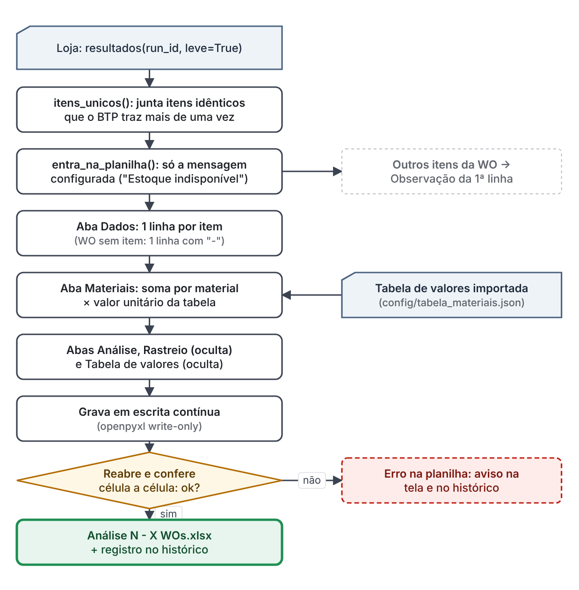


### 15.2 Quando a planilha é gerada

| Momento | Quem gera | Arquivo |
|---|---|---|
| Fim da análise | `Agente._rodar` → `_planilha` | `Análise N - X WOs.xlsx` |
| Durante a análise (botão "Baixar planilha parcial") | `planilha_parcial` | `Análise N - X WOs (parcial).xlsx` |
| Histórico → Baixar relatório | `regerar_relatorio` | Substitui o arquivo da análise, com as regras atuais |
| Retomada concluída | `_planilha` | Atualiza o mesmo arquivo da análise |


**Código-fonte — agente_btp/agente.py · Agente._planilha · linhas 898–925**

```python
 898      def _planilha(self, run_id, resultados, prefs, api, emitida_em, descricao, parcial=False):
 899          """Gera o Excel a partir da base (a qualquer momento). Devolve (arquivo, erro)."""
 900          ex = self.loja.obter(run_id)
 901          if parcial:
 902              destino = PASTA_SAIDAS / f"Análise {ex['numero']} - {ex['total']} WOs (parcial).xlsx"
 903          elif ex.get("arquivo"):
 904              destino = PASTA_SAIDAS / ex["arquivo"]       # retomada: atualiza o MESMO arquivo da análise
 905          else:
 906              destino = nome_analise(PASTA_SAIDAS, ex["numero"], ex["total"])
 907          try:
 908              tabela = materiais.carregar()      # tabela de valores vigente (Tipo Material e R$)
 909              arquivo = gerar_planilha(resultados, destino, numero=ex["numero"], emitida_em=emitida_em, origem=descricao,
 910                                       prefs=prefs, fonte_campos=api.campos,
 911                                       releitura_por_chave=bool(api.url_item and api.chaves_item), tabela=tabela)
 912              problemas = verificar_planilha(arquivo, resultados, prefs.exportar_incompletos, tabela,
 913                                             prefs.mensagem_planilha)
 914              if not parcial:
 915                  self.loja.definir_arquivo(run_id, arquivo.name)
 916              if problemas:
 917                  erro = "A conferência do Excel gravado encontrou diferenças: " + "; ".join(problemas[:5])
 918                  log.error(erro)
 919                  return arquivo, erro
 920              return arquivo, ""
 921          except Exception as exc:  # noqa: BLE001 — a análise feita não se perde (está na base)
 922              log.exception("Falha ao gerar o Excel")
 923              self.loja.problema(run_id, "excecao_app", diag_mod.evidencia(
 924                  erro=f"Excel: {exc}", origem=diag_mod.origem(exc), traceback=diag_mod.rastreio(exc)))
 925              return None, f"Erro ao gerar ou gravar o Excel: {exc}"
```


::: leitura
- **Linhas 901–906** — o nome do arquivo: parcial, o mesmo da análise (numa retomada) ou um novo, gerado por `nome_analise` (que nunca sobrescreve um arquivo existente: acrescenta "(2)", "(3)"...).
- **Linha 908** — carrega a tabela de valores vigente (Tipo Material e preços).
- **Linhas 909–913** — gera e, em seguida, **confere** o arquivo.
- **Linhas 916–919** — se a conferência encontrar diferenças, o erro é devolvido e aparece na tela e no histórico ("Erro na planilha").
- **Linhas 921–925** — se a geração falhar com exceção, ela é registrada no diagnóstico com o traceback; a análise **não se perde**, porque está na base e o relatório pode ser gerado de novo.
:::

### 15.3 A estrutura do arquivo


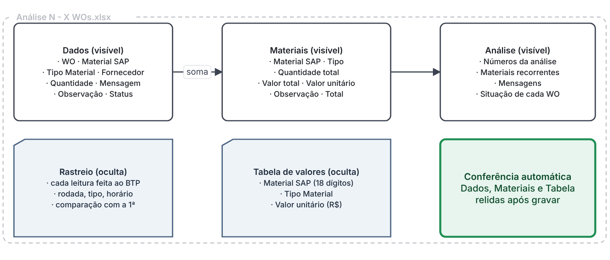


| Aba | Visível | Conteúdo |
|---|---|---|
| **Dados** | Sim | Uma linha por item faltante: WO, Material SAP, Tipo Material, Fornecedor SAP, Quantidade faltante, Mensagem, Observação, Status. WO sem item na planilha aparece numa linha com "-" e a explicação na Observação |
| **Materiais** | Sim | Uma linha por Material SAP, somando todas as WOs: Tipo Material, Quantidade total, Valor total (R$), Valor unitário (R$), Observação; e a linha **Total** |
| **Análise** | Sim | Números da análise, materiais mais recorrentes (com as WOs), mensagens e a situação de cada WO |
| **Rastreio** | Não (oculta) | Cada leitura feita ao BTP: WO, material, item, rodada, tipo, horário, valores e comparação com a 1ª leitura |
| **Tabela de valores** | Não (oculta) | A tabela de preços importada, com o material em 18 dígitos (como no BTP), para uso em fórmulas como PROCV |

### 15.4 As regras de preenchimento da aba Dados


**Código-fonte — agente_btp/exportacao.py · _linhas_dados · linhas 213–237**

```python
 213  def _linhas_dados(resultados, exportar_incompletos=True, tabela=None, filtro=FILTRO_PADRAO):
 214      """[(linha, destacar)]: destaca a Observação só quando há algo a conferir no BTP."""
 215      saida = []
 216      for r in resultados:
 217          estado = estado_rotulo(r, filtro)
 218          planilha, outros = _itens_da_wo(r, exportar_incompletos, filtro)
 219          extra = nota_outros(outros, filtro) if outros else ""
 220          for i, (l, n) in enumerate(planilha):
 221              conferir = observacao_item(l)
 222              obs = "; ".join(o for o in (conferir, NOTA_REPETIDO.format(n=n) if n > 1 else "",
 223                                          extra if i == 0 else "") if o)
 224              saida.append((_preencher([l.wo, l.material, _tipo(tabela, l.material), l.fornecedor,
 225                                        l.quantidade_faltante, l.mensagem, obs, estado]), bool(conferir)))
 226          if not planilha:
 227              obs = SITUACAO[r.status]
 228              if outros:
 229                  obs = f"Nenhum item com \"{filtro}\". " + extra
 230              elif r.linhas:   # havia itens, mas não validados e a exportação deles está desligada
 231                  obs = f"{len(r.linhas)} item(ns) com divergência omitido(s): conferir no BTP"
 232              elif r.status is Status.NAO_PROCESSADA:
 233                  obs = r.observacao or obs
 234              elif r.status in STATUS_FALHA and r.observacao and r.observacao != "OK":
 235                  obs = f"{obs} ({r.observacao})"
 236              saida.append((_preencher([r.wo, None, None, None, None, None, obs, estado]), False))
 237      return saida
```


::: leitura
- **Linha 218** — separa os itens da WO em "vão para a planilha" e "outros" (`_itens_da_wo`), já sem as cópias idênticas.
- **Linha 219** — os "outros" viram uma nota: "Outros itens no BTP, fora da planilha (mensagem diferente de "Estoque indisponível"): <material> (qtd N): <mensagem>; ...".
- **Linhas 220–225** — cada item vira uma linha. A Observação junta, nesta ordem: o que precisa ser conferido no BTP (`observacao_item`), a nota de repetição e — só na primeira linha da WO — a nota dos outros itens. O segundo valor da tupla (`bool(conferir)`) diz se a célula de Observação deve ser destacada em amarelo: só quando há algo a conferir.
- **Linhas 226–236** — WO sem nenhum item na planilha: uma linha com "-" nas colunas de item e a explicação (sem alerta no Monitor; nenhum item com a mensagem do filtro; falha de consulta com o motivo; pendente...).
- `_preencher` troca todo valor vazio por "-": nenhuma célula da aba Dados fica em branco.
:::

### 15.5 O filtro "Estoque indisponível"


**Código-fonte — agente_btp/exportacao.py · entra_na_planilha · linhas 184–196**

```python
 184  def entra_na_planilha(l: LinhaMensagem, filtro: str | None) -> bool:
 185      """Só itens com a mensagem configurada viram linha (comparação sem maiúsculas, acentos e espaços).
 186  
 187      Vale a mensagem do item em QUALQUER leitura: se ela mudou entre leituras e uma delas foi a do
 188      filtro, o item fica na planilha (sinalizado como divergente), nunca escondido na Observação.
 189      Mensagem que o BTP não informou (campo ausente) também fica: não dá para saber que não é."""
 190      if not filtro:
 191          return True
 192      alvo = _normalizar(filtro)
 193      lidas = l.mensagens_lidas or [mensagem_do_item(l)]
 194      if any(_normalizar(m) == alvo for m in lidas):
 195          return True
 196      return not any(lidas) and l.notas.get("mensagem", "").startswith("Não obtido")
```


**Código-fonte — agente_btp/exportacao.py · mensagem_do_item · linhas 176–181**

```python
 176  def mensagem_do_item(l: LinhaMensagem) -> str:
 177      """Mensagem do próprio item (janela Mensagens). Análises antigas não guardavam esse campo:
 178      no modo "item" ela é a mensagem gravada; no modo "as duas", o trecho antes de " — Alerta: "."""
 179      if l.mensagem_item:
 180          return l.mensagem_item
 181      return (l.mensagem or "").split(SEPARADOR_ALERTA, 1)[0]
```


::: nobtp
A comparação é feita com a **mensagem do item** (a da janela Mensagens), mesmo quando a planilha mostra a mensagem do alerta ou as duas — e com a mensagem de **todas** as leituras (`mensagens_lidas`, Cap. 14.5). Três situações:

- alguma leitura trouxe a mensagem do filtro → o item **entra**; se a mensagem mudou entre leituras, entra como **Divergente**, com a Observação "Mensagem diferente entre consultas (...): conferir no BTP". Um item de estoque nunca é escondido na Observação;
- o BTP não informou o campo de mensagem → o item **entra**, sinalizado: não há como saber que não é "Estoque indisponível";
- todas as leituras trouxeram outra mensagem, ou o item não tem mensagem própria → o item vai para a **Observação**.

A normalização (`_normalizar`) remove acentos, maiúsculas, espaços extras e pontuação final — "ESTOQUE INDISPONIVEL " entra; "Estoque insuficiente" não. A mensagem configurada vem da preferência `mensagem_planilha` (Configurações → Execução); vazia, todos os itens entram. Para análises antigas, que não guardavam as mensagens de cada leitura, vale a mensagem gravada; e as que nem guardavam a mensagem do item separadamente usam `mensagem_do_item`, que recupera o trecho anterior a " — Alerta: " (formato usado quando a opção era "as duas").
:::

::: exemplo
Medição feita sobre as linhas da planilha real de 13.623 WOs enviada pelo usuário (sem as cópias idênticas): 15.219 itens no total, dos quais **13.873** com "Estoque indisponível" ficam na planilha e **1.346** vão para a Observação. Entre as outras mensagens, as mais comuns eram "Os dados de centro do material ... estão bloqueados ..." e "Estoque insuficiente". Das 11.443 WOs com itens, 11.163 tinham só "Estoque indisponível", 37 eram mistas e 243 só tinham outras mensagens (essas viram uma linha "-" com a explicação). Fonte: `docs/relatorio-correcao-raiz.md`, seção 15.
:::

### 15.6 A aba Materiais e a tabela de valores


**Código-fonte — agente_btp/exportacao.py · linhas_materiais · linhas 261–297**

```python
 261  def linhas_materiais(itens: list[LinhaMensagem], tabela: TabelaMateriais | None) -> tuple[list[list], list]:
 262      """Aba Materiais: um material SAP por linha (todas as WOs juntas) e a linha de total.
 263  
 264      Quantidade total = soma da quantidade faltante dos itens CONFERIDOS (os mesmos da aba Dados,
 265      sem as cópias). Item não conferido ou sem quantidade fica fora da soma e é avisado.
 266      Valor total = quantidade total × valor unitário da tabela. Sem valor na tabela: "-"."""
 267      grupos: dict[str, list[LinhaMensagem]] = OrderedDict()
 268      for l in itens:
 269          if l.material:
 270              grupos.setdefault(chave_material(l.material), []).append(l)
 271      linhas = []
 272      for ls in grupos.values():
 273          somados = [l for l in ls if l.auditoria is Auditoria.VALIDADO and l.quantidade_faltante is not None]
 274          quantidade = sum((_decimal(l.quantidade_faltante) for l in somados), Decimal(0)) if somados else None
 275          achado = tabela.buscar(ls[0].material) if tabela else None
 276          unitario = achado.unitario if achado else None
 277          total = quantidade * unitario if quantidade is not None and unitario is not None else None
 278          obs = []
 279          if tabela is None:
 280              obs.append("Tabela de valores não importada (Configurações)")
 281          elif achado is None:
 282              obs.append("Material fora da tabela de valores")
 283          elif unitario is None:
 284              obs.append("Sem valor unitário na tabela de valores")
 285          fora = len(ls) - len(somados)
 286          if fora:
 287              obs.append(f"{fora} item(ns) não conferido(s) fora da soma: conferir no BTP")
 288          linhas.append(_preencher([ls[0].material, achado.tipo if achado else None,
 289                                    None if quantidade is None else _numero(quantidade),
 290                                    None if total is None else _numero(total),
 291                                    None if unitario is None else _numero(unitario), "; ".join(obs) + ("." if obs else "")]))
 292      linhas.sort(key=lambda l: (l[3] == SEM_INFO, -(l[3] if l[3] != SEM_INFO else 0), l[0]))
 293      sem_valor = sum(1 for l in linhas if l[3] == SEM_INFO)
 294      soma = sum((_decimal(l[3]) for l in linhas if l[3] != SEM_INFO), Decimal(0))
 295      total = _preencher(["Total", None, None, _numero(soma) if len(linhas) > sem_valor else None, None,
 296                          f"{sem_valor} material(is) sem valor ficaram fora do total." if sem_valor else None])
 297      return linhas, total
```


::: leitura
- **Linhas 267–270** — agrupa os itens pelo **número** do material (`chave_material`: `000000000022056365` e `22056365` são o mesmo material).
- **Linhas 273–274** — a quantidade total soma só os itens **validados** e com quantidade. Item não conferido fica fora da soma, e a Observação avisa ("1 item(ns) não conferido(s) fora da soma: conferir no BTP").
- **Linhas 275–277** — o valor unitário vem da tabela importada; o valor total é quantidade × unitário, calculado com `Decimal` (exato).
- **Linhas 279–284** — material fora da tabela, ou sem preço, ou tabela não importada: "-" e o motivo.
- **Linha 292** — ordena pelo maior valor total; materiais sem valor ficam no fim.
- **Linhas 293–296** — a linha Total soma os valores conhecidos e informa quantos materiais ficaram fora.
:::

A tabela de valores é importada em Configurações (rota `POST /api/materiais/tabela`). O módulo `materiais.py` procura no cabeçalho as colunas **Material**, **Texto breve material** (vira o Tipo Material) e **Unitário**, recusa a importação se o mesmo material aparecer com tipo ou valor diferentes e guarda o resultado em `config/tabela_materiais.json`, gravado de forma atômica (arquivo temporário + substituição).

### 15.7 Gravar sem interpretar


**Código-fonte — agente_btp/exportacao.py · _celula · linhas 527–543**

```python
 527  def _celula(ws, valor, fonte=None, fundo=None, alinhamento=None, borda=None, formato=None) -> WriteOnlyCell:
 528      """Uma célula gravada SEM interpretar nada: texto que começa com "=" fica texto (nunca
 529      fórmula); caracteres de controle que o .xlsx não aceita são removidos."""
 530      c = WriteOnlyCell(ws, value=_limpar(valor))
 531      if isinstance(c.value, str) and c.data_type == "f":
 532          c.data_type = "s"
 533      if fonte:
 534          c.font = fonte
 535      if fundo:
 536          c.fill = fundo
 537      if alinhamento:
 538          c.alignment = alinhamento
 539      if borda:
 540          c.border = borda
 541      if formato:
 542          c.number_format = formato
 543      return c
```


Duas proteções em poucas linhas:

1. Um texto que começa com `=` seria interpretado pelo Excel como **fórmula**. A linha 531 detecta esse caso e força o tipo "texto". O teste `test_texto_com_igual_e_controle_nao_vira_formula_nem_quebra` verifica com a mensagem `"=> Saldo insuficiente (-2)"`.
2. Caracteres de controle que o formato `.xlsx` não aceita (por exemplo, uma tabulação vertical vinda do BTP) derrubariam a gravação. `_limpar` os remove.

Além disso, as colunas de identificadores recebem o formato de célula `@` (texto), para que o Excel nunca converta o material num número.

### 15.8 Escrita contínua para volumes grandes

A planilha é gravada no modo *write-only* do openpyxl: cada linha vai direto para o arquivo, sem montar a planilha inteira na memória. A seção 6 de `docs/relatorio-correcao-raiz.md` mediu o efeito com 13.623 WOs: pico de memória de 1.487 MB para 387 MB, e a geração deixou de ter custo quadrático. O teste `test_excel_de_lote_grande_nao_e_quadratico` protege contra a volta do problema.

### 15.9 A conferência depois de gravar


**Código-fonte — agente_btp/exportacao.py · verificar_planilha · linhas 469–492**

```python
 469  def verificar_planilha(destino: str | Path, resultados: list[ResultadoWO],
 470                         exportar_incompletos: bool = True, tabela: TabelaMateriais | None = None,
 471                         filtro: str | None = FILTRO_PADRAO) -> list[str]:
 472      """Reabre o arquivo gravado e confere as abas Dados e Materiais, célula a célula."""
 473      esperadas = linhas_dados(resultados, exportar_incompletos, tabela, filtro)
 474      itens = itens_planilha(resultados, exportar_incompletos, filtro)
 475      mats, total = linhas_materiais(itens, tabela)
 476      # Somente leitura: lê célula a célula sem montar a planilha inteira na memória (13 mil WOs:
 477      # 3 MB em vez de ~840 MB) e ainda informa o TIPO de cada célula (fórmula = "f").
 478      wb = load_workbook(destino, read_only=True)
 479      try:
 480          if wb.sheetnames != ABAS:
 481              return [f"Abas fora da ordem esperada: {wb.sheetnames}"]
 482          problemas: list[str] = []
 483          dados = _ler_aba(wb[ABAS[0]], len(COLUNAS_DADOS), problemas)
 484          materiais = _ler_aba(wb[ABAS[1]], len(COLUNAS_MATERIAIS), problemas)
 485          tabela_gravada = _ler_aba(wb[ABAS[4]], len(COLUNAS_TABELA), problemas)
 486      finally:
 487          wb.close()
 488      problemas += _comparar("Dados", COLUNAS_DADOS, dados, esperadas)
 489      problemas += _comparar("Materiais", COLUNAS_MATERIAIS, materiais,
 490                             mats + ([[None] * len(COLUNAS_MATERIAIS), total]))
 491      problemas += _comparar("Tabela de valores", COLUNAS_TABELA, tabela_gravada, linhas_tabela(tabela))
 492      return problemas
```


A conferência recalcula, a partir dos mesmos resultados, o que **deveria** estar no arquivo e compara com o que **está** gravado, célula a célula, nas abas Dados, Materiais e Tabela de valores. Também acusa qualquer célula gravada como fórmula. O arquivo é aberto em modo somente leitura, que, segundo o comentário das linhas 476–477, reduziu a memória da conferência de cerca de 840 MB para 3 MB com 13 mil WOs. O teste `test_verificacao_detecta_excel_adulterado` altera uma célula do arquivo e confirma que a conferência acusa a diferença.

### 15.10 Como o usuário sabe que terminou e onde está o arquivo

A tela mostra o selo **Concluída** (ou "Concluída com ressalvas", "Concluída com divergências", "Interrompida"), a barra cheia — verde sem ressalvas, âmbar com ressalvas — e o botão **Baixar relatório auditado (.xlsx)**. O arquivo fica na pasta `saidas/` e é servido pela rota `GET /api/download/<nome>`, que só aceita arquivos de dentro dessa pasta (função `caminho_saida`, que recusa nomes com `../`).

### 15.11 O histórico

Cada análise é registrada em `historico/historico.json` desde o início (como "Em andamento") e atualizada ao final. A lista de WOs, que pode ter dezenas de milhares de itens, fica num arquivo próprio da análise (`historico/analises/<id>.json`), para que o histórico continue leve. A gravação é atômica e o histórico guarda até 300 análises (`LIMITE` em `historico.py`). O número da análise vem de `historico/contador.txt` e nunca se repete, mesmo depois de apagar o histórico.

## 16. O papel de cada função e módulo importante {#cap16}

Este capítulo reúne, em fichas, as funções que sustentam o funcionamento do agente. Cada ficha responde às mesmas perguntas, para facilitar a comparação. Os trechos de código correspondentes foram mostrados nos capítulos anteriores, indicados em cada ficha.

### 16.1 `Agente.enviar` e `Agente._laco` — a fila de comandos

| Pergunta | Resposta |
|---|---|
| Onde | `agente_btp/agente.py`, classe `Agente` (Cap. 10) |
| Responsabilidade | Receber comandos do servidor e executá-los um por vez, numa thread própria |
| Por que existe | Para o servidor responder imediatamente à tela e para nunca haver duas análises ao mesmo tempo |
| Como é acionada | Rotas como `/api/executar` chamam `enviar("executar", ...)`; `_laco` roda desde a inicialização |
| Recebe | Nome do comando e argumentos (lista de WOs, `run_id`...) |
| Produz | Atualizações no estado (`_estado`) que a tela lê |
| Chama | `_cmd_executar`, `_cmd_retomar`, `_cmd_refazer`, `_cmd_preparar`, `_cmd_raiox`, `_cmd_sondar` |
| Erros | Exceção num comando é registrada com traceback e mostrada na tela; o laço continua |
| Como verificar | Rotas retornam 409 ("já está executando") num segundo pedido; testes de `test_execucao.py` |
| Impacto de alterar | Afeta todos os comandos; mudar o momento em que `ocupado` é marcado reabre a corrida de cliques duplos |

### 16.2 `Agente._cmd_executar` e `Agente._rodar` — uma análise

| Pergunta | Resposta |
|---|---|
| Onde | `agente_btp/agente.py` |
| Responsabilidade | Garantir a fonte, confirmar a amostra, criar a análise na base, executar o motor, gerar a planilha e registrar o histórico |
| Por que existe | É o roteiro de uma análise do começo ao fim |
| Como é acionada | Comando "executar" (e "retomar"/"refazer", que reutilizam `_rodar`) |
| Recebe | Lista de WOs e descrição da origem ("250 WO(s) coladas + planilha lista.xlsx") |
| Usa | Preferências e fonte **gravadas na análise** — uma retomada usa as mesmas regras do início |
| Produz | Análise na base, planilha, registro no histórico, avisos na tela |
| Chama | `_garantir_preparo`, `_confirmar_fonte`, `Loja.criar`, `Motor.executar`, `_planilha`, `_registrar_historico` |
| Condições | Aba desconectada impede o início; fonte não confirmada pede a amostra |
| Erros | HTTP 404 em massa refaz a fonte; ≥ 90% das WOs sem itens refaz a fonte ("ligação errada") |
| Como verificar | `test_r2_retomar_so_refaz_o_que_falta_e_e_idempotente`; `test_lote_quase_todo_sem_registros_refaz_a_configuracao` |
| Impacto de alterar | É o ponto que costura tudo: mudanças aqui afetam tela, base, planilha e histórico |

### 16.3 `Motor.executar` — paralelismo e sessão

| Pergunta | Resposta |
|---|---|
| Onde | `agente_btp/motor.py` (Caps. 16 e 26) |
| Responsabilidade | Distribuir as WOs pendentes em grupos e trabalhadores, verificar a sessão e pausar/retomar |
| Por que existe | Isolar a lógica de execução concorrente e de sessão da lógica de cada WO |
| Recebe | Base, `run_id`, uma fábrica de clientes, preferências e funções de sonda e de conexão |
| Produz | Situação final: `concluida` ou `interrompida` |
| Chama | `processar_grupo`, `processar_wo_seguro`, `Loja.concluir`, `Loja.devolver`, a sonda |
| Condições | `concorrencia` (padrão 4) trabalhadores; `tamanho_lote` (padrão 20) WOs por grupo; sonda a cada 60 s ou 100 WOs |
| Erros | Sessão caída pausa; exceção inesperada vira falha do grupo com traceback; tempo máximo da análise interrompe |
| Como verificar | `test_r1_queda_no_meio_com_paralelismo_e_lote_nunca_vira_falha`; `rodar_sessao.py` (navegador) |
| Impacto de alterar | Afeta desempenho e a garantia de não perder WOs |


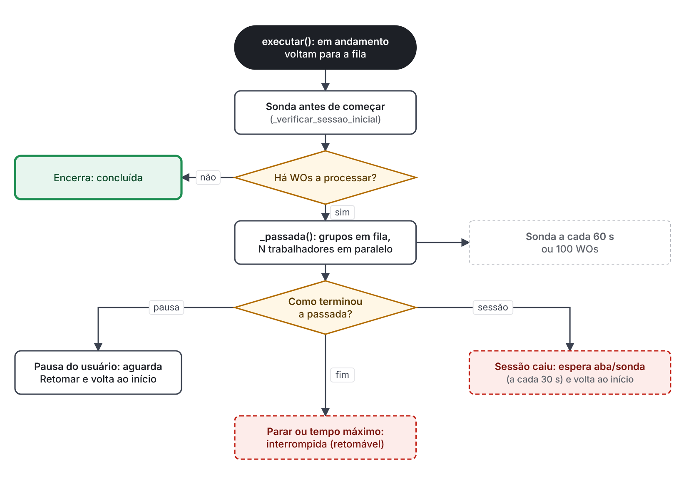


### 16.4 `processar_grupo` e `processar_wo` — uma WO do início ao fim

| Pergunta | Resposta |
|---|---|
| Onde | `agente_btp/processador.py` (Cap. 13) |
| Responsabilidade | Extração inicial, auditorias, leituras extras e situação da WO |
| Recebe | Cliente, WOs, preferências |
| Produz | `ResultadoWO` por WO |
| Chama | `ClienteBTP.ler_lote`, `ler_wo`, `reler`, `reler_lote`; `auditoria.consolidar` |
| Condições | Lote só com mais de uma WO válida e consulta repartível; verificação de equivalência |
| Erros | Falha de consulta vira resultado da WO (`processar_wo_seguro`); `SessaoExpirada` sobe para o motor |
| Como verificar | `test_r4_equivalencia_lote_paralelo_x_individual_serial_com_releitura_por_chave`; `test_tempo_maximo_da_wo_interrompe_as_auditorias` |
| Impacto de alterar | Afeta fidelidade e número de consultas |

### 16.5 `ClienteBTP` — as consultas

| Pergunta | Resposta |
|---|---|
| Onde | `agente_btp/cliente.py` (Caps. 11, 13) |
| Responsabilidade | Montar URLs, chamar o transporte (a ponte), classificar respostas, paginar, repartir lotes, reler por chave |
| Recebe | `ApiConfig`, função de transporte, tempos máximos, ritmo, cache |
| Produz | `Leitura` (itens por chave) ou exceções classificadas |
| Chama | `ponte.get` (transporte), `odata.*`, `classificar` |
| Erros | `SessaoExpirada`, `FalhaComunicacao`, `ErroConsulta`, `TempoEsgotado`, `LoteInconsistente` |
| Como verificar | `test_paginacao_segue_next`; `test_r3_deteccao_de_sessao_morta`; `test_linha_de_outra_wo_e_descartada_e_avisada` |
| Impacto de alterar | É a fronteira com o BTP: um erro aqui afeta todas as WOs |

### 16.6 `classificar` — o que significa cada resposta

| Pergunta | Resposta |
|---|---|
| Onde | `agente_btp/cliente.py` (Cap. 26) |
| Responsabilidade | Decidir se uma resposta é dado válido, sessão expirada, falha passageira ou erro |
| Recebe | `Resposta` (situação, tipo, corpo, redirecionado) e a URL |
| Produz | O corpo, ou uma exceção com motivo e evidência |
| Condições | Página HTML de login com situação 200 também conta como sessão expirada |
| Como verificar | `test_redirecionamento_e_sessao_expirada`; `test_r3_deteccao_de_sessao_morta` |
| Impacto de alterar | Classificar errado pode pausar sem motivo ou marcar falha onde era sessão |

### 16.7 `PonteAba` — a fila com a aba

| Pergunta | Resposta |
|---|---|
| Onde | `agente_btp/ponte.py` (Cap. 11) |
| Responsabilidade | Entregar consultas à aba e respostas a quem pediu; saber se a aba está conectada |
| Recebe | Consultas (`get`) e ciclos da aba (`ciclo`, `proxima_tarefa`, `entregar_resposta`) |
| Produz | `Resposta` para o cliente; tarefas para a aba |
| Erros | Aba que some: as tarefas entregues voltam para o início da fila (`_devolver_entregues`) |
| Como verificar | `test_ponte_com_varios_trabalhadores_na_aba_entrega_cada_resposta_a_quem_pediu`; `test_tarefa_entregue_a_aba_que_sumiu_volta_para_a_fila`; `test_aba_ocupada_com_consulta_lenta_nao_e_dada_como_desconectada` |
| Impacto de alterar | Afeta toda a comunicação; um erro de sincronização pode entregar resposta a quem não pediu |

### 16.8 `auditoria.consolidar` — a decisão

| Pergunta | Resposta |
|---|---|
| Onde | `agente_btp/auditoria.py` (Cap. 14) |
| Responsabilidade | Comparar leituras e decidir valores finais e estado |
| Recebe | Leituras de uma WO e o número de auditorias previstas |
| Produz | Linhas finais, estado da WO, observação, registros para a aba Rastreio |
| Condições | Divergência só é resolvida com evidência de alteração do BTP |
| Como verificar | `test_divergencia_de_quantidade_nao_e_aprovada_nem_por_maioria`; `test_quantidade_ambigua_nao_e_validada`; `test_item_nao_relido_nao_fica_validado` |
| Impacto de alterar | É a garantia de fidelidade do projeto; qualquer afrouxamento deixa passar valores errados |

### 16.9 `Loja` — a memória permanente

| Pergunta | Resposta |
|---|---|
| Onde | `agente_btp/loja.py` (Caps. 14, 26) |
| Responsabilidade | Guardar análises, WOs, eventos e problemas; responder contadores e retomada |
| Produz | Contadores da tela, lista do que retomar, resultados para a planilha, linha do tempo do diagnóstico |
| Erros | Transação falha é desfeita (ROLLBACK) e a exceção sobe |
| Como verificar | `test_programa_fechado_no_meio_retoma_de_onde_parou`; `test_serializacao_ida_e_volta_mantem_a_planilha` |
| Impacto de alterar | Mudar o esquema exige cuidado com bases já existentes nos computadores dos usuários (não há migração de esquema no código) |

### 16.10 `gerar_planilha` e `verificar_planilha` — o produto

| Pergunta | Resposta |
|---|---|
| Onde | `agente_btp/exportacao.py` (Cap. 15) |
| Responsabilidade | Gravar o Excel e conferi-lo |
| Recebe | Resultados (da base), destino, preferências, tabela de valores |
| Produz | Arquivo `.xlsx`; lista de diferenças (vazia = ok) |
| Condições | Filtro de mensagem; exportação de não validados (preferência `exportar_incompletos`) |
| Como verificar | `test_estrutura_completa_do_excel`; `test_planilha_so_com_estoque_indisponivel_e_outros_na_observacao`; `test_coluna_tipo_aba_materiais_e_tabela_oculta` |
| Impacto de alterar | Toda mudança de coluna exige atualizar `linhas_dados`, `verificar_planilha` e os testes juntos |

### 16.11 `Agente._garantir_preparo` e `_confirmar_fonte` — a fonte certa

| Pergunta | Resposta |
|---|---|
| Onde | `agente_btp/agente.py` (Cap. 12) |
| Responsabilidade | Descobrir a fonte e obter a confirmação do usuário |
| Recebe | WOs da análise (as 5 primeiras válidas servem de amostra) |
| Produz | `config/api.json` confirmado, ou falha com diagnóstico |
| Chama | `receita_monitor`, `Explorador`, `candidatos_pela_aba`, `sondar`, `analisar`, `_validar` |
| Como verificar | `test_isca_do_btp_real_nao_e_escolhida`; `test_fonte_nao_confirmada_e_trocada_pelo_caminho_confirmado_antes_da_amostra`; `test_lote_so_comeca_depois_da_conferencia_e_recusa_troca_a_fonte` |
| Impacto de alterar | Uma fonte errada invalida a análise inteira; por isso existe a conferência humana |

## 17. A relação entre os componentes {#cap17}

### 17.1 Quem depende de quem

A tabela foi gerada a partir das instruções `from .x import ...` de cada módulo (as importações internas do pacote):

| Módulo | Usa (importa) |
|---|---|
| `__main__` | agente, servidor |
| `servidor` | agente, config, entrada, historico, materiais, ponte, preferencias |
| `agente` | analisador, autoconfig, cliente, config, diagnostico, entrada, exploracao, exportacao, historico, loja, materiais, modelos, motor, odata, ponte, preferencias, raiox, sondagem |
| `motor` | cliente, diagnostico, loja, modelos, preferencias, processador |
| `processador` | auditoria, cliente, entrada, modelos, preferencias |
| `cliente` | campos, config, diagnostico, modelos, odata |
| `ponte` | cliente (só a classe `Resposta`), diagnostico, modelos |
| `auditoria` | campos, modelos, odata |
| `exportacao` | loja, materiais, modelos |
| `loja` | diagnostico, modelos |
| `odata` | modelos |
| `historico`, `materiais`, `preferencias` | config |
| `config`, `modelos`, `diagnostico`, `campos`, `entrada` | (nenhum módulo interno) |

### 17.2 Leitura da tabela

- **Quem inicia operações:** `__main__` (o processo), `servidor` (cada pedido HTTP) e `agente` (cada comando).
- **Quem fornece dados:** `cliente` (do BTP, via `ponte`), `entrada` (WOs do usuário), `materiais` (preços), `loja` (resultados gravados).
- **Quem transforma:** `odata` (formato), `auditoria` (decisão), `exportacao` (planilha).
- **Quem produz resultados:** `exportacao` (Excel), `historico` (lista de análises), `diagnostico` (explicações).
- **Componentes compartilhados por quase todos:** `modelos` (estruturas e exceções) e `diagnostico` (motivos). Alterar o nome de um motivo ou de um campo de `ResultadoWO` afeta muitos módulos e a base de dados.
- **Mais fáceis de substituir:** `historico` (um arquivo JSON) e `materiais` (uma tabela de consulta); a interface deles é pequena.
- **Mais delicados:** `cliente` e `auditoria` — o primeiro é a fronteira com o BTP; o segundo, a garantia de fidelidade.

### 17.3 O caminho de uma informação: a quantidade faltante de um material

::: exemplo
Dados fictícios. Suponha a WO `12345|678901234` com um item do material `000000000022056366`, quantidade faltante 1, mensagem "Estoque indisponível".

1. **BTP → aba.** O serviço `UltimoRetornoView` devolve o registro com `"quantidade": "1e+0"` (formato observado no serviço real, segundo o comentário de `receita_monitor`).
2. **Aba → ponte → cliente.** O script devolve o corpo como texto; a ponte o entrega ao cliente como `Resposta`.
3. **Cliente.** `classificar` aceita (200, JSON); `extrair_pagina` devolve o registro; `ocorrencia` lê `quantidade` (nome gravado na fonte) e `como_quantidade("1e+0")` devolve `1`.
4. **Processador.** O mesmo valor é lido de novo nas auditorias.
5. **Auditoria.** Três leituras com `1` → valor final `1`, estado **Validado**.
6. **Motor → loja.** O resultado é serializado e gravado na transação da WO.
7. **Exportação.** A linha entra na aba Dados (mensagem do item = "Estoque indisponível"); na aba Materiais, `1` soma-se às quantidades validadas do mesmo material em outras WOs e é multiplicado pelo valor unitário da tabela.
8. **Conferência.** `verificar_planilha` recalcula a linha e confirma que a célula gravada contém `1`.
:::

### 17.4 Onde uma mudança se propaga

| Se mudar... | Revise também | Por quê |
|---|---|---|
| Um campo de `LinhaMensagem` ou `ResultadoWO` | `loja.serializar`/`desserializar`, `exportacao`, testes | O resultado é gravado na base e lido para a planilha |
| Um motivo da taxonomia | `loja.motivo_da_wo`, `index.html` (rótulos), testes | Motivos aparecem na base, no diagnóstico e na tela |
| As colunas da aba Dados | `linhas_dados`, `verificar_planilha`, `COLUNAS_DADOS`, testes | A conferência compara coluna a coluna |
| O formato das tarefas da ponte | `ponte.py`, `agente_btp.js` e a cópia em `extensao/` | Os dois lados precisam falar o mesmo formato |
| A receita confirmada | `autoconfig.receita_monitor`, `VERSAO_CONFIG`, testes de preparo | Fontes antigas precisam ser descartadas |
| Uma preferência | `preferencias.py` (campo, faixa), `index.html` (`CONFIG`), testes | A tela gera o formulário a partir de `CONFIG` |


# Parte IV — Como o código é construído e alterado {#parte4}

As partes anteriores explicaram **o que** o agente faz e **em que ordem**. Esta parte ensina a **ler** e a **modificar** o código com segurança. Primeiro, os conceitos de programação necessários, sempre com exemplos do próprio projeto. Depois, a anatomia de trechos importantes que ainda não foram analisados. Por fim, dois roteiros práticos: como acrescentar uma funcionalidade e como alterar uma existente sem quebrar o resto.

## 18. Como ler o código do Agente BTP {#cap18}

O programa local é escrito em **Python** (pasta `agente_btp/`, 25 módulos `.py`). A parte que roda dentro da aba do BTP é escrita em **JavaScript** (`agente_btp/web/agente_btp.js`), e a tela é uma página **HTML** com JavaScript embutido (`agente_btp/web/index.html`). Este capítulo usa principalmente Python, porque é onde está quase toda a lógica.

### 18.1 Variáveis e constantes

::: termo
**Variável** é um nome que guarda um valor enquanto o programa roda — como uma etiqueta colada numa caixa. **Constante** é uma variável que, por convenção, nunca muda depois de definida. Em Python, constantes são escritas em MAIÚSCULAS.
:::

No Agente BTP, as constantes concentram os números que governam o comportamento:

| Constante | Arquivo | Valor | O que controla |
|---|---|---|---|
| `LIMITE_PAGINAS` | `cliente.py`, linha 41 | 50 | Máximo de páginas seguidas numa resposta paginada |
| `INTERVALO_SONDA_SEG` | `motor.py`, linha 30 | 60.0 | De quanto em quanto tempo a sessão é verificada |
| `SONDA_A_CADA_WOS` | `motor.py`, linha 31 | 100 | Verificação da sessão a cada 100 WOs concluídas |
| `REVERIFICAR_PAUSA_SEG` | `motor.py`, linha 32 | 30.0 | Intervalo de nova tentativa enquanto pausado por sessão |
| `GRUPOS_VERIFICADOS_POR_INTEIRO` | `motor.py`, linha 36 | 3 | Grupos de lote conferidos WO a WO contra a consulta individual |
| `LIMITE_TRABALHADORES_ABA` | `ponte.py`, linha 29 | 6 | Consultas simultâneas máximas dentro da aba |
| `VERSAO_CONFIG` | `config.py` | 6 | Versão mínima aceita da fonte gravada |
| `LIMITE` | `historico.py`, linha 17 | 300 | Análises guardadas no histórico |
| `FILTRO_PADRAO` | `exportacao.py`, linha 167 | "Estoque indisponível" | Mensagem padrão dos itens da planilha |

::: atencao
Mudar uma constante parece inofensivo, mas muitas delas estão amarradas a testes e a decisões documentadas. Por exemplo, aumentar `LIMITE_TRABALHADORES_ABA` faz a aba disparar mais consultas simultâneas ao BTP, o que pode provocar respostas HTTP 429 ("reduza o ritmo"). Antes de alterar, procure onde a constante é usada (Capítulo 21).
:::

### 18.2 Tipos de dados

Todo valor tem um **tipo**, que define o que se pode fazer com ele. Os tipos que aparecem o tempo todo no agente:

| Tipo | Exemplo no projeto | Por que importa |
|---|---|---|
| `str` (texto) | `"02235|230771207"` (uma WO), `"000000000022056366"` (um material) | Identificadores são **sempre** texto, para preservar zeros à esquerda (Cap. 14.3) |
| `int` (inteiro) | `concorrencia = 4` | Contagens e limites |
| `float` (número com vírgula) | `tempo_max_wo_seg = 180.0` | Tempos em segundos |
| `Decimal` (número exato) | quantidade faltante, valores em R$ | Evita erros de arredondamento do `float` |
| `bool` (verdadeiro/falso) | `exportar_incompletos = True` | Liga/desliga opções |
| `None` (vazio) | quantidade que não veio do BTP | O agente usa `None` para dizer "não sei", em vez de inventar um valor |
| `list` (lista) | lista de WOs | Coleção ordenada |
| `dict` (dicionário) | registro devolvido pelo BTP: `{"material": "...", "quantidade": "1e+0"}` | Pares nome → valor |

O código usa **anotações de tipo**, que não mudam o comportamento, mas documentam a intenção. Em `def normalizar_wo(valor) -> str:` (`entrada.py`, linha 11), a seta `-> str` informa que a função devolve um texto. Em `quantidade_faltante: Decimal | int | None` (`modelos.py`, linha 60), a barra `|` significa "ou": o campo pode ser um número exato, um inteiro ou vazio.

### 18.3 Condições

Uma **condição** escolhe um caminho conforme uma pergunta de sim ou não. É o `if` (se), `elif` (senão, se) e `else` (senão). O exemplo mais importante do projeto é a decisão do estado de um item na auditoria (`auditoria.py`, linhas 151–160, mostrado no Capítulo 14):

```python
if divergente:
    estado = Auditoria.DIVERGENTE        # mais grave primeiro
elif incompleto:
    estado = Auditoria.INCOMPLETO
elif feitas < previstas or previstas == 0:
    estado = Auditoria.NAO_CONCLUIDO
else:
    estado = Auditoria.VALIDADO          # só chega aqui se nada acima for verdade
```

A **ordem** das perguntas é a regra de negócio: divergência pesa mais que falta de dado, que pesa mais que conferência incompleta. Trocar a ordem das linhas mudaria o significado do resultado.

### 18.4 Repetições

Uma **repetição** (laço) executa o mesmo bloco várias vezes. Em Python há duas formas:

- `for item in colecao:` — percorre cada elemento. Ex.: `for campo in CAMPOS:` compara os cinco campos de um item, um de cada vez (`auditoria.py`, linha 115).
- `while condição:` — repete enquanto a condição for verdadeira. Ex.: `while not self._parar.is_set():` mantém a espera da sessão até o usuário parar (`motor.py`, linha 300).

Há também a **compreensão de lista**, uma forma compacta de montar uma lista a partir de outra. Em `_preencher` (`exportacao.py`, linha 159):

```python
return [SEM_INFO if v is None or v == "" else v for v in valores]
```

Lê-se: "para cada `v` em `valores`, coloque `"-"` se `v` estiver vazio; senão, o próprio `v`". É assim que nenhuma célula da aba Dados fica em branco.

### 18.5 Funções, parâmetros e retornos

Uma **função** é um bloco com nome que recebe informações (**parâmetros**), faz um trabalho e devolve um resultado (**retorno**). A função mais simples e didática do projeto:


**Código-fonte — agente_btp/entrada.py · normalizar_wo · linhas 11–17**

```python
  11  def normalizar_wo(valor) -> str:
  12      """Converte para texto sem alterar dígitos (preserva zeros à esquerda)."""
  13      if valor is None:
  14          return ""
  15      texto = str(valor).strip()
  16      # Tolera espaços ao redor da barra: "02235 | 230771207".
  17      return re.sub(r"\s*\|\s*", "|", texto)
```


- `valor` é o parâmetro: o que veio da planilha ou do texto colado.
- `return ""` encerra a função cedo quando não há valor.
- `str(valor).strip()` converte para texto e tira espaços das pontas; `re.sub(...)` remove espaços ao redor da barra.
- O retorno é o texto da WO, **sem alterar nenhum dígito**.

Parâmetros podem ter **valor padrão**. Em `Loja.concluir(self, run_id, r, origem_dado: str = "", texto_log: str = "")`, quem chama pode omitir os dois últimos.

### 18.6 Importações e módulos

Um **módulo** é um arquivo `.py`. Um módulo usa outro por meio de `import`. Há dois tipos no projeto:

- **Da biblioteca padrão ou de terceiros:** `import json`, `from openpyxl import Workbook`.
- **Internas do pacote:** `from .modelos import Status` — o ponto inicial significa "deste mesmo pacote" (`agente_btp`).

A matriz de importações internas está no Capítulo 17. Ela é o melhor mapa para responder "se eu mudar este arquivo, quem pode ser afetado?".

### 18.7 Classes e objetos

Uma **classe** é um molde; um **objeto** é algo construído a partir do molde. O projeto usa classes de três maneiras:

1. **Estruturas de dados** com `@dataclass`, que gera automaticamente o código de criação. `Preferencias` (`preferencias.py`, linhas 21–45) é uma ficha com todos os campos das Configurações e seus padrões.
2. **Enumerações** (`Enum`): listas fechadas de valores possíveis. `Status` e `Auditoria` (`modelos.py`) garantem que ninguém escreva "Validdo" por engano — só existem os valores declarados.
3. **Componentes com estado**: `Agente`, `Motor`, `PonteAba`, `ClienteBTP`, `Loja`. Cada objeto guarda informações próprias (`self.loja`, `self.prefs`...) e oferece **métodos** (funções da classe). `self` é o próprio objeto.

### 18.8 Exceções

Uma **exceção** é a forma de um trecho de código avisar "não consegui continuar" — ela interrompe o caminho normal e sobe até alguém que a trate com `try`/`except`. O agente define sua própria família de exceções:


**Código-fonte — agente_btp/modelos.py · família de exceções do agente · linhas 133–161**

```python
 133  class _ComMotivo(Exception):
 134      """Exceção com MOTIVO classificado (taxonomia do diagnóstico) e EVIDÊNCIA da 1ª observação
 135      (URL, status HTTP, tipo e trecho do corpo da resposta — sem cookies nem tokens)."""
 136      motivo_padrao = "excecao_app"
 137  
 138      def __init__(self, mensagem: str = "", motivo: str | None = None, evidencia: dict | None = None):
 139          super().__init__(mensagem)
 140          self.motivo = motivo or self.motivo_padrao
 141          self.evidencia = dict(evidencia or {})
 142  
 143  
 144  class SessaoExpirada(_ComMotivo):
 145      """A sessão autenticada não é mais válida (redirecionou ao SSO, 401, 403, HTML de login)."""
 146      motivo_padrao = "sessao_expirada"
 147  
 148  
 149  class FalhaComunicacao(_ComMotivo):
 150      """Timeout de uma consulta, erro de rede, HTTP 429 ou 5xx (pode ser repetida)."""
 151      motivo_padrao = "falha_rede"
 152  
 153  
 154  class ErroConsulta(_ComMotivo):
 155      """Resposta inesperada do serviço (HTTP 4xx, JSON inválido etc.)."""
 156      motivo_padrao = "consulta_rejeitada"
 157  
 158  
 159  class TempoEsgotado(_ComMotivo):
 160      """O tempo máximo da WO (ou do lote) acabou; não adianta repetir."""
 161      motivo_padrao = "timeout_wo"
```


::: leitura
- `_ComMotivo` (linhas 133–141) é a "mãe": toda exceção do agente carrega um **motivo** (um código da taxonomia do diagnóstico, como `http_403`) e uma **evidência** (URL, situação HTTP, trecho da resposta, já sem segredos).
- As quatro filhas dizem **o que fazer** com o problema: `SessaoExpirada` pausa a análise; `FalhaComunicacao` pode ser repetida; `ErroConsulta` não adianta repetir; `TempoEsgotado` encerra a WO.
- Herança (`class SessaoExpirada(_ComMotivo)`) significa "é um tipo de". Um `except _ComMotivo` captura todas as quatro.
:::

### 18.9 Estruturas de dados centrais

| Estrutura | Arquivo | Representa |
|---|---|---|
| `Ocorrencia` | `modelos.py`, 81–89 | Um item lido numa leitura (valores + registro bruto) |
| `Leitura` | `modelos.py`, 93–106 | Uma rodada de leitura de uma WO (extração, auditoria, extra) |
| `LinhaMensagem` | `modelos.py`, 54–77 | Um item com os valores **finais** após a auditoria |
| `ResultadoWO` | `modelos.py`, 110–130 | Tudo sobre uma WO: situação, auditoria, linhas, leituras, motivo |
| `Resposta` | `cliente.py`, 29–34 | Uma resposta HTTP trazida pela aba |
| `ApiConfig` | `config.py`, 34–53 | A fonte de dados confirmada (URLs-modelo e nomes de campos) |

### 18.10 Entrada e saída

**Entrada e saída** (E/S) é tudo o que o programa lê ou grava fora da memória. No agente:

| Operação | Onde | Detalhe |
|---|---|---|
| Ler a planilha de WOs | `entrada.ler_wos_planilha` | openpyxl, só leitura |
| Gravar configurações | `preferencias.salvar`, `config.salvar`, `historico._gravar` | Arquivo temporário `.tmp` + `replace` (gravação atômica: nunca fica meio escrito) |
| Base de execução | `loja.Loja` | SQLite em `dados/` |
| Registro de eventos | `__main__.configurar_log` | Arquivo `logs/agente_btp.log`, nunca na janela preta |
| Relatório | `exportacao.gerar_planilha` | `.xlsx` em `saidas/` |

O padrão de gravação atômica aparece em três módulos. Em `historico.py`, linhas 38–42:


**Código-fonte — agente_btp/historico.py · gravação atômica · linhas 38–42**

```python
  38  def _gravar(caminho: Path, dados) -> None:
  39      caminho.parent.mkdir(parents=True, exist_ok=True)
  40      tmp = caminho.with_suffix(".tmp")
  41      tmp.write_text(json.dumps(dados, ensure_ascii=False, indent=1), encoding="utf-8")
  42      tmp.replace(caminho)
```


Se o computador desligar no meio, o arquivo antigo continua intacto, porque a substituição (`replace`) é uma operação única do sistema operacional.

### 18.11 Comunicação entre componentes

Os componentes conversam de três formas:

1. **Chamada direta de função** — o caso comum: `motor` chama `processar_grupo`, que chama `consolidar`.
2. **HTTP local** — a tela e a aba falam com o servidor Flask por rotas como `/api/estado` e `/api/agente/ciclo` (Apêndice A).
3. **Filas entre threads** — o servidor entrega comandos ao `Agente` por uma fila (`Agente.enviar`), e a `PonteAba` guarda consultas numa fila até a aba buscá-las.

### 18.12 Execução simultânea: threads e funções assíncronas

::: conceito
**Thread** é uma linha de execução independente dentro do mesmo programa — como vários atendentes numa mesma loja. O agente usa threads para que o servidor continue respondendo à tela enquanto uma análise roda, e para que até 8 grupos de WOs sejam processados ao mesmo tempo (`concorrencia`, faixa 1–8).
:::

Para que as threads não atrapalhem umas às outras, o código usa:

- **Travas** (`threading.Lock`): só uma thread por vez entra no trecho protegido. Ex.: `with self._trava:` em `Loja.concluir`.
- **Eventos** (`threading.Event`): sinais de liga/desliga observados por várias threads. Ex.: `self._parar`, `self._sessao_caiu` no `Motor`.
- **Filas** (`queue.Queue`): os grupos de WOs ficam numa fila de onde cada trabalhador retira o próximo (`motor.py`, linha 177).

No JavaScript da aba, a simultaneidade é feita de outro jeito: **funções assíncronas** (`async function`). A palavra `await` significa "espere esta operação terminar, mas deixe o navegador fazer outras coisas enquanto isso". Em `agente_btp.js`, a função `trabalhador` (linha 231) é chamada várias vezes, e cada cópia fica num laço pedindo tarefas ao servidor e executando consultas com `await fetchOriginal(...)` (linha 195).

::: resumo
Para ler um trecho do agente: (1) identifique o módulo e a função; (2) leia a docstring (o texto entre aspas triplas logo abaixo do `def`), que quase sempre explica a regra; (3) siga as condições na ordem; (4) observe quais exceções podem ser levantadas e quem as captura; (5) consulte a matriz do Capítulo 17 para saber quem depende do trecho.
:::

## 19. Anatomia do código {#cap19}

Este capítulo analisa trechos ainda não examinados em detalhe, em ordem de importância para o funcionamento. Comentários didáticos acrescentados por este livro aparecem **fora** do código, nos blocos "Leitura do código"; os comentários que aparecem dentro dos trechos são **originais** do projeto.

### 19.1 Classificar cada resposta do BTP


**Código-fonte — agente_btp/cliente.py · classificar · linhas 55–85**

```python
  55  def classificar(resposta: Resposta, url: str = "") -> str:
  56      """Valida a resposta HTTP e devolve o corpo, ou levanta a exceção adequada.
  57  
  58      Cada exceção leva o MOTIVO (taxonomia do diagnóstico) e a EVIDÊNCIA da resposta.
  59      Sessão (pausa a análise): redirecionamento, 401, 403, HTML ou página de login.
  60      """
  61      def ev(**extra):
  62          return evidencia(url, resposta.status, resposta.content_type, resposta.corpo, **extra)
  63      if resposta.redirecionado or resposta.status == 0:
  64          raise SessaoExpirada("Sessão expirada: o BTP redirecionou para o login.", "sessao_expirada",
  65                               ev(redirecionado=True))
  66      if resposta.status == 401:
  67          raise SessaoExpirada("Sessão expirada ou não autenticada (HTTP 401).", "http_401", ev())
  68      if resposta.status == 403:
  69          raise SessaoExpirada("Acesso negado (HTTP 403).", "http_403", ev())
  70      if resposta.status == 429:
  71          raise FalhaComunicacao("O BTP pediu para reduzir o ritmo (HTTP 429).", "http_429",
  72                                 ev(retry_after=resposta.retry_after))
  73      if resposta.status >= 500:
  74          raise FalhaComunicacao(f"Servidor indisponível (HTTP {resposta.status}).", "http_5xx", ev())
  75      if resposta.status == 404:
  76          raise ErroConsulta("Endereço de dados não encontrado (HTTP 404).", "http_404", ev())
  77      if resposta.status >= 400:
  78          raise ErroConsulta(f"Consulta rejeitada (HTTP {resposta.status}).", "consulta_rejeitada", ev())
  79      corpo = resposta.corpo or ""
  80      marca = marcador_login(corpo) if corpo.lstrip()[:1] == "<" or "html" in resposta.content_type.lower() else None
  81      if marca or "html" in resposta.content_type.lower():
  82          # O approuter devolve a página de login em HTML (status 200) quando a sessão cai.
  83          raise SessaoExpirada("Recebida página HTML no lugar de dados (provável login).", "sessao_expirada",
  84                               ev(marcador_login=marca or "content-type html"))
  85      return corpo
```


| Aspecto | Descrição |
|---|---|
| Função | Transformar uma resposta HTTP em "dado aproveitável" ou numa exceção com motivo |
| Entrada | `Resposta` (situação, tipo de conteúdo, corpo, se houve redirecionamento) e a URL |
| Saída | O corpo (texto) ou uma das exceções `SessaoExpirada`, `FalhaComunicacao`, `ErroConsulta` |
| Dependências | `marcador_login` (padrões de página de login), `diagnostico.evidencia` |
| No fluxo | Chamada por `ClienteBTP._chamar` em **toda** consulta |

::: leitura
- **Linhas 63–69** — redirecionamento, 401 e 403 são tratados como **sessão**: a análise pausa e nenhuma WO vira falha. O motivo é diferente em cada caso (`sessao_expirada`, `http_401`, `http_403`), para o diagnóstico.
- **Linhas 70–74** — 429 (excesso de pedidos) e 5xx (falha do servidor) são **passageiros**: `FalhaComunicacao`, que `_com_retentativa` pode repetir.
- **Linhas 75–78** — 404 e outros 4xx são **erros da consulta**: repetir não resolve.
- **Linhas 79–84** — o caso sutil: quando a sessão cai, o *approuter* (o porteiro de entrada do BTP) pode devolver a página de login com situação **200**, que normalmente significaria sucesso. Por isso, um corpo HTML ou com marcas de formulário de login também é tratado como sessão expirada.
:::

::: atencao
**Efeito de uma alteração.** Classificar 403 como `ErroConsulta` faria uma queda de sessão marcar centenas de WOs como falha em segundos. O motor tem uma proteção complementar: se um erro de sessão acontecer e a sonda mostrar que a sessão está válida, as WOs do grupo são refeitas uma a uma e só a que repetir o erro falha (`motor._sessao_na_wo`, linhas 225–249).
:::

### 19.2 Repetir só o que vale a pena repetir


**Código-fonte — agente_btp/processador.py · _com_retentativa · linhas 33–43**

```python
  33  def _com_retentativa(funcao, tentativas_extras: int, prazo: float | None):
  34      for tentativa in range(tentativas_extras + 1):
  35          try:
  36              return funcao()
  37          except FalhaComunicacao:
  38              if tentativa == tentativas_extras:
  39                  raise
  40              pausa = min(2 ** tentativa, 5)
  41              if prazo is not None and time.monotonic() + pausa >= prazo:
  42                  raise
  43              _dormir(pausa)
```


::: leitura
- Repete **apenas** `FalhaComunicacao` (linha 37). Sessão, erro de consulta e tempo esgotado sobem imediatamente.
- A espera cresce: 1 s, 2 s, 4 s, limitada a 5 s (`min(2 ** tentativa, 5)`, linha 40) — a chamada "espera exponencial", que dá tempo ao servidor para se recuperar.
- Linha 41: se a espera ultrapassaria o prazo da WO, desiste na hora, em vez de dormir à toa.
- `tentativas_extras` vem da preferência `repeticoes_falha` (padrão 2, faixa 0–10).
:::

### 19.3 Um trabalhador do motor


**Código-fonte — agente_btp/motor.py · Motor._trabalhador · linhas 173–193**

```python
 173      def _trabalhador(self, grupos: queue.Queue, feitas: set[str]) -> None:
 174          cliente = self.fabrica()
 175          while not self._deve_segurar():
 176              try:
 177                  grupo = grupos.get_nowait()
 178              except queue.Empty:
 179                  return
 180              self.loja.iniciar(self.run_id, grupo)
 181  
 182              def gravar(r: ResultadoWO, g=grupo):
 183                  self._gravar(r, feitas)
 184              with self._trava:
 185                  self._grupos += 1
 186                  verificar = "todas" if self._grupos <= GRUPOS_VERIFICADOS_POR_INTEIRO else "amostra"
 187              try:
 188                  processar_grupo(cliente, grupo, self.prefs, self.ao_etapa, None, verificar=verificar,
 189                                  ao_lote_desativado=self._lote_desativado, ao_concluir=gravar)
 190              except SessaoExpirada as exc:
 191                  self._sessao_na_wo(cliente, grupo, exc, feitas)
 192              except Exception as exc:  # noqa: BLE001 — nunca engolida: vira motivo com traceback
 193                  self._excecao(grupo, exc, feitas)
```


::: leitura
- **Linha 174** — cada trabalhador tem o seu próprio `ClienteBTP` (criado pela "fábrica"), com seu próprio ritmo.
- **Linhas 175–179** — retira grupos da fila até ela esvaziar ou até ser preciso segurar (pausa, parada, sessão caída).
- **Linha 180** — marca as WOs do grupo como "em andamento" na base **antes** de consultar. É isso que permite devolvê-las à fila numa queda.
- **Linhas 185–186** — os 3 primeiros grupos da análise são conferidos inteiramente contra a consulta individual; os seguintes, por amostra.
- **Linhas 190–193** — os dois destinos de erro: sessão vai para `_sessao_na_wo`; qualquer outra exceção inesperada vai para `_excecao`, que registra o *traceback* (o rastro das chamadas) e marca as WOs do grupo como falha **com motivo** `excecao_app`. Nenhuma exceção é silenciosamente ignorada.
:::

### 19.4 Validar as Configurações


**Código-fonte — agente_btp/preferencias.py · validar · linhas 63–96**

```python
  63  def validar(dados: dict) -> tuple[Preferencias, list[str]]:
  64      """Monta as preferências a partir de um dicionário qualquer. Devolve (prefs, problemas)."""
  65      base, problemas = asdict(Preferencias()), []
  66      for f in fields(Preferencias):
  67          if f.name not in (dados or {}):
  68              continue
  69          bruto, padrao = dados[f.name], base[f.name]
  70          try:
  71              if isinstance(padrao, bool):
  72                  valor = bruto if isinstance(bruto, bool) else str(bruto).lower() in ("1", "true", "sim", "on")
  73              elif isinstance(padrao, int):
  74                  valor = int(float(bruto))
  75              elif isinstance(padrao, float):
  76                  valor = float(bruto)
  77              else:
  78                  valor = str(bruto)
  79          except (TypeError, ValueError):
  80              problemas.append(f"{f.name}: valor inválido ({bruto!r}); mantido {padrao}")
  81              continue
  82          if isinstance(valor, float) and not math.isfinite(valor):
  83              problemas.append(f"{f.name}: valor inválido ({bruto!r}); mantido {padrao}")
  84              continue
  85          if f.name in _FAIXAS:
  86              minimo, maximo = _FAIXAS[f.name]
  87              if not minimo <= valor <= maximo:
  88                  problemas.append(f"{f.name}: {valor} fora da faixa {minimo}–{maximo}; ajustado")
  89                  valor = min(max(valor, minimo), maximo)
  90          if isinstance(valor, str) and f.name not in _OPCOES:
  91              valor = " ".join(valor.split())[:120]
  92          if f.name in _OPCOES and valor not in _OPCOES[f.name]:
  93              problemas.append(f"{f.name}: opção inválida ({valor}); mantido {padrao}")
  94              continue
  95          base[f.name] = valor
  96      return Preferencias(**base), problemas
```


::: leitura
- Começa pelos **padrões** (`asdict(Preferencias())`) e só substitui o que veio e é válido. Um campo ausente mantém o padrão.
- Converte cada valor para o tipo do padrão (linhas 72–79). Texto que não vira número é recusado com mensagem.
- Recusa infinito e "não é número" (linhas 82–84).
- Ajusta para dentro da faixa (linhas 85–89): `concorrencia = 50` vira 8 e o problema é relatado.
- Textos livres têm espaços normalizados e no máximo 120 caracteres (linhas 90–91).
- Opções fechadas (`divergencia`, `wo_sem_resultado`, `em_erro`) só aceitam os valores previstos (linhas 92–94).
:::

O resultado é que **nenhum valor recebido da tela chega ao motor sem passar por aqui**. Os testes `test_preferencias_persistem_e_sao_validadas` e `test_tempos_com_decimal_e_valores_invalidos` (em `test_auditoria.py`) exercitam esse caminho.

### 19.5 A taxonomia do diagnóstico

O arquivo `agente_btp/diagnostico.py` contém um dicionário `TAXONOMIA` (linhas 20–73) com 24 motivos. Cada motivo tem uma **categoria**, uma **descrição** e a **próxima ação** recomendada ao usuário:


**Código-fonte — agente_btp/diagnostico.py · consulta à taxonomia · linhas 76–93**

```python
  76  def motivo_base(motivo: str) -> str:
  77      return motivo.split(":", 1)[0]
  78  
  79  
  80  def categoria(motivo: str) -> str:
  81      return TAXONOMIA.get(motivo_base(motivo), ("APP",))[0]
  82  
  83  
  84  def descricao(motivo: str) -> str:
  85      base = motivo_base(motivo)
  86      texto = TAXONOMIA.get(base, ("", motivo, ""))[1]
  87      if ":" in motivo:
  88          texto += f" Campo: {motivo.split(':', 1)[1]}."
  89      return texto
  90  
  91  
  92  def proxima_acao(motivo: str) -> str:
  93      return TAXONOMIA.get(motivo_base(motivo), ("", "", "Envie este diagnóstico."))[2]
```


Motivos podem ter um complemento depois de dois-pontos: `campo_ausente:fornecedor`. `motivo_base` separa a parte que está na taxonomia; `descricao` acrescenta "Campo: fornecedor." ao texto. O Apêndice C lista todos os motivos.

### 19.6 Proteger segredos nas evidências


**Código-fonte — agente_btp/diagnostico.py · remoção de segredos · linhas 96–122**

```python
  96  # ------------------------------------------------------------------ evidência sem segredos
  97  _SEGREDOS = [
  98      (re.compile(r"eyJ[\w-]{8,}\.[\w-]{8,}\.[\w-]{8,}"), "<token removido>"),          # JWT
  99      (re.compile(r"(?i)(bearer\s+)[\w.~+/=-]+"), r"\1<removido>"),
 100      (re.compile(r"(?i)((?:access|refresh|id)_token|SAMLResponse|SAMLRequest|RelayState|"
 101                  r"x-csrf-token|session(?:id)?|JSESSIONID|password|senha)([\"']?\s*[:=]\s*[\"']?)[^\"'&\s<>]+"),
 102       r"\1\2<removido>"),
 103      (re.compile(r"(?i)(name=[\"'](?:SAMLResponse|SAMLRequest|RelayState)[\"'][^>]*value=[\"'])[^\"']+"),
 104       r"\1<removido>"),
 105  ]
 106  LIMITE_CORPO = 800
 107  
 108  
 109  def sanitizar(texto: str, limite: int = LIMITE_CORPO) -> str:
 110      texto = str(texto or "")[: limite * 4]
 111      for padrao, troca in _SEGREDOS:
 112          texto = padrao.sub(troca, texto)
 113      return texto[:limite]
 114  
 115  
 116  def evidencia(url: str = "", status=None, content_type: str = "", corpo: str = "", wo: str = "", **extra) -> dict:
 117      ev = {"quando": datetime.now().isoformat(timespec="seconds"), "url": sanitizar(url, 1500),
 118            "status": status, "content_type": content_type, "corpo": sanitizar(corpo)}
 119      if wo:
 120          ev["wo"] = wo
 121      ev.update({k: v for k, v in extra.items() if v not in (None, "")})
 122      return ev
```


::: leitura
- Antes de qualquer trecho de resposta ser guardado como evidência, `sanitizar` substitui padrões de *tokens* JWT, cabeçalhos `Bearer`, campos `SAMLResponse`, `JSESSIONID`, `password`, `senha` e semelhantes por `<removido>`.
- O corpo guardado é cortado em 800 caracteres (`LIMITE_CORPO`) e a URL em 1.500.
- **Limitação:** é uma lista de padrões conhecidos. Um segredo com formato diferente não seria reconhecido. Como o agente não lê nem guarda cookies (quem os envia é o próprio navegador, porque a consulta é feita com `credentials: 'same-origin'` a partir da aba já logada — `agente_btp.js`, linha 196), o risco real se concentra no corpo das respostas, que raramente contém segredos. <span class="interpretacao">INTERPRETAÇÃO TÉCNICA</span>
:::

### 19.7 Recusar arquivos fora da pasta de saídas


**Código-fonte — agente_btp/agente.py · caminho_saida · linhas 1112–1117**

```python
1112  def caminho_saida(nome: str) -> Path | None:
1113      """Resolve um arquivo de saída sem permitir sair da pasta (../)."""
1114      caminho = (PASTA_SAIDAS / nome).resolve()
1115      if caminho.parent != PASTA_SAIDAS.resolve() or not caminho.is_file():
1116          return None
1117      return caminho
```


A rota `/api/download/<nome>` usa esta função. `resolve()` transforma o caminho em absoluto, resolvendo `..`; se a pasta do arquivo resultante não for exatamente `saidas/`, a resposta é "não encontrado". Um pedido como `/api/download/..%2Fconfig%2Fapi.json` não consegue sair da pasta.

### 19.8 O que este capítulo não mostrou

Por economia de espaço, ficaram de fora os módulos de **descoberta da fonte** usados só na preparação (`autoconfig.py`, 482 linhas; `analisador.py`, `exploracao.py`, `sondagem.py`, `raiox.py`). Seu papel foi explicado no Capítulo 12; para estudá-los, comece por `autoconfig.receita_monitor` (linhas 453–482), que descreve a fonte confirmada, e por `Agente._preparar_com_wos` (linhas 468–562), que define a ordem de tentativas.

## 20. Como implementar uma nova funcionalidade {#cap20}

Este capítulo usa um exemplo **proposto**, que **não está implementado** no projeto. O código mostrado aqui é ilustrativo e não foi testado; ele existe para ensinar o caminho.

::: proposta
**Funcionalidade de exemplo:** permitir que a planilha aceite **mais de uma** mensagem de item. Hoje a preferência `mensagem_planilha` aceita um único texto (padrão "Estoque indisponível"). A proposta é aceitar vários textos separados por ponto e vírgula, por exemplo `Estoque indisponível; Estoque insuficiente`.
:::

### 20.1 Os doze passos aplicados ao exemplo

| Passo | No exemplo |
|---|---|
| 1. Comportamento desejado | Item cuja mensagem do item seja **qualquer uma** das listadas vira linha; os demais continuam na Observação |
| 2. Componente responsável | `exportacao.entra_na_planilha` (linhas 184–196) decide se o item entra |
| 3. Dependências | `_itens_da_wo`, `nota_outros` (texto "mensagem diferente de ..."), `_linhas_dados` (texto "Nenhum item com ..."), `verificar_planilha` (recalcula com o mesmo filtro), a tela (`index.html`, campo `mensagem_planilha`, linha 1265) |
| 4. Informações necessárias | O texto da preferência; nenhuma informação nova do BTP |
| 5. Comportamento esperado | Separar por `;`, ignorar partes vazias, comparar cada parte normalizada (sem acento, maiúsculas, espaços) |
| 6. Arquivos a alterar | `exportacao.py`; o texto de ajuda em `index.html`; `testes/test_auditoria.py` |
| 7. Implementar | Ver 20.2 |
| 8. Integrar | Nenhuma rota nova: a preferência já é gravada e lida (`preferencias.py`) e passada a `gerar_planilha` e `verificar_planilha` (`agente.py`, linhas 909–913) |
| 9. Testar | Casos normal, vazio, com espaços extras e com um texto só (compatibilidade) |
| 10. Não regredir | Rodar a suíte inteira; os testes atuais do filtro precisam continuar passando |
| 11. Registrar | Commit com mensagem descritiva; seção nova em `docs/relatorio-correcao-raiz.md`, como o projeto faz a cada rodada |
| 12. Implantar | Gerar o `.zip` e substituir a pasta no computador do usuário (Cap. 9) |

### 20.2 A alteração proposta

<span class="hipotese">PROPOSTA — NÃO IMPLEMENTADA</span>

```python
# PROPOSTA (não faz parte do projeto): agente_btp/exportacao.py
def _filtros(filtro: str | None) -> set[str]:
    """Divide 'A; B' em {'a', 'b'} já normalizados. Vazio = sem filtro."""
    return {_normalizar(p) for p in (filtro or "").split(";") if p.strip()}


def entra_na_planilha(l: LinhaMensagem, filtro: str | None) -> bool:
    alvos = _filtros(filtro)
    if not alvos:
        return True
    lidas = l.mensagens_lidas or [mensagem_do_item(l)]          # todas as leituras (Cap. 15.5)
    if any(_normalizar(m) in alvos for m in lidas):
        return True
    return not any(lidas) and l.notas.get("mensagem", "").startswith("Não obtido")
```

Note três escolhas:

1. **Compatibilidade:** um texto sem `;` produz um conjunto com um só elemento — o comportamento atual é preservado.
2. **Vazio continua significando "todos"**, e as duas proteções atuais são mantidas: vale a mensagem de qualquer leitura, e mensagem não informada pelo BTP entra sinalizada.
3. **A normalização é a mesma** (`_normalizar`), então "ESTOQUE INDISPONIVEL" continua sendo aceito.

### 20.3 Os testes propostos

```python
# PROPOSTA (não faz parte do projeto): testes/test_auditoria.py
def test_planilha_com_duas_mensagens_no_filtro(tmp_path):
    # Monta duas WOs: uma com "Estoque indisponível", outra com "Estoque insuficiente"
    # e uma terceira mensagem qualquer. Gera com
    # Preferencias(mensagem_planilha="Estoque indisponível; Estoque insuficiente").
    # Espera: as duas primeiras viram linha; a terceira vai para a Observação;
    # verificar_planilha(...) devolve lista vazia.
    ...
```

O esqueleto acima está em **pseudocódigo** (as reticências indicam o que ainda precisaria ser escrito). Um teste real deveria seguir o modelo de `test_planilha_so_com_estoque_indisponivel_e_outros_na_observacao`, que já monta resultados e confere as abas.

### 20.4 Riscos desta funcionalidade

- **Texto de Observação:** `nota_outros` diz "mensagem diferente de "<filtro>"". Com vários textos, a frase continuaria correta, mas ficaria longa; vale ajustar a redação.
- **Análises antigas:** `regerar_relatorio` usa as preferências **gravadas na análise**, então relatórios antigos regenerados continuariam com o filtro antigo — isso é desejável, mas precisa ser explicado ao usuário.
- **Mensagem com ponto e vírgula:** se alguma mensagem do BTP contiver `;`, ela não poderia ser usada como filtro. <span class="naodet">NÃO DETERMINADO</span> se isso ocorre nos dados reais.

## 21. Como alterar uma funcionalidade existente sem comprometer o sistema {#cap21}

### 21.1 O método

1. **Encontrar a implementação atual.** Procure pelo texto que aparece na tela ou na planilha. No terminal, dentro da pasta do projeto: `grep -rn "Tipo Material" agente_btp testes` lista cada arquivo e linha onde o texto aparece.
2. **Encontrar quem depende dela.** Use a matriz do Capítulo 17 e procure o nome da função: `grep -rn "linhas_dados" agente_btp testes`.
3. **Entender os efeitos colaterais.** Pergunte: o resultado é gravado na base (afeta análises antigas)? É conferido por `verificar_planilha`? Aparece na tela? É usado em fórmulas pelo usuário?
4. **Preservar o comportamento existente.** Antes de mudar, rode os testes e guarde uma planilha gerada (a "linha de base").
5. **Testar.** `python -m pytest -q testes` (Capítulo 24); depois, os testes de navegador relevantes.
6. **Comparar antes e depois.** Gere o relatório da mesma análise antes e depois (Histórico → Baixar relatório, que regenera a partir da base) e compare as abas.
7. **Reconhecer uma regressão.** Um teste que passava e passou a falhar; uma coluna em posição diferente; contadores da tela que não batem com a planilha; a mensagem "A conferência do Excel gravado encontrou diferenças".
8. **Voltar a uma versão estável.** O projeto está sob Git: `git log --oneline` mostra os commits; `git revert <commit>` desfaz uma mudança criando um novo commit (sem apagar histórico). No computador do usuário, a versão estável é o `.zip` anterior — guardar uma cópia antes de substituir a pasta.

### 21.2 Exemplo hipotético: mover a coluna "Tipo Material"

::: proposta
**Cenário hipotético** (não implementado): o usuário pede que "Tipo Material" fique depois de "Fornecedor SAP" na aba Dados.
:::

**O que existe hoje** <span class="confirmado">CONFIRMADO</span>: a ordem das colunas está em `COLUNAS_DADOS` (`exportacao.py`, linhas 40–41), e a linha de cada item é montada em `_linhas_dados` (linhas 224–225) na mesma ordem. A gravação aplica formato de texto às colunas `(1, 2, 3, 4, 6, 7, 8)` e quebra de linha às colunas `(6, 7)` pelo **número** da coluna (linhas 325–326), e as larguras são uma lista posicional `[18, 22, 34, 16, 12, 55, 55, 13]` (linha 319).

**Onde a mudança se propaga:**

| Local | O que precisaria mudar | Risco se esquecer |
|---|---|---|
| `COLUNAS_DADOS` | Ordem dos nomes | Cabeçalho errado |
| `_linhas_dados` (duas listas) | Ordem dos valores | Valor sob o cabeçalho errado |
| Larguras (linha 319) | Ordem das larguras | Só aparência |
| Formatos por número (linhas 325–326) | Números das colunas de texto e de quebra | A coluna de quantidade poderia virar texto, e o Excel deixaria de somá-la |
| `_COL_OBS` | Calculado pelo nome, não muda | — |
| `verificar_planilha` | Usa as mesmas funções, acompanha sozinho | — |
| Testes | `test_estrutura_completa_do_excel` e `test_coluna_tipo_aba_materiais_e_tabela_oculta` conferem cabeçalhos | O teste falharia — e é bom que falhe, porque avisa |
| Usuário | Fórmulas como PROCV que apontam para colunas por letra | Fórmulas do usuário quebrariam sem aviso |

::: atencao
A última linha da tabela não é detectável por teste: é um efeito **fora** do programa. Mudanças na estrutura da planilha devem ser comunicadas a quem usa o arquivo.
:::


# Parte V — Configuração, execução e testes {#parte5}

Esta parte é o manual de operação. Ela documenta cada configuração, traz o procedimento numerado de uma análise do começo ao fim, apresenta os testes existentes (com os resultados obtidos na execução feita para este livro) e, por fim, explica como distinguir uma execução que **parece** concluída de uma execução **efetivamente válida**.

## 22. Configuração do ambiente {#cap22}

### 22.1 Onde ficam as configurações

O agente tem **quatro** arquivos de configuração, todos na pasta `config/` e todos **fora do controle de versão** (listados no `.gitignore`), porque pertencem a cada computador:

| Arquivo | Quem grava | Quem lê | Conteúdo |
|---|---|---|---|
| `config/api.json` | O próprio agente, na preparação (`Agente._gravar_config` → `config.salvar`) | `config.carregar`, usado pelo `ClienteBTP` | A fonte de dados confirmada: modelos de URL e nomes de campos |
| `config/preferencias.json` | Tela Configurações (`POST /api/configuracoes` → `preferencias.salvar`) | `preferencias.carregar` | Os parâmetros operacionais (seção 22.3) |
| `config/tabela_materiais.json` | Importação da tabela de valores (`POST /api/materiais/tabela` → `materiais.salvar`) | `materiais.carregar` | Material, Tipo Material e valor unitário |
| `config/fontes_recusadas.json` | O agente, quando o usuário responde "outra" na conferência da amostra | `Agente._rejeitada` | Assinaturas de fontes que o usuário recusou |

O repositório traz apenas `config/api.exemplo.json`, um **modelo ilustrativo** antigo (o próprio arquivo diz isso no campo `_comentario`). Ele **não** corresponde à fonte confirmada atual — esta foi descrita no Capítulo 12. <span class="confirmado">CONFIRMADO</span>

::: atencao
Nenhum desses arquivos guarda senha, cookie ou *token*. A docstring de `preferencias.py` (linhas 1–5) declara isso explicitamente, e a inspeção dos campos de `ApiConfig` (`config.py`, linhas 34–53) confirma: só há endereços-modelo e nomes de campos.
:::

### 22.2 A fonte de dados (`config/api.json`)

| Campo | O que controla | Formato | Se ausente ou inválido |
|---|---|---|---|
| `url_lista` | Consulta das linhas de alerta de uma WO | Texto com o marcador `{wo}` | `a_partir_de_dict` recusa: "'url_lista' precisa conter o marcador {wo}." |
| `url_mensagens` / `campo_mensagens_expandidas` / `campo_mensagens_link` / `campo_mensagens_json` | De onde vêm os itens da janela Mensagens (um dos quatro modos) | Texto ou vazio | Pelo menos um é obrigatório; senão: "Informe de onde vêm as mensagens" |
| `campos` | Nome técnico de cada campo no BTP (`material`, `fornecedor`, `quantidade_faltante`, `mensagem`...) | Dicionário | Precisa de pelo menos 3 dos 4 obrigatórios, sempre com material ou mensagem |
| `url_item`, `chaves_item` | Releitura de um item pela chave (auditoria independente) | Texto e lista | Sem eles, as auditorias são sempre novas consultas da WO |
| `mensagem_origem` | Mensagem que vai para a planilha: `item`, `alerta` ou `ambas` | Texto | Padrão `item` |
| `confirmada` | Se o usuário confirmou a amostra | Verdadeiro/falso | Fonte não confirmada pede a conferência antes da análise |
| `versao` | Versão da regra de fonte | Inteiro | Abaixo de `VERSAO_CONFIG` (6), o arquivo é apagado na inicialização (`descartar_se_antiga`) e a fonte é refeita |

**Como verificar se foi carregada:** a rota `GET /api/estado` informa a fonte em uso (resumo produzido por `Agente._fonte_resumo`), e a tela a mostra em Configurações. A função `config_atual` (`agente.py`, linhas 1098–1100) devolve `None` quando o arquivo não existe.

### 22.3 As preferências (`config/preferencias.json`)

A tabela a seguir foi montada a partir de `preferencias.py` (classe `Preferencias`, linhas 21–45; faixas `_FAIXAS`, linhas 49–54; opções `_OPCOES`, linhas 59–60) e dos rótulos da tela (`index.html`, objeto `CONFIG`).

| Rótulo na tela | Campo | Padrão | Faixa ou opções | Usado por |
|---|---|---|---|---|
| Auditorias por WO | `auditorias_por_wo` | 2 | 0–20 | `processador` |
| Auditorias independentes | `auditorias_independentes` | sim | sim/não | `processador` (alterna nova consulta e releitura por chave) |
| Repetições em caso de falha | `repeticoes_falha` | 2 | 0–10 | `_com_retentativa` |
| Diante de divergência | `divergencia` | reconsultar | reconsultar, revisar | `processador._concluir` |
| Leituras extras por divergência | `consultas_extras_divergencia` | 3 | 0–10 | `processador._concluir` |
| Tempo máximo — consulta da WO no Monitor | `tempo_consulta_wo_seg` | 30 s | 5–600 | `ClienteBTP` |
| Tempo máximo — detalhes do alerta | `tempo_consulta_detalhes_seg` | 30 s | 5–600 | `ClienteBTP` |
| Intervalo entre auditorias | `intervalo_auditorias_seg` | 0 s | 0–60 | `processador._pausa` |
| Tempo máximo por WO | `tempo_max_wo_seg` | 180 s | 10–3600 | `processador` (prazo da WO) |
| Tempo máximo da análise completa | `tempo_max_lote_min` | 240 min | 1–1440 | `Motor._passada` |
| Intervalo entre consultas ao BTP | `intervalo_consultas_seg` | 0 s | 0–30 | `cliente.Ritmo` |
| WO sem resultado | `wo_sem_resultado` | reconsultar | registrar, reconsultar | `processador` |
| Diante de erros | `em_erro` | continuar | continuar, interromper | `Motor._gravar` |
| Exportar resultados não validados | `exportar_incompletos` | sim | sim/não | `exportacao` |
| Mensagem dos itens na planilha | `mensagem_planilha` | Estoque indisponível | texto (até 120 caracteres); vazio = todos | `exportacao` |
| Consultas em paralelo | `concorrencia` | 4 | 1–8 | `Motor` (trabalhadores) e servidor (trabalhadores da aba, limitado a 6) |
| WOs por consulta em lote | `tamanho_lote` | 20 | 1–50 | `Motor` e `ClienteBTP.ler_lote` |

**Se o arquivo estiver ausente ou ilegível:** `carregar` devolve os padrões (linhas 118–121). **Se um valor estiver fora da faixa:** é ajustado ao limite mais próximo e o problema é relatado à tela (Cap. 19.4). **Migração:** arquivos da versão 1 (5 auditorias fixas) são convertidos para a política atual, mas só quando o valor gravado era igual ao padrão antigo (`migrar`, linhas 99–109) — uma escolha explícita do usuário é preservada.

::: atencao
O `README.md` do repositório ainda descreve "padrão 5" auditorias. Esse texto é anterior à versão 2 das preferências; o padrão **atual** é 2 (com escalonamento para até 5 leituras em caso de divergência). Ver Capítulo 30.
:::

### 22.4 Variável de ambiente

::: termo
**Variável de ambiente** é um valor definido no sistema operacional, fora do programa, que o programa pode ler ao iniciar. Serve para mudar um comportamento sem editar o código.
:::

O agente lê uma única variável: `AGENTE_BTP_URL` (`config.py`, linhas 21–22). Ela contém o endereço do *launchpad* do SAP e é usada **apenas** para saber de qual site a aba conectada deve vir — o servidor deriva dele a origem permitida (`ORIGEM_SAP`, `servidor.py`, linha 22) e recusa chamadas de outras origens. O agente não abre esse endereço. Quando a variável não está definida, vale o endereço gravado no código, que **não** é reproduzido neste livro por ser um endereço interno da empresa; aqui ele é representado por `<endereço do launchpad>`.

### 22.5 Endereço e porta do programa

Fixos no código: `127.0.0.1`, porta `8767` (`__main__.py`, linha 13). O endereço `127.0.0.1` ("loopback") só aceita conexões do próprio computador: outra máquina da rede não consegue acessar o agente. A porta 8767 foi escolhida para não colidir com outro programa da mesma família, o Agente Atlas, que usa a 8765 (comentário da linha 12).

### 22.6 Pastas de dados criadas em uso

| Pasta | Conteúdo | Pode apagar? |
|---|---|---|
| `dados/` | `execucoes.sqlite3` (base de todas as análises, com resultados comprimidos) | Sim, mas perde a possibilidade de retomar e de regerar relatórios |
| `historico/` | `historico.json`, `analises/`, `contador.txt` | Sim; o contador recomeça do 1 se `contador.txt` for apagado |
| `saidas/` | Planilhas geradas | Sim (são cópias; a base pode regerá-las) |
| `logs/` | `agente_btp.log` | Sim |
| `.venv/` | Ambiente Python criado pelo `.bat` | Sim; é recriado na próxima abertura |

## 23. Como executar o agente do início ao fim {#cap23}

Os passos abaixo seguem a ordem da sequência completa mostrada no Capítulo 31 (Figura 31.1).

Os passos abaixo valem para o computador do usuário (Windows), com o navegador já logado no BTP.

### Passo 1 — Preparar a pasta

- **O que é:** descompactar o `.zip` do projeto numa pasta do usuário (por exemplo, `Documentos\Agente-BTP`).
- **Resultado esperado:** a pasta contém `Abrir Agente BTP.bat`, `agente_btp\`, `extensao\`, `requirements.txt`.
- **Problema:** se o Windows bloquear o `.bat` ("o Windows protegeu o computador"), clicar em "Mais informações" → "Executar assim mesmo". Isso acontece com arquivos vindos de *download* ou e-mail.

### Passo 2 — Verificar o Python

- **Comando** (no Prompt de Comando): `py -3 --version`
- **Resultado esperado:** `Python 3.x.y`. <span class="naodet">NÃO DETERMINADO</span>: o projeto não declara versão mínima em nenhum arquivo. Os testes deste livro rodaram com Python 3.13.16. As anotações do tipo `str | None` não exigem, sozinhas, uma versão recente, porque todos os módulos com código usam `from __future__ import annotations` (só `__init__.py`, que não define funções, não usa); ainda assim, recomenda-se uma versão 3.10 ou mais nova, ainda mantida pelos desenvolvedores do Python.
- **Problema:** "py não é reconhecido" → instalar o Python pelo site oficial marcando "Add python.exe to PATH".

### Passo 3 — Abrir o agente

- **Ação:** dois cliques em `Abrir Agente BTP.bat`.
- **O que acontece** (linha a linha no Capítulo 9): encerra uma cópia antiga na porta 8767; cria `.venv` na primeira vez; instala `flask` e `openpyxl` (`pip install -r requirements.txt`); executa `python -m agente_btp`.
- **Resultado esperado:** a janela preta fica aberta e o navegador abre `http://127.0.0.1:8767` cerca de 1 segundo depois (`threading.Timer(1.0, webbrowser.open, ...)`, `__main__.py`, linha 55).
- **Problema:** a janela fecha sozinha ou mostra erro do `pip` → falta de internet na primeira execução, ou Python ausente. Ver Capítulo 27.

::: atencao
**Operação destrutiva embutida.** A linha 7 do `.bat` encerra à força (`taskkill /F`) qualquer processo que esteja escutando na porta 8767. Se outro programa usar essa porta, ele também será encerrado. Na prática, a porta é exclusiva do agente.
:::

### Passo 4 — Conectar a aba do BTP

- **Ação:** com a extensão instalada (Capítulo 9), basta ter a aba do BTP aberta e logada: o selo "Agente BTP: conectado" aparece na aba. Sem a extensão, clicar no favorito "Agente BTP" com a aba do BTP ativa.
- **Resultado esperado:** a tela do agente mostra a conexão como ativa (rota `/api/estado`, campo de conexão).
- **Problema:** "aguardando o programa" na aba → o `.bat` não está aberto. "Desconectado" na tela → a aba foi recarregada ou fechada; clicar de novo no favorito ou recarregar com a extensão.

### Passo 5 — Informar as WOs

- **Ação:** colar as WOs (uma por linha) ou enviar uma planilha.
- **Regras** (`entrada.py`): formato `00000|000000000`; espaços ao redor da barra são tolerados; duplicadas são removidas mantendo a ordem. Na planilha, o agente procura uma coluna com cabeçalho exatamente "WO", depois uma que contenha a palavra "WO", depois qualquer célula no formato de WO (linhas 30–60).
- **Problema:** "Não encontrei WOs na planilha" → nenhuma célula no formato esperado (por exemplo, zeros à esquerda perdidos porque a coluna estava como número no Excel).

### Passo 6 — Executar e conferir a amostra

- **Ação:** "Executar análise". Na primeira vez (ou depois de "Refazer a fonte de dados"), o agente prepara a fonte e mostra uma **amostra** de itens reais para o usuário conferir com a janela Mensagens do BTP.
- **Respostas possíveis:** "sim" (é a janela Mensagens — a fonte é gravada como confirmada); "outra" (a fonte é recusada e outra é procurada); "mostrar" (abre os detalhes).
- **Por que existe:** o agente não tem como provar sozinho que uma tabela do BTP é a mesma que o usuário vê; a confirmação humana fecha essa lacuna (Capítulo 12).

### Passo 7 — Acompanhar

- **O que ver:** barra de progresso, contadores (validadas, divergentes, incompletas, falhas), taxa de WOs por segundo e registro de eventos.
- **Pausar / Retomar / Parar:** "Pausar" segura a fila e mantém a sessão viva com uma sonda a cada 240 s (`KEEPALIVE_PAUSA_USUARIO_SEG`); "Parar" encerra, e a análise fica **retomável**.
- **Se a sessão cair:** a tela mostra "Pausada" e o painel "O que deu errado". Basta fazer login de novo na aba: o agente verifica a cada 30 s e retoma sozinho.

### Passo 8 — Verificar o resultado

- **Ação:** "Baixar relatório auditado (.xlsx)". Abrir a aba **Dados**, filtrar a coluna **Status** por tudo que não for "Validada" e ler a **Observação** dessas linhas (Capítulo 25).
- **Resultado esperado:** selo "Concluída" e nenhuma mensagem de erro de conferência do Excel.

### Passo 9 — Encerrar

- **Ação:** fechar a janela preta (ou Ctrl+C nela). A base, o histórico e as planilhas ficam gravados.
- **Problema:** fechar no meio de uma análise não perde as WOs concluídas: a análise aparece como "Retomar análise" na próxima abertura (teste `test_programa_fechado_no_meio_retoma_de_onde_parou`).

### Passo 10 — Diagnosticar falhas

- **Na tela:** Histórico → a análise → "Diagnóstico" (rota `/api/diagnostico`), que agrupa os problemas por categoria (FONTE, APP, ENTRADA) com a próxima ação recomendada.
- **No arquivo:** `logs/agente_btp.log`.
- **Na planilha:** a coluna Observação das WOs não validadas.

## 24. Como testar o funcionamento {#cap24}

### 24.1 O que é testar

::: conceito
**Testar** é executar o programa em situações controladas e comparar o que ele faz com o que deveria fazer. Um **teste automatizado** é um pequeno programa que faz isso sozinho e responde "passou" ou "falhou". A vantagem é poder repetir centenas de verificações em segundos a cada mudança.
:::

| Tipo | O que verifica | Existe no projeto? |
|---|---|---|
| Unitário | Uma função isolada (ex.: `como_quantidade("1e+0") == 1`) | **Sim**, em `testes/test_*.py` |
| Integração | Vários módulos juntos com um BTP simulado (ex.: motor + processador + loja + exportação) | **Sim**, em `testes/test_execucao.py` e `test_preparo.py`, com os simuladores `servico_real_falso.py` e `btp_lote_falso.py` |
| Ponta a ponta | Programa real + navegador real (Chromium) + SAP falso | **Sim**, em `testes/e2e/` |
| Regressão | Casos que reproduzem problemas reais já corrigidos, para não voltarem | **Sim**: testes nomeados `test_r1_`…`test_r6_` e os que citam números de análises reais |
| Manual | Uso no BTP real, com sessão real | Só pelo usuário; não há roteiro versionado. O e-book não pôde executá-lo (sem acesso ao BTP) |


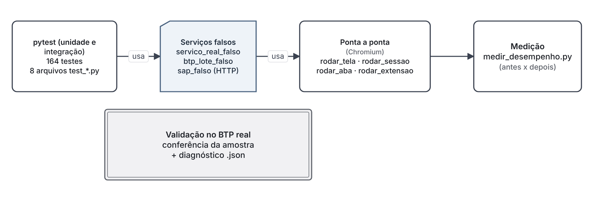


### 24.2 Os testes existentes

| Arquivo | Funções de teste | Foco |
|---|---|---|
| `test_auditoria.py` | 49 | Auditoria, conversões, planilha, preferências |
| `test_execucao.py` | 33 | Motor, sessão, retomada, lote, tempos |
| `test_preparo.py` | 21 | Descoberta e confirmação da fonte |
| `test_agente.py` | 20 | Cliente, classificação de respostas, paginação |
| `test_ponte.py` | 13 | Fila com a aba, vários trabalhadores, desconexão |
| `test_analisador.py` | 12 | Interpretação de consultas observadas |
| `test_materiais.py` | 10 | Tabela de valores, aba Materiais |
| `test_historico.py` | 4 | Histórico e numeração |
| **Total** | **162 funções** | O pytest conta **167** casos, porque alguns testes são parametrizados (rodam com vários dados) |

### 24.3 Resultado da execução feita para este livro

::: evidencia
Executado em 30/10/2026, sobre o commit `0a39d6c` (correção da regra "Estoque indisponível"), no ambiente Linux de produção do e-book (não no computador do usuário):

- `python3 -m pytest -q testes` → **167 passed in 35.58s**.
- `testes/e2e/rodar_tela.py` (cópia limpa do projeto) → **136 verificações ok, 0 falharam**.
- `testes/e2e/rodar_sessao.py` → **RESULTADO: OK** — a sessão caiu com 60 de 500 WOs validadas; 80 WOs em andamento voltaram para a fila e nenhuma virou falha; após o novo login a análise terminou com 500 validadas em 9,4 s.
- `testes/e2e/rodar_aba.py` → terminou sem erro (código de saída 0), incluindo a preparação pela aba e o apagamento de uma análise do histórico.
- `testes/e2e/rodar_extensao.py` → terminou sem erro; selo "conectado" na aba sem clique.
- `testes/e2e/rodar_combinacoes.py` **não** foi executado: exige como argumentos duas pastas de versões diferentes (programa e extensão).
:::

::: atencao
Uma primeira execução de `rodar_tela.py` **dentro** da pasta do projeto (e não numa cópia) teve 2 falhas, porque outros roteiros tinham deixado análises no histórico e o teste espera um histórico vazio. Os próprios roteiros avisam no cabeçalho: "Rode a partir de uma CÓPIA do projeto (ele grava config/, dados/ e saidas/)". Na cópia limpa, todas as 136 verificações passaram.
:::

### 24.4 Cenários essenciais e onde estão cobertos

| Cenário | Exemplo de teste |
|---|---|
| Execução bem-sucedida | `test_estrutura_completa_do_excel`; `rodar_extensao.py` |
| Ausência de dados (WO sem alerta) | testes de `Status.NAO_ENCONTRADA` em `test_agente.py`; `test_lote_quase_todo_sem_registros_refaz_a_configuracao` |
| Dados incompletos | `test_quantidade_ambigua_nao_e_validada`; `test_item_nao_relido_nao_fica_validado` |
| Respostas inesperadas | `test_linha_de_outra_wo_e_descartada_e_avisada`; `test_texto_com_igual_e_controle_nao_vira_formula_nem_quebra` |
| Falhas de conexão | `test_tarefa_entregue_a_aba_que_sumiu_volta_para_a_fila` |
| Falhas de autenticação | `test_redirecionamento_e_sessao_expirada`; `test_r3_deteccao_de_sessao_morta`; `rodar_sessao.py` |
| Erros na geração do resultado | `test_verificacao_detecta_excel_adulterado` |
| Repetição de operações | `test_r2_retomar_so_refaz_o_que_falta_e_e_idempotente` |
| Divergência entre leituras | `test_divergencia_de_quantidade_nao_e_aprovada_nem_por_maioria`; `test_r4_divergencia_escalona_para_5_leituras_e_nunca_valida` |
| Volume | `test_excel_de_lote_grande_nao_e_quadratico`; `testes/medir_desempenho.py` (medição, não teste) |

### 24.5 Como rodar

Na pasta do projeto, com as dependências de teste instaladas (`pip install pytest`; os roteiros de navegador exigem também `playwright` e o Chromium):

```
python -m pytest -q testes
python testes/e2e/rodar_tela.py      # a partir de uma CÓPIA do projeto
```

`pytest` e `playwright` **não** estão em `requirements.txt`: são ferramentas de desenvolvimento, não necessárias para usar o agente. <span class="confirmado">CONFIRMADO</span>

### 24.6 O que os testes não cobrem

- **O BTP real.** Todos os testes usam simuladores escritos a partir de observações do serviço real. Se o BTP mudar, os testes continuam passando. <span class="confirmado">CONFIRMADO</span>
- **Windows.** A execução para este livro foi em Linux; o `.bat` e o comportamento da janela de console não foram testados aqui.
- **A extensão instalada no Chrome do usuário** com políticas corporativas.

## 25. Como saber se o resultado está correto {#cap25}

### 25.1 Concluída não é o mesmo que correta

Uma análise **concluída** é aquela em que todas as WOs passaram pelo motor. Uma análise **válida** é aquela em que cada valor da planilha corresponde ao BTP. O agente separa as duas coisas na própria planilha, pela coluna **Status**, e na tela, pelo selo: "Concluída" (todas validadas), "Concluída com ressalvas" ou "Concluída com divergências".

### 25.2 As verificações que o agente faz sozinho

| Pergunta | Como o agente verifica | Onde |
|---|---|---|
| Os registros esperados foram encontrados? | Cada WO tem uma situação: com itens, sem itens, não consta no Monitor; uma WO "não consta" só é validada se **todas** as leituras concordarem | `processador._concluir`, `auditoria.consolidar` |
| Os campos foram preenchidos? | Campo vazio → item **Incompleto**, nota "Não obtido no BTP" | `consolidar`, linhas 138–143 |
| As relações estão corretas (item na WO certa)? | Linhas de outra WO numa resposta são descartadas e avisadas; a leitura em lote é comparada com a individual | `ClienteBTP`, `processar_grupo` (equivalência) |
| Há duplicações indevidas? | Cópias idênticas viram uma linha com a contagem; não somam na aba Materiais | `itens_unicos` |
| Os valores correspondem à fonte? | Leitura repetida (extração + 2 auditorias); divergência nunca é aprovada sem evidência do BTP | `consolidar`, `_resolver` |
| O arquivo foi gravado corretamente? | Reabertura e comparação célula a célula; fórmula acidental é acusada | `verificar_planilha` |
| Contadores, registro e planilha batem? | Gravação na mesma transação | `Loja.concluir` |

### 25.3 O que o usuário deve conferir

1. **Filtre a coluna Status** por "Divergente", "Incompleta" e "Falha". A Observação de cada linha diz o que conferir.
2. **Confira por amostragem** algumas WOs "Validada" diretamente na janela Mensagens do BTP, sobretudo na primeira análise depois de uma mudança no BTP.
3. **Compare os totais** da aba Análise com a quantidade de WOs enviadas.
4. **Observe a aba Materiais:** materiais "fora da tabela de valores" indicam que a tabela importada está desatualizada, não que o dado do BTP esteja errado.

### 25.4 Garantias que o agente **não** oferece

- **Não prova que a fonte é a janela Mensagens.** Depende da confirmação humana da amostra. Uma confirmação errada valida, com toda a auditoria, dados da tabela errada. Por isso a regra de segurança "≥ 90% das WOs sem itens refaz a fonte" existe, mas não cobre todos os casos. <span class="interpretacao">INTERPRETAÇÃO TÉCNICA</span>
- **Leituras repetidas não detectam um erro constante.** Se o BTP devolver sempre o mesmo valor errado, as três leituras concordam. A auditoria garante **estabilidade da leitura**, não correção do dado de origem.
- **Valores em R$** dependem inteiramente da tabela importada.

::: proposta
Uma verificação adicional possível (não implementada): uma "amostra de conferência" ao final de cada análise, com 5 WOs sorteadas e um atalho para abri-las no BTP, registrando no histórico que a conferência humana foi feita.
:::


# Parte VI — Falhas, segurança e manutenção {#parte6}

Um programa que conversa com um sistema externo vai, cedo ou tarde, encontrar falhas que não são culpa dele: sessão expirada, servidor lento, aba fechada. Esta parte mostra como o Agente BTP reconhece e trata cada tipo de falha, traz um manual de solução de problemas, examina a segurança das informações e termina com uma avaliação franca das limitações e das melhorias possíveis.

## 26. Tratamento de erros {#cap26}

### 26.1 A ideia: cada erro tem um dono

O princípio que organiza o tratamento de erros do agente é **perguntar de quem é o problema** antes de decidir o que fazer:

| Dono | Exemplo | Reação correta |
|---|---|---|
| A **sessão** | Login expirou | Pausar tudo; nenhuma WO vira falha; retomar quando a sessão voltar |
| A **comunicação** | BTP lento, HTTP 503 | Repetir com espera crescente |
| A **WO** | Número inválido; 403 só nesta WO | Registrar falha **desta** WO, com motivo, e seguir |
| O **programa** | Erro inesperado no código | Registrar com rastro completo (*traceback*) e marcar as WOs afetadas |

O diagnóstico codifica esse princípio em três categorias (`diagnostico.py`, linhas 7–10): **FONTE** (o BTP ou o caminho até ele não entregou o dado), **APP** (o próprio agente falhou ou atingiu um limite configurado) e **ENTRADA** (a WO informada não serve).


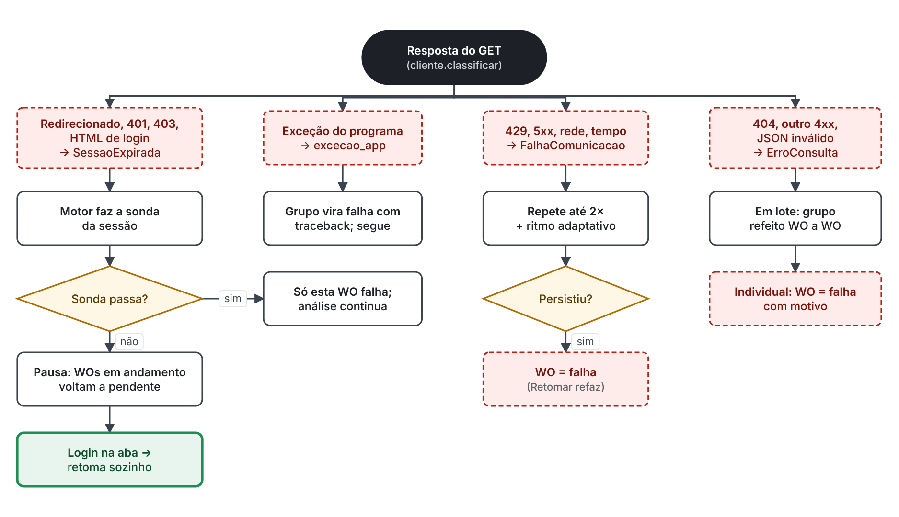


### 26.2 Mecanismo 1 — Classificação na origem

Toda resposta passa por `cliente.classificar` (Cap. 19.1), que converte a situação HTTP numa exceção com motivo. É a peça que permite às camadas superiores reagir corretamente sem examinar a resposta de novo.

### 26.3 Mecanismo 2 — Repetição com espera crescente

`processador._com_retentativa` (Cap. 19.2) repete apenas falhas de comunicação, até `repeticoes_falha` vezes, com esperas de 1, 2 e 4 s (máximo 5 s), respeitando o prazo da WO. Além disso, o `Ritmo` do cliente (`cliente.py`, linhas 88–123) aumenta a espera entre consultas quando o BTP responde 429 ou 5xx (dobrando até 30 s e respeitando o cabeçalho `Retry-After`) e a reduz a cada sucesso. <span class="confirmado">CONFIRMADO</span>

### 26.4 Mecanismo 3 — Falha de consulta vira resultado da WO


**Código-fonte — agente_btp/processador.py · processar_wo_seguro · linhas 186–201**

```python
 186  def processar_wo_seguro(cliente: ClienteBTP, wo: str, prefs: Preferencias | None = None,
 187                          ao_etapa: Callable[[str], None] | None = None,
 188                          deve_parar: Callable[[], bool] | None = None) -> ResultadoWO:
 189      """processar_wo, mas falha de consulta vira resultado da PRÓPRIA WO (com motivo classificado).
 190      SessaoExpirada continua propagando: não é problema da WO, é da sessão."""
 191      try:
 192          return processar_wo(cliente, wo, prefs, ao_etapa, deve_parar)
 193      except FalhaComunicacao as exc:
 194          return ResultadoWO(wo, Status.FALHA_COMUNICACAO, auditoria=Auditoria.NAO_CONCLUIDO, observacao=str(exc),
 195                             motivo=exc.motivo, origem="consulta individual")
 196      except TempoEsgotado as exc:
 197          return ResultadoWO(wo, Status.TEMPO_ESGOTADO, auditoria=Auditoria.NAO_CONCLUIDO, observacao=str(exc),
 198                             motivo=exc.motivo, origem="consulta individual")
 199      except ErroConsulta as exc:
 200          return ResultadoWO(wo, Status.ERRO, auditoria=Auditoria.NAO_CONCLUIDO, observacao=str(exc),
 201                             motivo=exc.motivo, origem="consulta individual")
```


Uma falha de consulta não derruba a análise: vira um `ResultadoWO` com situação, auditoria "Não concluído" e o motivo. A única exceção que continua subindo é `SessaoExpirada`, porque não é problema da WO (docstring, linhas 189–190).

### 26.5 Mecanismo 4 — Sessão: pausa, sonda e retomada automática

::: nobtp
**Sonda** é uma consulta leve feita só para saber se a sessão ainda é válida. O motor sonda antes de começar, a cada 60 s ou a cada 100 WOs concluídas (`motor.py`, linhas 30–31 e 153–154). Como toda consulta passa pelo *approuter* do BTP, a sonda também funciona como "mantenha viva" (*keep-alive*) da sessão.
:::

Quando uma consulta indica sessão expirada, o motor **não acredita de imediato**: sonda de novo (`_sessao_na_wo`, linha 226).

- **Sonda falhou** → a sessão caiu mesmo. As WOs do grupo voltam para "pendente" (`Loja.devolver`), o motivo é registrado e a análise entra em `pausado_sessao`.
- **Sonda passou** → o problema é de alguma WO específica (por exemplo, 403 por falta de permissão naquela WO). As WOs do grupo são refeitas uma a uma; só a que repetir o erro falha, com a observação "Só nesta WO: a sessão do BTP continua válida".

Durante a pausa, `_esperar_sessao` (linhas 292–315) tenta de novo quando a aba se anuncia (por exemplo, após recarregar com o novo login) ou a cada 30 s. Ao passar, registra "Sessão do BTP válida de novo" e continua. O tempo pausado **não conta** para o limite de tempo da análise (`_pausado_total`).

::: evidencia
`testes/e2e/rodar_sessao.py`, executado para este livro: queda simulada (302 para o SSO) com 60 de 500 WOs feitas → 80 WOs em andamento voltaram para a fila, nenhuma falha; após o novo login, 500 validadas. Teste unitário correspondente: `test_r1_queda_no_meio_com_paralelismo_e_lote_nunca_vira_falha`.
:::

### 26.6 Mecanismo 5 — Exceções inesperadas nunca são silenciosas

No motor, qualquer exceção que não seja de sessão vai para `_excecao` (linhas 251–260): grava no diagnóstico o motivo `excecao_app`, o tipo e a mensagem do erro, a **origem no código** (módulo, função, linha — `diagnostico.origem`) e o *traceback* (até 6.000 caracteres — `diagnostico.rastreio`), e marca as WOs em andamento do grupo como falha com essa explicação. A mesma regra vale para a sonda (linhas 264–269: "a sonda nunca derruba a análise") e para a geração do Excel (`Agente._planilha`, linhas 921–925).

### 26.7 Mecanismo 6 — Interrupção segura e retomada

| Situação | O que acontece | Retomável? |
|---|---|---|
| Usuário clica "Parar" | WOs em andamento terminam; as pendentes ficam pendentes | Sim |
| Tempo máximo da análise | Motivo `limite_execucao`; evento registrado | Sim |
| Preferência "Diante de erros: interromper" | Para na primeira falha de WO (exceto WO inválida) — `Motor._gravar`, linhas 214–217 | Sim |
| Programa fechado ou computador desligado | WOs concluídas já estão na base; as que estavam em andamento voltam a pendente quando a análise é retomada (`Motor.executar` chama `devolver_em_andamento`, `motor.py`, linha 86) | Sim |

A retomada usa as **mesmas preferências e a mesma fonte** gravadas no início da análise, refaz só o que falta e é idempotente — repetir a retomada não duplica nada (teste `test_r2_retomar_so_refaz_o_que_falta_e_e_idempotente`).

### 26.8 Mecanismo 7 — Continuidade parcial

A base guarda cada WO assim que termina. Por isso:

- a planilha parcial pode ser baixada a qualquer momento durante a análise (`planilha_parcial`);
- uma falha na geração do Excel não perde a análise — o relatório pode ser regerado pelo Histórico;
- uma consulta em lote que diverge da individual desativa o lote só **naquela análise** e continua WO a WO (motivo `lote_desativado`).

### 26.9 Situações ainda não tratadas ou tratadas parcialmente

| Situação | Comportamento atual | Classificação |
|---|---|---|
| Falha ao copiar o `agente_btp.js` para a pasta da extensão | `sincronizar_extensao` ignora `OSError` em silêncio (`servidor.py`, linhas 41–44); a extensão pode ficar com cópia antiga | <span class="confirmado">CONFIRMADO</span> no código |
| Porta 8767 ocupada por outro programa | O `.bat` encerra o processo; se o agente for iniciado sem o `.bat`, o Flask falha ao abrir a porta e a janela mostra o erro | <span class="interpretacao">INTERPRETAÇÃO TÉCNICA</span> |
| Disco cheio | Gravações de base, histórico ou Excel falham com exceção; o Excel tem tratamento, a base não tem tratamento específico | <span class="hipotese">HIPÓTESE</span> — não reproduzido |
| Mudança de formato no BTP que continue devolvendo JSON válido com os mesmos nomes de campo, mas significado diferente | Não detectável pelo agente | <span class="interpretacao">INTERPRETAÇÃO TÉCNICA</span> |

## 27. Manual de solução de problemas {#cap27}

As tabelas abaixo estão separadas por área. A coluna "Base" indica se o problema é **confirmado** (aparece no código, em testes ou em registros do projeto), um **risco plausível** pela arquitetura ou um **cenário hipotético** ainda não reproduzido.

### 27.1 Instalação e inicialização

| Sintoma | Causas possíveis | Como verificar | Como corrigir | Como confirmar | Base |
|---|---|---|---|---|---|
| Janela preta abre e fecha | Python ausente; erro no `pip` | Abrir o Prompt de Comando na pasta e rodar `py -3 --version` e o `.bat` dali, para ler a mensagem | Instalar Python com "Add to PATH"; garantir internet na 1ª execução | A tela abre em `127.0.0.1:8767` | Risco plausível |
| "No module named flask" | `.venv` corrompido ou instalação interrompida | Ver a mensagem na janela | Apagar a pasta `.venv` e abrir o `.bat` de novo | A janela não mostra erro | Risco plausível |
| Navegador não abre sozinho | Navegador padrão não configurado | A janela preta continua aberta sem erro | Abrir manualmente `http://127.0.0.1:8767` | Tela carrega | Risco plausível |
| A análise "congela" em Windows ao clicar na janela preta | Modo de seleção do console congela escritas | — | Corrigido: o registro vai só para arquivo e o modo de seleção é desligado (`desligar_selecao_da_janela`) | — | Confirmado (comentário de `__main__.py`, linhas 17–21: "a análise parava no meio, ex.: 391 de 499 WOs") |

### 27.2 Conexão com a aba

| Sintoma | Causas possíveis | Como verificar | Como corrigir | Como confirmar | Base |
|---|---|---|---|---|---|
| Selo "aguardando o programa" na aba | Programa fechado | A janela preta está aberta? | Abrir o `.bat` | Selo muda para "conectado" | Confirmado (`rodar_extensao.py`) |
| Favorito mostra "Agente BTP não encontrado" | Programa fechado; navegador bloqueou acesso à rede local | Mensagem do alerta (`servidor.codigo_carregador`) | Abrir o programa; **permitir** o acesso à rede local quando o navegador perguntar | Selo "conectado" | Confirmado no código |
| Tela mostra aba desconectada durante a análise | Aba recarregada, fechada, ou em segundo plano congelada pelo navegador | Painel "O que deu errado": motivo `aba_desconectada` ou `aba_sem_resposta` | Reabrir a aba logada e clicar no favorito (ou recarregar com a extensão); não minimizar a janela | A análise retoma | Confirmado (taxonomia) |
| Extensão não conecta após atualizar o programa | Cópia antiga do `agente_btp.js` na pasta da extensão; extensão não recarregada | Comparar a data de `extensao/agente_btp.js`; ver a versão no selo | Em `chrome://extensions`, clicar em "Recarregar" na extensão | Selo "conectado" | Risco plausível (ver 26.9) |
| Chamadas recusadas com 403 pelo programa | A aba não é do endereço configurado (`AGENTE_BTP_URL`) | Endereço da aba | Usar a aba do *launchpad* correto | Conexão aceita | Confirmado (`exigir_origem_sap`) |

### 27.3 Sessão e acesso ao BTP

| Sintoma | Causas possíveis | Como verificar | Como corrigir | Como confirmar | Base |
|---|---|---|---|---|---|
| Análise "Pausada" com motivo de sessão | Sessão expirou (redirecionamento, 401, página de login) | Painel "O que deu errado" | Fazer login de novo na aba | Retoma sozinha em até 30 s | Confirmado (`rodar_sessao.py`) |
| Algumas WOs com falha `http_403` e a sessão válida | Usuário sem permissão naquelas WOs | Observação "Só nesta WO: a sessão do BTP continua válida" | Verificar permissão no SAP | — | Confirmado no código |
| Muitas WOs com `http_404` | O app do BTP foi atualizado e o endereço mudou | Diagnóstico: motivo `http_404` | Configurações → "Refazer a fonte de dados" | Amostra confere com a janela Mensagens | Confirmado (taxonomia; o agente refaz a fonte sozinho com 404 em massa) |
| Lentidão, motivo `http_429` | BTP pedindo menos pedidos por segundo | Diagnóstico | Reduzir "Consultas em paralelo" | Sem novos 429 | Confirmado (taxonomia) |
| Falhas `http_5xx` | Instabilidade do BTP | Diagnóstico | Esperar e "Retomar" | WOs refeitas | Confirmado (taxonomia) |

### 27.4 Fonte de dados e extração

| Sintoma | Causas possíveis | Como verificar | Como corrigir | Como confirmar | Base |
|---|---|---|---|---|---|
| Quase todas as WOs "sem itens" | Fonte errada (ligação com as mensagens incorreta); ou WOs realmente sem alerta | O agente refaz a fonte sozinho acima de 90% (`LIMIAR_SEM_REGISTROS`) | Conferir a amostra com a janela Mensagens | Itens aparecem | Confirmado |
| Muitos itens "quantidade ambígua" | Tabela usada não é a janela Mensagens (tem dois campos de quantidade) | Motivo `quantidade_ambigua`; a amostra mostra a tabela | "Refazer a fonte de dados" | Itens validados | Confirmado (taxonomia e comentário de `agente.py`, linha 574, sobre 2.900 WOs afetadas por uma fonte assim) |
| Muitas WOs `wo_inexistente` | WOs digitadas erradas; WOs sem alerta no Monitor | Conferir algumas no BTP | Corrigir a lista | — | Confirmado (diagnóstico real: 2.180 de 13.623) |
| Itens "Divergente" | Valor mudou no BTP durante a análise; leitura instável | Observação com as leituras `r0=... / r1=...` e aba Rastreio | Conferir manualmente no BTP | — | Confirmado |
| Lote desativado logo no início | Leitura em lote diferente da individual | Evento `lote_desativado` | Nada: o resultado segue exato, só mais lento | — | Confirmado (diagnóstico real: lote desativado 1 s após o início) |

### 27.5 Planilha e arquivos

| Sintoma | Causas possíveis | Como verificar | Como corrigir | Como confirmar | Base |
|---|---|---|---|---|---|
| "A conferência do Excel gravado encontrou diferenças" | Arquivo alterado durante a gravação; erro de programa | Mensagem lista as primeiras diferenças | Histórico → Baixar relatório (regera); se repetir, enviar o diagnóstico | Sem mensagem | Confirmado (teste `test_verificacao_detecta_excel_adulterado`) |
| "Erro ao gerar ou gravar o Excel" | Arquivo aberto no Excel com o mesmo nome; disco cheio; permissão | Diagnóstico `excecao_app` com *traceback* | Fechar o arquivo no Excel; liberar espaço; regerar pelo Histórico | Arquivo baixado | Risco plausível |
| Tipo Material e valores "-" | Tabela de valores não importada ou material fora dela | Observação da aba Materiais | Importar a tabela atualizada em Configurações | Valores preenchidos | Confirmado |
| Importação da tabela recusada | Mesmo material com tipo ou valor diferentes; colunas não encontradas | Mensagem de `TabelaInvalida` | Corrigir a planilha de valores | Importação aceita | Confirmado (`materiais._montar`) |
| Zeros à esquerda sumiram na planilha de entrada | Coluna de WO formatada como número no Excel de origem | Ver a célula no Excel | Formatar a coluna como texto | WOs aceitas | Risco plausível |

### 27.6 Execução

| Sintoma | Causas possíveis | Como verificar | Como corrigir | Como confirmar | Base |
|---|---|---|---|---|---|
| "O agente já está executando uma análise" (409) | Clique duplo; outra análise em curso | Selo da tela | Aguardar ou "Parar" | — | Confirmado |
| Análise "Interrompida" com `limite_execucao` | Tempo máximo da análise atingido | Diagnóstico | Aumentar o tempo em Configurações e "Retomar" | Termina | Confirmado |
| WOs com `timeout_wo` | BTP lento; prazo de 180 s curto para muitas auditorias | Diagnóstico | "Retomar"; se persistir, aumentar os tempos | WOs concluídas | Confirmado (taxonomia) |
| Retomada não aparece | Análise já concluída ou apagada do histórico | Histórico | Iniciar nova análise | — | Confirmado |

## 28. Segurança e proteção das informações {#cap28}

### 28.1 Mecanismos implementados

| Tema | Mecanismo | Evidência |
|---|---|---|
| Credenciais | O agente **não** pede, não lê e não grava senha, cookie ou *token*. A autenticação é a do próprio navegador do usuário | `preferencias.py` (linhas 1–5); campos de `ApiConfig`; descrição do manifesto da extensão: "Não faz login, não lê cookies, não guarda dados." |
| Somente leitura | O transporte só faz `GET` (`agente_btp.js`, linha 196: `method: 'GET'`); não há código para "Reprocessar" ou "Efetuar Baixa" | <span class="confirmado">CONFIRMADO</span> |
| Acesso ao programa | Escuta só em `127.0.0.1` (o próprio computador) | `__main__.py`, linha 13 |
| Canal com a aba | Rotas `/api/agente/*` exigem o cabeçalho `Origin` igual ao do *launchpad* (`exigir_origem_sap`); CORS liberado só para essa origem | `servidor.py`, linhas 66–81 |
| Arquivos baixados | Download restrito à pasta `saidas/` | `caminho_saida` (Cap. 19.7) |
| Evidências do diagnóstico | Segredos conhecidos removidos; corpo limitado a 800 caracteres | `diagnostico.sanitizar` (Cap. 19.6) |
| Tamanho de envio | Pedidos ao programa limitados a 20 MB | `servidor.py`, `MAX_CONTENT_LENGTH` |
| Permissões da extensão | `scripting` e `tabs`, só no endereço do *launchpad* | `extensao/manifest.json` |
| Dados locais fora do Git | `.gitignore` exclui `config/api.json`, preferências, tabela, histórico, `dados/`, `saidas/`, `logs/` | `.gitignore` |

### 28.2 Que informações ficam no computador

| Local | Conteúdo sensível? |
|---|---|
| `saidas/*.xlsx` | **Sim** — dados operacionais: WOs, materiais, fornecedores, quantidades, valores. Tratar como documento interno |
| `dados/execucoes.sqlite3` | **Sim** — os mesmos dados, mais as leituras brutas (aba Rastreio) e evidências do diagnóstico |
| `historico/` | WOs de cada análise e resumos |
| `logs/agente_btp.log` | Números de WO, situação e contagem de itens por WO (`motor.py`, linha 213); erros com *traceback* |
| `config/api.json` | Endereços internos do serviço OData do BTP (não são segredos de acesso, mas revelam a estrutura interna) |

::: atencao
Ao enviar um "diagnóstico" para análise, ele contém WOs, URLs internas e trechos de respostas (já sem segredos conhecidos). Compartilhe apenas com quem pode ver esses dados.
:::

### 28.3 Riscos e recomendações (não implementadas)

| Risco | Explicação | Classificação |
|---|---|---|
| Pedidos de outros sites para as rotas da tela | As rotas da tela (por exemplo, `POST /api/parar`, que não tem corpo) não verificam a origem. Em tese, uma página maliciosa aberta no mesmo navegador poderia enviar um pedido simples a `127.0.0.1:8767`. Navegadores recentes aplicam proteções de acesso à rede local que tendem a bloquear isso | <span class="hipotese">HIPÓTESE</span> — não testado |
| Endereço interno no código | O endereço do *launchpad* está gravado em `config.py` e no manifesto da extensão | <span class="confirmado">CONFIRMADO</span>; baixo impacto, pois não dá acesso sem login |
| Dependências externas | `flask` e `openpyxl` são instalados sem versão máxima (`>=`); uma versão nova incompatível ou comprometida seria instalada automaticamente na próxima abertura do `.bat` | <span class="confirmado">CONFIRMADO</span> (`requirements.txt`) |
| Planilhas com dados operacionais | Ficam em `saidas/` sem prazo de expiração | <span class="confirmado">CONFIRMADO</span> |

::: proposta
1. Exigir um cabeçalho próprio (por exemplo `X-Agente-BTP: 1`) nas rotas de alteração da tela — pedidos com cabeçalho customizado exigem verificação prévia (*preflight*) do navegador, que outro site não passa.
2. Fixar as versões em `requirements.txt` (por exemplo `flask==3.0.3`) e atualizá-las de forma deliberada, após rodar os testes.
3. Oferecer em Configurações a limpeza de análises e planilhas antigas.
:::

## 29. Manutenção e evolução {#cap29}

### 29.1 Dependências

`requirements.txt` declara apenas `flask>=3.0` e `openpyxl>=3.1`. Para saber o que está instalado: `.venv\Scripts\python -m pip list`. Para ver se há versões novas: `.venv\Scripts\python -m pip list --outdated`.

Antes de aceitar uma atualização: ler as notas de versão (Apêndice D), atualizar numa cópia, rodar `python -m pytest -q testes` e os roteiros de navegador, e gerar uma planilha de uma análise conhecida para comparar.

### 29.2 Mudanças no BTP

O BTP é a dependência mais crítica e a que o projeto não controla. Sinais de que ele mudou:

- muitos `http_404` (endereço mudou);
- aumento súbito de `quantidade_ambigua` ou `campo_ausente` (campos renomeados);
- amostra que não corresponde mais à janela Mensagens;
- quase todas as WOs "sem itens".

A defesa já existente é a **re-preparação**: descartar a fonte ("Refazer a fonte de dados") e conferir a amostra de novo. Quando a mudança for estrutural, o ponto de partida no código é `autoconfig.receita_monitor` e os testes de `test_preparo.py`.

### 29.3 Logs e diagnóstico

- `logs/agente_btp.log`: uma linha por WO concluída e os erros, com data e hora.
- Diagnóstico da análise (Histórico): problemas agrupados por motivo e categoria, com evidência e próxima ação.
- Eventos da análise (rota `/api/execucoes/<id>/registro`): linha do tempo com sondas, pausas e marcos.

### 29.4 Versões e registro de modificações

O projeto usa Git (39 commits de código e documentação entre 01/10/2026 e 29/10/2026, antes dos commits deste livro, mais a correção de 30/10). Cada rodada de correção é documentada em `docs/relatorio-correcao-raiz.md`, com o diagnóstico, o que mudou, os testes e as limitações. Esse hábito deve ser mantido. A tela exibe uma "versão" que é uma **impressão digital** de todos os arquivos do programa (`servidor.py`: os 10 primeiros caracteres de um *hash* SHA-1), o que permite saber, pela tela, se dois computadores rodam exatamente o mesmo código.

### 29.5 Regressão e versão estável

1. Antes de mudar: rodar os testes e guardar uma planilha de referência.
2. Depois: rodar de novo; comparar a planilha regerada da mesma análise.
3. Distribuir com um novo `.zip` e guardar o anterior. Voltar atrás = descompactar o anterior (a base em `dados/` é compatível enquanto o esquema não mudar).

### 29.6 Pontos que exigem atenção especial

- **Esquema da base SQLite:** não há migração de esquema no código. Uma mudança nas tabelas exige cuidado com bases existentes. <span class="confirmado">CONFIRMADO</span>
- **Duas cópias do `agente_btp.js`:** a da pasta `agente_btp/web/` (servida ao favorito) e a da extensão, sincronizada ao abrir o programa.
- **`VERSAO_CONFIG`:** aumentar o número descarta as fontes gravadas de todos os usuários na próxima abertura — é o mecanismo correto para forçar a re-preparação.

## 30. Limitações e possibilidades de melhoria {#cap30}

### 30.1 Limitações confirmadas

| Limitação | Consequência |
|---|---|
| Depende de uma aba do navegador aberta e logada | Não roda sem o usuário; a aba não pode ser fechada nem congelada |
| A escolha da fonte depende de confirmação humana | Uma confirmação errada valida dados da tabela errada |
| Auditoria mede estabilidade, não correção na origem | Um valor errado e constante no BTP passa como validado |
| Testes não usam o BTP real | Mudanças no BTP só aparecem em uso |
| Só Windows tem lançador (`.bat`) | Outros sistemas exigem rodar `python -m agente_btp` manualmente |
| README desatualizado ("padrão 5" auditorias, menções antigas) | Pode confundir quem lê o repositório |
| `config/api.exemplo.json` não reflete a fonte atual | Idem |
| Exceção ignorada em `sincronizar_extensao` | Extensão pode ficar com cópia antiga sem aviso |

### 30.2 Propostas classificadas

Critério: **Alta** = afeta a correção dos dados ou a segurança; **Média** = afeta a manutenção ou o diagnóstico; **Baixa** = conforto ou clareza.

| Prioridade | Proposta (não implementada) | Justificativa |
|---|---|---|
| Alta | Fixar versões das dependências | Evita que uma atualização automática quebre o programa na abertura |
| Alta | Cabeçalho obrigatório nas rotas de alteração da tela | Fecha o risco de pedidos de outros sites (28.3) |
| Alta | Roteiro de teste manual versionado no BTP real (5 WOs conhecidas) | Única forma de detectar mudança no BTP antes de uma análise grande |
| Média | Avisar na tela quando `sincronizar_extensao` falhar | Remove a única exceção silenciosa encontrada |
| Média | Atualizar `README.md` e `api.exemplo.json` | Coerência da documentação do repositório |
| Média | Migração de esquema da base | Permite evoluir a base sem perder análises antigas |
| Média | Painel de tendências entre análises (taxa de validadas, motivos) | Monitoramento: uma piora súbita indica mudança no BTP |
| Baixa | Filtro com várias mensagens (Cap. 20) | Flexibilidade da planilha |
| Baixa | Limpeza de análises antigas | Higiene de dados locais |
| Baixa | Dividir `agente.py` (1.117 linhas) em partes menores (preparação, execução, relatório) | Clareza do código |


# Parte VII — Visão integrada do sistema {#parte7}

As partes anteriores examinaram o agente peça por peça. Esta última parte junta tudo: acompanha uma análise inteira num único exemplo, mostra o que acontece quando algo muda e termina com o mapa completo do conhecimento do projeto.

## 31. A execução completa explicada em um único exemplo {#cap31}

::: atencao
**Todos os dados deste capítulo são fictícios.** As WOs `11111|111111111`, `22222|222222222` e `33333|333333333`, o material `000000000012345678` e o fornecedor `0000099999` não existem no BTP. Os nomes de funções, arquivos e mensagens são os reais.
:::


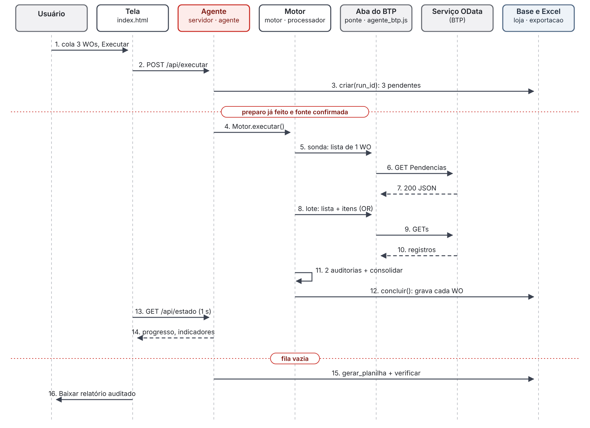


### 31.1 Estado inicial

- O programa está aberto (`Abrir Agente BTP.bat`), servindo a tela em `127.0.0.1:8767` (Cap. 10).
- A aba do BTP está logada e conectada pela extensão: quatro trabalhadores do `agente_btp.js` estão em ciclo com o servidor (Cap. 11).
- A fonte já foi preparada e confirmada em análises anteriores: `config/api.json` com `confirmada: true` e `versao: 6` (Cap. 12).
- Preferências padrão: 2 auditorias, 4 consultas em paralelo, lote de 20, filtro "Estoque indisponível" (Cap. 22).
- A tabela de valores está importada e contém o material `000000000012345678` com Tipo Material "CABO DROP" e valor unitário R$ 2,50 (fictício).

### 31.2 O evento inicial

O usuário cola as três WOs na tela e clica em **Executar análise**. A tela envia `POST /api/executar` com a lista.

### 31.3 Primeiro componente acionado

A rota `executar` (`servidor.py`) valida que não há análise em curso (senão, 409), normaliza as WOs (`entrada.ler_wos_texto`) e chama `agente.enviar("executar", ...)`. A thread do `Agente` (`_laco`) recebe o comando e executa `_cmd_executar` (Cap. 16.1–16.2).

### 31.4 Operações de preparação

1. `_garantir_preparo` verifica que a fonte existe e está confirmada — nada a fazer.
2. A análise é criada na base: `Loja.criar` grava as 3 WOs como `pendente`, com as preferências e a fonte **congeladas** na análise.
3. O histórico recebe a entrada "Em andamento" com o próximo número de análise.
4. `_rodar` cria o `Motor` e chama `executar`.

### 31.5 Comunicações

1. **Sonda inicial** (Cap. 26.5): o motor pede, pela ponte, uma consulta leve. A `PonteAba` coloca a tarefa na fila; um trabalhador da aba a recebe no próximo ciclo e executa um `fetch` GET na própria origem do BTP, com os cookies da sessão enviados pelo navegador. A resposta (200, JSON) volta pelo `POST /api/agente/ciclo` e é entregue a quem pediu.
2. **Leitura em lote** (Cap. 13): como há mais de uma WO válida, o processador monta uma consulta com filtro OR para as três WOs (`ClienteBTP.ler_lote`), seguida da consulta dos itens. Por ser um dos 3 primeiros grupos da análise, cada WO também é lida individualmente para verificar a equivalência.
3. **Auditorias**: mais duas leituras de cada WO, alternando nova consulta e releitura por chave (`auditorias_independentes`).

### 31.6 Dados obtidos (fictícios)

| WO | O que o BTP devolve |
|---|---|
| `11111|111111111` | Um item: material `000000000012345678`, fornecedor `0000099999`, quantidade `"2e+0"`, mensagem "Estoque indisponível" |
| `22222|222222222` | Nenhuma linha de alerta |
| `33333|333333333` | Um item com mensagem "Estoque insuficiente" e quantidade `"1e+0"` |

### 31.7 Transformações

- `odata.extrair_pagina` lê o JSON; `ClienteBTP.ocorrencia` mapeia os nomes de campo gravados na fonte.
- `como_texto` mantém `000000000012345678` como texto; `como_quantidade("2e+0")` devolve `2` (Cap. 14.3).

### 31.8 Validações

- WO 11111: as três leituras trazem os mesmos valores → item **Validado** (Cap. 14.5).
- WO 22222: as três leituras confirmam a ausência → situação "Não consta no Monitor", auditoria **Validado**, motivo `wo_inexistente` registrado no diagnóstico (categoria ENTRADA).
- WO 33333: item validado, mas a mensagem do item não é a do filtro.

### 31.9 Decisões e gravação

Cada WO é gravada assim que termina, numa transação (`Loja.concluir`): estado `validada` nas três. A tela, que consulta `GET /api/estado` a cada segundo, mostra 3/3.

### 31.10 Resultado gerado

`_planilha` gera `Análise N - 3 WOs.xlsx`:

| WO | Material SAP | Tipo Material | Fornecedor SAP | Qtd. faltante | Mensagem | Observação | Status |
|---|---|---|---|---|---|---|---|
| 11111\|111111111 | 000000000012345678 | CABO DROP | 0000099999 | 2 | Estoque indisponível | - | Validada |
| 22222\|222222222 | - | - | - | - | - | Nenhum alerta encontrado no Monitor para esta WO | Validada |
| 33333\|333333333 | - | - | - | - | - | Nenhum item com "Estoque indisponível". Outros itens no BTP, fora da planilha (...): ... (qtd 1): Estoque insuficiente | Validada |

Na aba **Materiais**: uma linha para o material, quantidade total 2, valor total R$ 5,00, valor unitário R$ 2,50.

### 31.11 Verificações finais

`verificar_planilha` reabre o arquivo e compara cada célula das abas Dados, Materiais e Tabela de valores com o esperado (Cap. 15.9). Sem diferenças, a análise é marcada como concluída no histórico, e a tela mostra o selo **Concluída** e o botão **Baixar relatório auditado**.

### 31.12 E se uma etapa falhasse?

| Etapa | Falha | Consequência (capítulo) |
|---|---|---|
| 31.3 | Outra análise em curso | 409; nada é criado (27.6) |
| 31.5 | Sessão expira durante a leitura | Pausa; WOs em andamento voltam a pendente; retomada automática após o login (26.5) |
| 31.5 | Lote diferente da leitura individual | Lote desativado nesta análise; segue WO a WO (13) |
| 31.5 | BTP responde 503 | Até 2 repetições com espera crescente; persistindo, falha da WO com `http_5xx` (26.3) |
| 31.8 | Quantidade muda entre leituras | +3 leituras extras; sem explicação do BTP, item **Divergente**, valor vazio e nota "revisar no BTP" (14.7) |
| 31.10 | Excel aberto no Excel com o mesmo nome | Erro registrado; análise preservada; regerar pelo Histórico (27.5) |

## 32. O que acontece quando algo muda {#cap32}


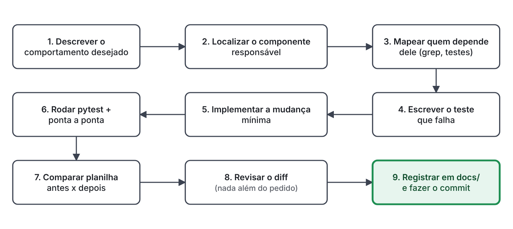


O diagrama resume o roteiro seguro já detalhado nos Capítulos 20 e 21. As seções a seguir aplicam esse roteiro a mudanças plausíveis na arquitetura real.

### 32.1 A estrutura da fonte de dados muda (o BTP é atualizado)

- **Sinais:** `http_404` em massa; amostra diferente da janela Mensagens; muitas WOs sem itens.
- **O que o agente já faz:** 404 em massa e ≥ 90% sem itens disparam a re-preparação.
- **Examinar:** `autoconfig.receita_monitor`, `exploracao.py`, `analisador.py`; os registros do diagnóstico.
- **Testar:** `test_preparo.py`; uma análise curta no BTP real com conferência atenta da amostra.
- **Efeitos colaterais:** se a nova receita for gravada no código, aumentar `VERSAO_CONFIG` para descartar as fontes antigas de todos os usuários.

### 32.2 Um campo relevante muda de nome ou de significado

- **Exemplo:** a quantidade passa a vir em `quantidadePendente`.
- **Examinar:** `campos.py` (pesos dos nomes de campo, `peso_nome`), `auditoria.consolidar` (regra de quantidade ambígua, linhas 144–150), `config/api.json` (campo `quantidade_faltante`).
- **Risco:** se o nome novo não indicar "faltante", os itens ficam **Incompletos** por ambiguidade — o comportamento seguro, mas que bloqueia a validação até o ajuste.
- **Testar:** `test_quantidade_ambigua_nao_e_validada` e os testes de mapeamento de campos.

### 32.3 A forma de autenticação muda

- **Exemplo:** o BTP passa a usar outro provedor de login, com outra página.
- **Examinar:** os padrões `_LOGIN` em `cliente.py` (linhas 46–47) e `classificar`.
- **Risco:** se a nova página de login vier como JSON ou sem as marcas conhecidas, a queda de sessão poderia ser lida como erro de consulta e virar falha de WO. A proteção do motor (sonda após erro de sessão) não ajudaria nesse caso, porque o erro nem seria classificado como sessão. <span class="interpretacao">INTERPRETAÇÃO TÉCNICA</span>
- **Testar:** `test_redirecionamento_e_sessao_expirada`, `test_r3_deteccao_de_sessao_morta` e `rodar_sessao.py`, com o novo formato reproduzido no SAP falso.

### 32.4 Uma dependência falha

- **flask:** sem ele, o programa não abre (erro na janela preta). **openpyxl:** sem ele, não lê planilhas de entrada nem gera o relatório.
- **Examinar:** `pip list`; a mensagem da janela; `requirements.txt`.
- **Correção:** apagar `.venv` e reabrir o `.bat`; se a versão nova for incompatível, fixar a anterior em `requirements.txt` (Cap. 28.3).

### 32.5 A estrutura do resultado final muda

Ver o exemplo completo do Capítulo 21.2. Pontos de atenção: `COLUNAS_DADOS`, listas posicionais em `gerar_planilha`, `verificar_planilha` (acompanha automaticamente se as funções de linha forem as mesmas), testes de estrutura e fórmulas dos usuários.

### 32.6 Uma nova regra operacional

- **Exemplo:** "WOs com mais de 10 itens indisponíveis devem ser destacadas".
- **Onde:** é uma regra de **apresentação**, não de auditoria: pertence a `exportacao.py` (por exemplo, a Observação ou a aba Análise), nunca a `auditoria.py`, que deve continuar decidindo apenas a fidelidade da leitura.
- **Testar:** novo teste em `test_auditoria.py` no padrão dos testes de planilha; conferir que `verificar_planilha` continua sem diferenças.

## 33. Mapa final do conhecimento do projeto {#cap33}


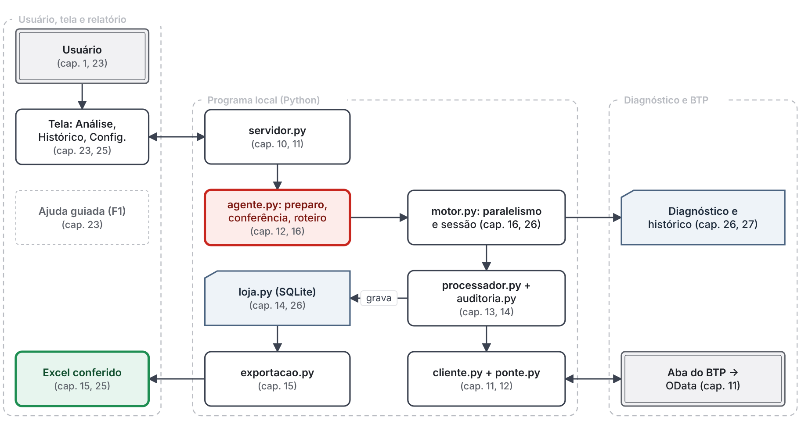


| Tema | Em uma frase | Onde aprofundar |
|---|---|---|
| Problema operacional | Conferir, WO a WO, os itens com "Estoque indisponível" na janela Mensagens do Monitor de Alertas do BTP e consolidá-los numa planilha | Caps. 1–2 |
| Arquitetura | Programa local em Python (Flask) + script na aba do BTP + extensão do Chrome; o BTP só é acessado pela aba logada | Caps. 6, 11 |
| Componentes principais | `servidor`, `agente`, `motor`, `processador`, `cliente`, `ponte`, `auditoria`, `loja`, `exportacao` | Caps. 16–17 |
| Fluxo dos dados | JSON do BTP → `Ocorrencia` → `Leitura` → `LinhaMensagem` → base SQLite → Excel | Caps. 13–15 |
| Comunicação externa | GET na própria origem do BTP feito pela aba, com fila *long-poll* entre a aba e o programa | Cap. 11 |
| Extração | Receita confirmada (`Pendencias` → `UltimoRetornoView`), em lote com verificação de equivalência ou individual | Caps. 12–13 |
| Processamento | Extração + 2 auditorias; divergência escalona para até 5 leituras e nunca é aprovada sem evidência do BTP | Cap. 14 |
| Resultados | Excel com Dados, Materiais, Análise, Rastreio e Tabela de valores, gravado em escrita contínua | Cap. 15 |
| Validação | Auditoria por item, transação por WO, conferência célula a célula do arquivo | Caps. 14, 25 |
| Execução | `.bat` → tela → conectar aba → WOs → amostra → acompanhar → baixar | Cap. 23 |
| Diagnóstico | Taxonomia de 24 motivos em três categorias, com evidência sem segredos e próxima ação | Caps. 26–27 |
| Manutenção | Testes (167 casos + roteiros de navegador), relatório de rodadas, Git, `VERSAO_CONFIG` | Caps. 24, 29 |

::: resumo
O Agente BTP não "raspa" a tela: ele pede ao próprio navegador logado que faça consultas somente leitura ao serviço de dados por trás do Monitor de Alertas. Lê cada WO mais de uma vez, só afirma o que se repetiu, grava cada resultado assim que termina e entrega uma planilha que ele mesmo confere depois de gravar. Quando algo dá errado, ele diz de quem é o problema e o que fazer.
:::

# Apêndices {#apendices}

## Apêndice A — Rotas do programa local {#apA}

Rotas definidas em `agente_btp/servidor.py` (função `criar_app`). As rotas `/api/agente/*` são usadas apenas pela aba do BTP e exigem a origem do *launchpad*; as demais são usadas pela tela.

| Método | Rota | Função |
|---|---|---|
| GET | `/` | A tela (`index.html`) com a versão do programa |
| GET | `/agente_btp.js` | O script injetado na aba |
| POST | `/api/agente/ola` | A aba se anuncia; recebe o número de trabalhadores |
| POST | `/api/agente/ciclo` | Ciclo *long-poll*: entrega uma resposta e recebe a próxima tarefa |
| GET | `/api/agente/tarefa` | Busca da próxima tarefa (modo alternativo ao ciclo) |
| POST | `/api/agente/tchau` | A aba se despede (fechamento ou recarga) |
| POST | `/api/agente/resposta` | Entrega de resposta (modo alternativo ao ciclo) |
| POST | `/api/agente/captura` | Consultas observadas durante o aprendizado pela tela |
| GET | `/api/favorito` | Código do favorito "Agente BTP" |
| POST | `/api/extensao/abrir` | Abre a pasta da extensão no Explorer (Windows) |
| GET | `/api/estado` | Estado completo para a tela (atualizado a cada segundo) |
| POST | `/api/executar` | Inicia análise (ou refaz uma, com `modo: refazer`) |
| POST | `/api/entrada/planilha` | Lê uma planilha de WOs enviada |
| GET | `/api/execucoes` | As 20 análises mais recentes da base (usadas para oferecer a retomada) |
| GET | `/api/execucoes/<run_id>/registro` | Eventos de uma análise |
| GET | `/api/execucoes/<run_id>/planilha` | Planilha parcial |
| GET | `/api/execucoes/<run_id>/relatorio` | Relatório regerado a partir da base |
| POST | `/api/fonte/mensagem` | Define qual mensagem vai para a planilha: `item`, `alerta` ou `ambas` |
| POST | `/api/fonte` | Resposta à conferência da amostra: `sim`, `outra`, `mostrar` |
| POST | `/api/fonte/refazer` | Descarta a fonte e prepara de novo |
| POST | `/api/raiox`, `/api/raiox/pronto` | Raio-X de uma WO (investigação da fonte) |
| POST | `/api/pausar`, `/api/retomar`, `/api/parar` | Controle da análise em curso |
| GET/POST/DELETE | `/api/materiais/tabela` | Consultar, importar ou remover a tabela de valores |
| GET/POST | `/api/configuracoes` | Ler e salvar as preferências |
| POST | `/api/configuracoes/padrao` | Restaurar os padrões |
| GET/DELETE | `/api/historico`, `/api/historico/<id>` | Listar, obter e apagar análises do histórico |
| GET | `/api/diagnostico` | Diagnóstico da análise atual ou de uma análise do histórico |
| GET | `/api/download/<nome>` | Download de um arquivo da pasta `saidas/` |

## Apêndice B — Configurações {#apB}

A referência completa das preferências, com rótulos, padrões e faixas, está no Capítulo 22.3; a da fonte de dados, no Capítulo 22.2. Os padrões podem ser restaurados pela tela (Configurações → restaurar padrões, rota `POST /api/configuracoes/padrao`).

## Apêndice C — Taxonomia de motivos do diagnóstico {#apC}

Tabela gerada a partir do dicionário `TAXONOMIA` de `agente_btp/diagnostico.py` (linhas 20–73), sem edição.

| Motivo | Categoria | Descrição | Próxima ação |
|---|---|---|---|
| `sessao_expirada` | FONTE | A sessão do BTP expirou (redirecionou ao login ou devolveu a página de login). | Faça login de novo na aba do BTP. O agente verifica a sessão e retoma sozinho. |
| `aba_desconectada` | FONTE | A aba do BTP foi fechada, recarregada ou parou de responder ao agente. | Abra a aba do BTP já logada e clique no favorito/extensão 'Agente BTP'. |
| `http_401` | FONTE | O BTP recusou a consulta por falta de autenticação (HTTP 401). | Faça login de novo na aba do BTP. O agente retoma sozinho. |
| `http_403` | FONTE | O BTP negou acesso (HTTP 403). | Se ocorreu em todas as WOs: faça login de novo. Se só em algumas: confira a permissão do usuário para essas WOs. |
| `http_404` | FONTE | O endereço de dados do BTP não existe mais (HTTP 404) — o app pode ter sido atualizado. | Use 'Refazer fonte' na engrenagem e execute de novo. |
| `http_429` | FONTE | O BTP pediu para reduzir o ritmo das consultas (HTTP 429). | Nada a fazer: o agente reduz o ritmo sozinho. Se persistir, diminua o paralelismo na engrenagem. |
| `http_5xx` | FONTE | O servidor do BTP falhou (HTTP 5xx). | Aguarde alguns minutos e use 'Retomar' (só as WOs que falharam são refeitas). |
| `falha_rede` | FONTE | Falha de rede entre a aba e o BTP. | Confira a conexão e use 'Retomar'. |
| `aba_sem_resposta` | FONTE | A aba do BTP não respondeu a tempo (aba congelada ou em segundo plano). | Deixe a aba do BTP aberta (sem minimizar) e use 'Retomar'. |
| `timeout_wo` | FONTE | Uma consulta de WO excedeu o tempo máximo configurado. | Use 'Retomar'. Se persistir, aumente o tempo de consulta na engrenagem. |
| `timeout_lote` | FONTE | Uma consulta em lote (várias WOs de uma vez) excedeu o tempo máximo. | Nada a fazer: o agente refaz essas WOs individualmente e reduz o tamanho do lote. |
| `wo_inexistente` | ENTRADA | A WO não tem alerta no Monitor de Alertas (confirmado em todas as leituras). | Confira se o número da WO está correto. Não é erro do agente. |
| `wo_invalida` | ENTRADA | O número da WO não está no formato 00000/000000000. | Corrija o número na lista de entrada. |
| `campo_ausente` | FONTE | O BTP não informou um dos campos obrigatórios do item. | Confira o item na janela Mensagens do BTP. |
| `quantidade_ambigua` | FONTE | O registro do BTP tem mais de um campo de quantidade (ex.: quantidade e quantidadeDoc) e nenhum é claramente o faltante: o agente não escolhe. Em muitas WOs, indica que a tabela usada NÃO é a da janela Mensagens. | Confira a tabela mostrada na conferência da amostra; se não for UltimoRetornoView, use 'Refazer a fonte de dados' na engrenagem e execute de novo. |
| `auditoria_incompleta` | FONTE | A conferência da WO não pôde ser concluída (veja a observação na planilha). | Confira a observação da WO na planilha; use 'Retomar' se foi falha passageira. |
| `parse_falhou` | FONTE | A resposta do BTP não é um JSON/OData reconhecível. | Se repetir, baixe este diagnóstico e envie para ajuste. |
| `erro_servico` | FONTE | O serviço do BTP respondeu com uma mensagem de erro. | Veja a evidência abaixo; se repetir, envie este diagnóstico. |
| `consulta_rejeitada` | APP | O BTP rejeitou a consulta montada pelo agente (HTTP 4xx). | Envie este diagnóstico para ajuste (a evidência mostra a URL recusada). |
| `divergencia_persistente` | FONTE | Os valores mudaram entre leituras e o BTP não registrou a alteração. | Confira manualmente no BTP os itens marcados na planilha. |
| `lote_desativado` | APP | A consulta em lote deu resultado diferente da consulta individual; o agente passou a consultar WO a WO. | Nada a fazer: o resultado segue exato, só mais lento. |
| `limite_execucao` | APP | O tempo máximo da análise (engrenagem) foi atingido. | Use 'Retomar' para continuar de onde parou. |
| `interrompida_usuario` | APP | A análise foi interrompida pelo usuário. | Use 'Retomar' para continuar de onde parou. |
| `excecao_app` | APP | Erro inesperado no programa. | Baixe este diagnóstico e envie para correção (contém o traceback). |

## Apêndice D — Fontes e bibliografia {#apD}

### D.1 Fontes primárias (do projeto)

| Fonte | Uso neste livro |
|---|---|
| Código-fonte em `agente_btp/` (25 módulos Python), `agente_btp/web/` e `extensao/` | Fonte principal de todas as descrições de funcionamento; cada trecho citado foi extraído automaticamente do arquivo, com as linhas indicadas |
| `testes/` e `testes/e2e/` | Comportamentos garantidos; resultados da execução de 30/10/2026 (Cap. 24.3) |
| Histórico Git do repositório | Cronologia (Cap. 5) |
| `docs/relatorio-correcao-raiz.md` | Medições de desempenho e memória, números das análises reais citadas |
| `README.md`, `config/api.exemplo.json` | Documentação anterior (parcialmente desatualizada, ver Cap. 30) |
| Diagnóstico e planilha de uma análise real, enviados pelo usuário durante o desenvolvimento (não versionados) | Números agregados citados nos Caps. 1, 15 e 27; nenhum dado identificável foi reproduzido |

### D.2 Documentação oficial das tecnologias

::: atencao
O ambiente em que este livro foi produzido **não tinha acesso à internet** (as tentativas de acesso foram recusadas pela política de rede da sessão). Os endereços abaixo são as referências oficiais indicadas para aprofundamento, mas **não foram acessados** durante a produção; por isso não há data de acesso. As afirmações sobre essas tecnologias foram restritas ao comportamento observado no código e nos testes executados.
:::

| Título | Organização | Endereço |
|---|---|---|
| Python 3 — documentação (módulos `sqlite3`, `decimal`, `threading`, `queue`) | Python Software Foundation | https://docs.python.org/3/ |
| Flask — documentação | Pallets Projects | https://flask.palletsprojects.com/ |
| openpyxl — modos otimizados (*read-only* e *write-only*) | openpyxl | https://openpyxl.readthedocs.io/en/stable/optimized.html |
| SQLite — Write-Ahead Logging | SQLite | https://www.sqlite.org/wal.html |
| OData — documentação das versões 2 e 4 | OASIS / OData.org | https://www.odata.org/documentation/ |
| Fetch API | MDN Web Docs (Mozilla) | https://developer.mozilla.org/docs/Web/API/Fetch_API |
| Cross-Origin Resource Sharing (CORS) | MDN Web Docs (Mozilla) | https://developer.mozilla.org/docs/Web/HTTP/CORS |
| Chrome Extensions — Manifest V3 e API `scripting` | Google | https://developer.chrome.com/docs/extensions/ |
| SAP Business Technology Platform | SAP | https://help.sap.com/docs/btp |
| pytest — documentação | pytest-dev | https://docs.pytest.org/ |
| Playwright para Python | Microsoft | https://playwright.dev/python/ |